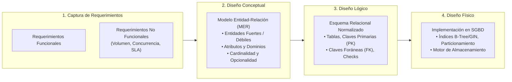
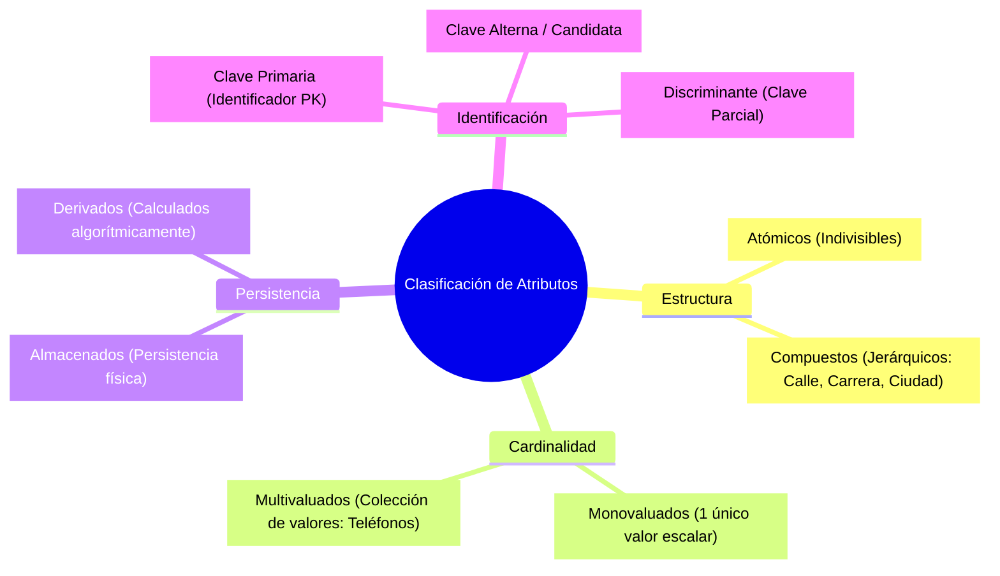
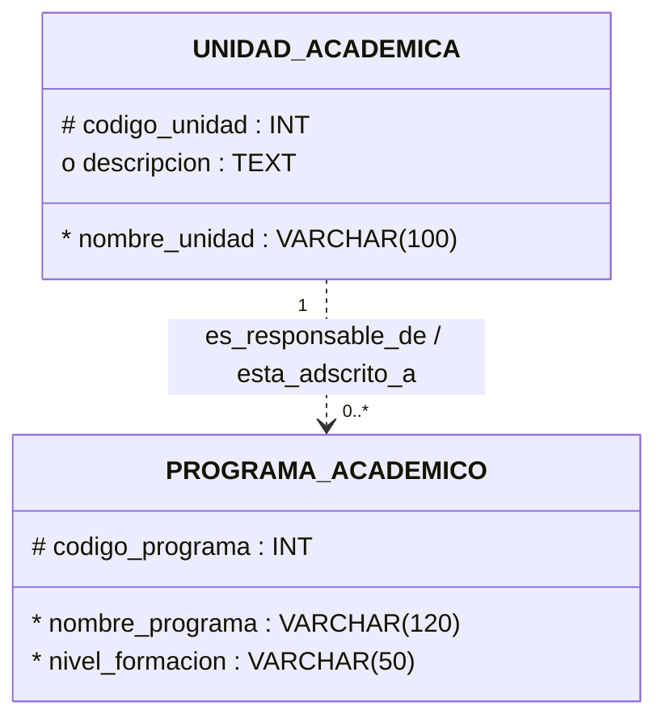
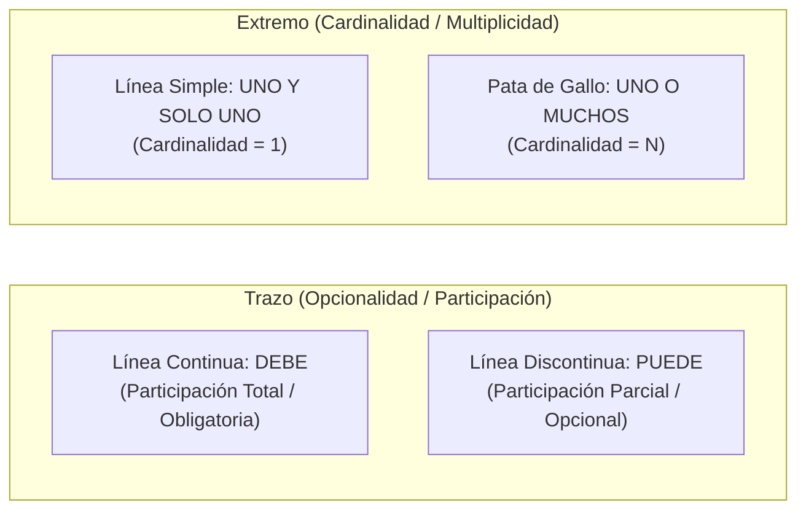
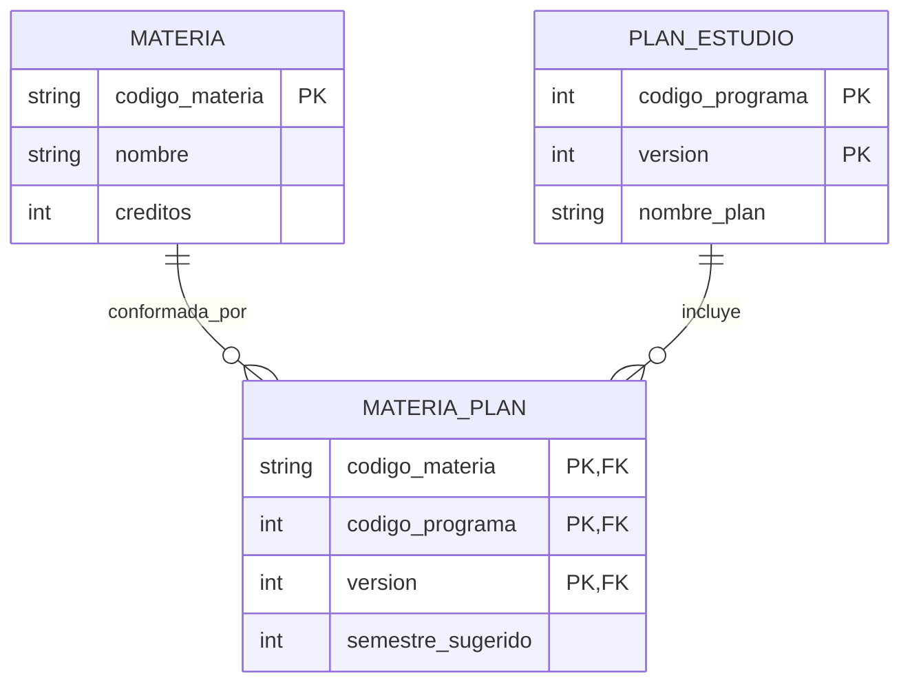
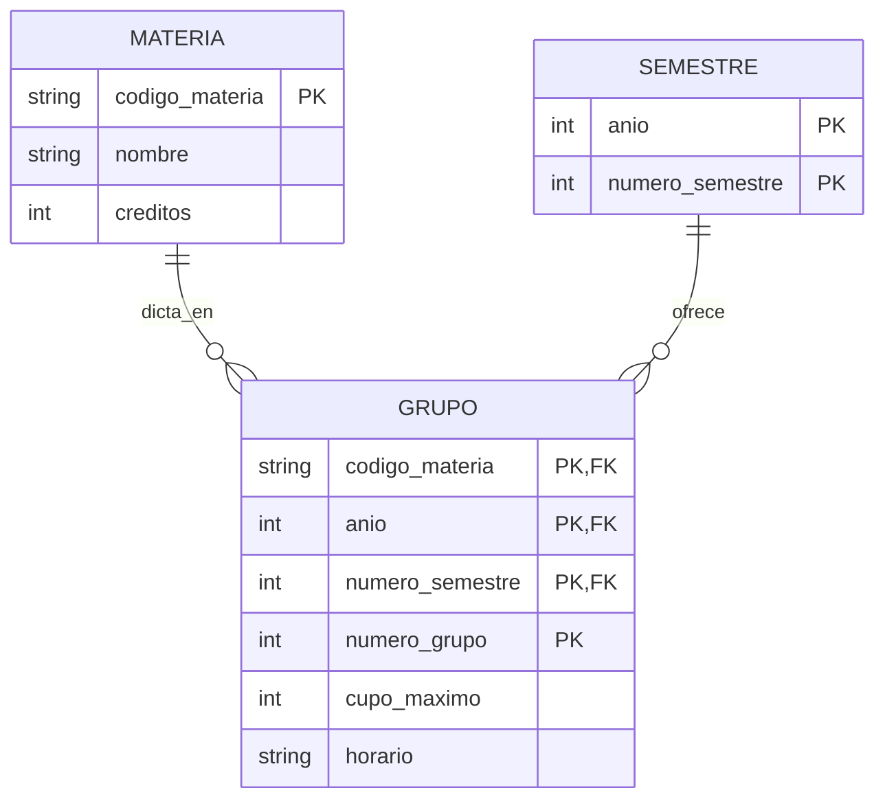
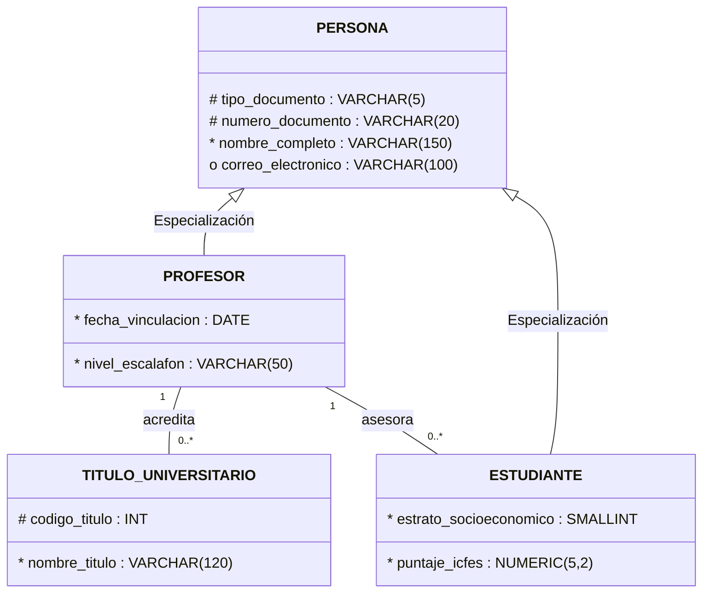
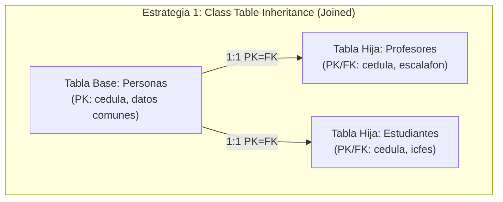
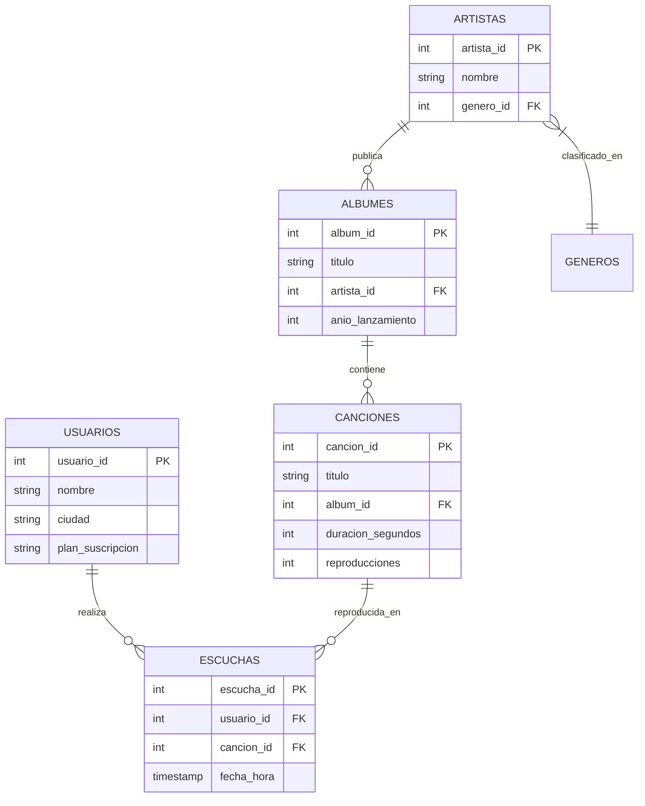
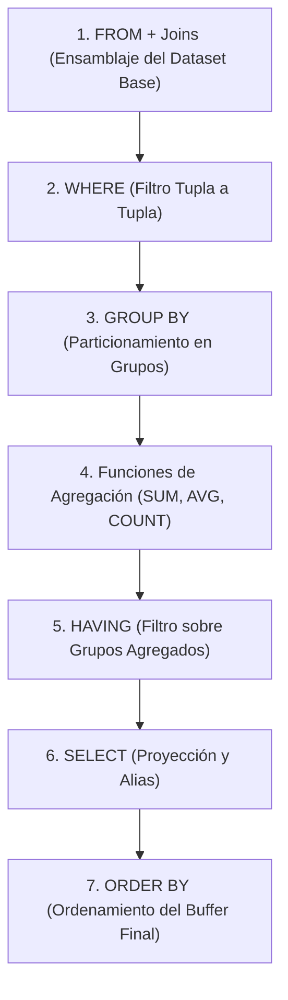

## 1. Fundamentos del Diseño Conceptual y el Modelo Entidad-Relación (MER)

El diseño de bases de datos es un proceso ingenieril estratificado que transforma los requisitos del mundo real en estructuras computacionales óptimas. El **Modelo Entidad-Relación (MER)**, propuesto formalmente por Peter Chen en 1976 y refinado por diversas escuelas metodológicas, constituye la piedra angular de la etapa **conceptual**, proporcionando una representación semántica abstracta independiente del Sistema de Gestión de Bases de Datos (SGBD) subyacente.



### 1.1 Taxonomía Formal de Componentes

1. **Entidad ($E$)**: Representación abstracta de un objeto o concepto del mundo real distinguible de otros objetos (ej. `Profesor`, `Estudiante`, `Materia`).
2. **Conjunto de Entidades**: Colección homogénea de entidades que comparten la misma estructura atributiva:
   $$\mathcal{E} = \{e_1, e_2, \dots, e_n\} \quad \text{donde cada } e_i \text{ posee el esquema } (A_1, A_2, \dots, A_m)$$
3. **Atributo ($A$)**: Función que mapea una entidad a un valor dentro de un dominio permitido $\mathcal{D}$:
   $$A_j: \mathcal{E} \to \mathcal{D}_j \cup \{\text{NULL}\}$$
4. **Relación ($R$)**: Asociación matemática entre dos o más entidades pertenecientes a conjuntos de entidades:
   $$R \subseteq \mathcal{E}_1 \times \mathcal{E}_2 \times \dots \times \mathcal{E}_k$$

---

## 2. Clasificación Avanzada de Atributos y Dominios

El análisis detallado de atributos previene anomalías de redundancia y modela la semántica exacta del negocio.

| Tipo de Atributo | Definición Matemática / Estructural | Ejemplo en Dominio Académico | Mapeo al Esquema Físico Relacional |
| :--- | :--- | :--- | :--- |
| **Simple / Atómico** | Valor indivisible perteneciente a un dominio escalar primario. | `cedula` ($\mathbb{Z}^+$), `fecha_nacimiento` ($\text{DATE}$) | Columna directa con restricción de tipo escalar. |
| **Compuesto** | Estructura jerárquica descomponible en subcomponentes atómicos. | `direccion` $\to$ (`calle`, `carrera`, `numero`, `ciudad`) | Se descomponen en columnas independientes en la tabla relacional. |
| **Monovaluado** | Cada tupla $e \in \mathcal{E}$ contiene a lo sumo un valor escalar. | `creditos_materia`, `estrato_socioeconomico` | Columna individual `NOT NULL` o `NULL`. |
| **Multivaluado** | La entidad puede asociar un conjunto de valores $\{v_1, \dots, v_p\} \subset \mathcal{D}$. | `telefonos_contacto`, `titulos_universitarios` | Se extraen hacia una tabla dependiente 1:N vinculada por FK. |
| **Derivado** | Valor calculado algorítmicamente a partir de otros atributos o relaciones. | `edad` = $f(\text{fecha\_nacimiento}, \text{fecha\_actual})$ | Columna virtual calculada (`GENERATED ALWAYS AS`), vista o lógica de consulta. |



> [!WARNING]
> Almacenar atributos compuestos o multivaluados en un único campo de texto delimitado (ej. `"3001234567, 3119876543"`) viola la **Primera Forma Normal (1FN)**, destruye la capacidad del motor para indexar valores individuales y obliga a realizar escaneos secuenciales costosos mediante operaciones de coincidencia de cadenas (`LIKE '%...'`).

---

## 3. Notación Barker: Reglas de Sintaxis, Multiplicidad y Opcionalidad

La **Notación Barker** (desarrollada por Richard Barker en Oracle CASE) es ampliamente adoptada por su claridad para plasmar restricciones de integridad directamente sobre el diagrama conceptual.



### 3.1 Simbología de Atributos en Barker
- `#` (**Hash / Identificador Único**): Atributo constituyente de la clave primaria (PK). Es intrínsecamente obligatorio.
- `*` (**Asterisco / Obligatorio**): Atributo con restricción de existencia (`NOT NULL`).
- `o` (**Círculo / Opcional**): Atributo que admite valores nulos (`NULL`).

### 3.2 Lectura Bidireccional de Relaciones (Multiplicidad y Opcionalidad)
Toda relación en notación Barker se lee en ambas direcciones combinando dos dimensiones: **opcionalidad** (trazo) y **cardinalidad** (extremo).

$$\text{Sentencia Barker: } \mathbf{\text{Cada }} \langle \text{Entidad A} \rangle + [\mathbf{\text{debe}} \mid \mathbf{\text{puede}}] + \langle \text{Verbo} \rangle + [\mathbf{\text{uno y solo un}} \mid \mathbf{\text{uno o muchos}}] + \langle \text{Entidad B} \rangle$$



#### Reglas de Lectura Formal:
1. **De Origen a Destino**:
   - Si el segmento inicial es **continuo**, se formula con **"debe"** (participación total).
   - Si el segmento inicial es **discontinuo/punteado**, se formula con **"puede"** (participación parcial).
2. **Conexión al Extremo Destino**:
   - Si remata en **línea simple**, la cardinalidad es **uno y solo uno** ($1$).
   - Si remata en **pata de gallo (crow's foot)**, la cardinalidad es **uno o muchos** ($N$).

---

## 4. Tipologías de Relaciones y Patrones de Transformación Física

### 4.1 Relaciones Muchos a Muchos ($N:M$) y Entidades Asociativas
Una relación $N:M$ pura no puede mapearse directamente a nivel relacional físico mediante una simple foreign key sin incurrir en redundancia o violación de atomicidad. Requiere la descomposición formal en dos relaciones $1:N$ mediadas por una **tabla asociativa (puente)**:



```sql
-- DDL del Patrón de Tabla Asociativa para Relación N:M
CREATE TABLE materia_plan (
    codigo_materia VARCHAR(10) NOT NULL,
    codigo_programa INT NOT NULL,
    version INT NOT NULL,
    semestre_sugerido SMALLINT NOT NULL CHECK (semestre_sugerido BETWEEN 1 AND 12),
    PRIMARY KEY (codigo_materia, codigo_programa, version),
    FOREIGN KEY (codigo_materia) REFERENCES materias(codigo_materia) ON DELETE RESTRICT,
    FOREIGN KEY (codigo_programa, version) REFERENCES planes_estudio(codigo_programa, version) ON DELETE CASCADE
);
```

---

### 4.2 Relaciones Uno a Uno ($1:1$) y Decisiones de Fusión Relacional
Cuando dos entidades presentan una cardinalidad estricta $1:1$, el diseñador se enfrenta a dos alternativas arquitectónicas:

1. **Fusión en una Única Tabla (Single-Table Merger)**: Absorber todos los atributos de ambas entidades en una sola relación relacional. Se prefiere cuando ambas entidades tienen participación total obligatoria y ciclos de vida idénticos.
2. **Tablas Separadas con Clave Foránea Única (`UNIQUE FK`)**: Mantener dos relaciones independientes cuando una de las entidades es opcional (para evitar saturación de columnas `NULL`), o cuando existen restricciones de seguridad y privilegios diferenciados.

---

### 4.3 Relaciones Recursivas (Autorreferenciales)
Una relación es recursiva cuando un conjunto de entidades se asocia consigo mismo bajo roles semánticos distintos (ej. jerarquía organizacional o dependencias académicas).


```sql
CREATE TABLE unidades_academicas (
    codigo_unidad INT PRIMARY KEY,
    nombre VARCHAR(120) NOT NULL,
    tipo_unidad VARCHAR(50) NOT NULL,
    codigo_unidad_padre INT NULL,
    CONSTRAINT fk_unidad_padre FOREIGN KEY (codigo_unidad_padre) 
        REFERENCES unidades_academicas(codigo_unidad) ON DELETE RESTRICT
);
```

---

## 5. Entidades Débiles y Dependencia de Identificación

Una **entidad débil** es aquella cuya existencia y clave primaria dependen semántica y estructuralmente de una o más **entidades fuertes (propietarias)**.



### 5.1 Criterios de Dependencia
1. **Dependencia de Existencia**: Si la entidad fuerte es eliminada del sistema, la entidad débil pierde su justificación lógica y debe ser eliminada (`ON DELETE CASCADE`).
2. **Dependencia de Identificación**: La entidad débil no posee un conjunto de atributos propios que conformen una clave primaria global única. Su clave primaria se construye concatenando la clave primaria de la entidad fuerte ($PK_{fuerte}$) más un **discriminante o clave parcial** ($D_{debil}$):

$$\text{PK}_{\text{Grupo}} = (\text{codigo\_materia}, \text{anio}, \text{numero\_semestre}) \cup \{\text{numero\_grupo}\}$$

---

## 6. Jerarquías de Generalización y Especialización (Herencia)

La modelación de dominios complejos requiere abstraer atributos comunes en un **supertipo (generalización)** y derivar **subtipos (especialización)** con propiedades y relaciones exclusivas.



### 6.1 Estrategias de Mapeo Relacional de Jerarquías



| Estrategia de Mapeo | Estructura Físico-Relacional | Ventajas | Desventajas / Trade-offs |
| :--- | :--- | :--- | :--- |
| **Class Table Inheritance (Joined)** *(Recomendada)* | 1 tabla base para el supertipo + 1 tabla por cada subtipo (vinculadas mediante $PK = FK$). | Normalización óptima (3FN/BCNF), sin valores `NULL` espurios, integridad referencial estricta para relaciones especializadas. | Requiere `JOIN` entre supertipo y subtipo en consultas de lectura. |
| **Single Table Inheritance** | 1 única tabla consolidada con columna discriminadora (`tipo_rol`) y todas las columnas de todos los subtipos. | Consultas directas sin `JOIN`, inserción rápida. | Columnas no aplicables quedan en `NULL`, imposibilidad de aplicar restricciones `NOT NULL` a nivel de base de datos para atributos de subtipos. |
| **Concrete Table Inheritance** | Tablas independientes para cada subtipo concreto sin tabla de supertipo. | No requiere `JOIN` para entidades terminales. | Redundancia de esquema, duplicación de claves y dificultad para consultar el universo consolidado de personas. |

---

## 7. Consultas SQL Complejas: Agregación, Outer Joins y División Relacional

Para validar el modelado en entornos transaccionales analíticos, se examina un esquema multidimensional de plataforma de streaming musical compuesto por:
$$\text{Usuarios}, \quad \text{Artistas}, \quad \text{Álbumes}, \quad \text{Canciones}, \quad \text{Géneros}, \quad \text{Escuchas}$$



---

### 7.1 Outer Joins para Conservación de Tuplas No Coincidentes

Al analizar el consumo de usuarios frente al catálogo total, el uso de `INNER JOIN` elimina automáticamente a aquellos usuarios sin actividad registrada. Para incluir a todos los usuarios preservando la totalidad del dominio de la entidad izquierda, se emplea `LEFT OUTER JOIN` combinado con funciones de sustitución de nulos (`COALESCE`):

```sql
-- Listar todos los usuarios con su plan, total de reproducciones y tiempo total consumido (en minutos)
SELECT 
    U.usuario_id,
    U.nombre AS usuario,
    U.ciudad,
    U.plan_suscripcion,
    COUNT(E.escucha_id) AS total_escuchas,
    ROUND(COALESCE(SUM(C.duracion_segundos), 0) / 60.0, 2) AS minutos_totales_escuchados
FROM usuarios U
LEFT JOIN escuchas E ON U.usuario_id = E.usuario_id
LEFT JOIN canciones C ON E.cancion_id = C.cancion_id
GROUP BY U.usuario_id, U.nombre, U.ciudad, U.plan_suscripcion
ORDER BY minutos_totales_escuchados DESC;
```

> [!NOTE]
> Cuando se realiza un `LEFT JOIN` con agregación, `COUNT(E.escucha_id)` retorna `0` si el usuario no tiene registros en `escuchas`, mientras que `COUNT(*)` retornaría erróneamente `1` debido a la presencia de la tupla enriquecida con valores `NULL`.

---

### 7.2 Agrupamiento Multidimensional con Filtro Agregado (`GROUP BY` + `HAVING`)

Cuando se requiere filtrar entidades basándose en el resultado de funciones agregadas multilínea (`AVG`, `SUM`, `COUNT`), la condición debe residir obligatoriamente en la cláusula `HAVING`, dado que la cláusula `WHERE` solo evalúa predicados a nivel de tupla individual antes de la conformación de grupos.



```sql
-- Artistas cuyo promedio de reproducciones por canción supera 150,000, 
-- proyectando el total de canciones publicadas y el promedio redondeado
SELECT 
    A.artista_id,
    A.nombre AS artista,
    COUNT(DISTINCT C.cancion_id) AS total_canciones,
    ROUND(AVG(C.reproducciones), 0) AS promedio_reproducciones
FROM artistas A
INNER JOIN albumes ALB ON A.artista_id = ALB.artista_id
INNER JOIN canciones C ON ALB.album_id = C.album_id
GROUP BY A.artista_id, A.nombre
HAVING AVG(C.reproducciones) > 150000
ORDER BY promedio_reproducciones DESC;
```

---

### 7.3 El Problema de la División Relacional en SQL: Cuantificador Universal ($\forall$)

En el álgebra relacional, la **división relacional** ($R \div S$) resuelve consultas que involucran la condición de universalidad: *"Obtener las entidades de $R$ asociadas con **todos** los elementos de $S$"*.

$$\text{Consulta Formal: } \{u \in \text{Usuarios} \mid \forall g \in \text{Generos}, \exists e \in \text{Escuchas}, c \in \text{Canciones}, a \in \text{Artistas} \text{ t.q. } e.\text{usuario} = u \wedge c.\text{genero} = g\}$$

Dado que el estándar SQL carece de un operador primitivo `FORALL` o `DIVIDE BY`, el problema se resuelve mediante dos patrones canónicos:


#### Solución 1: Doble Negación Correlacionada (`NOT EXISTS`)
Se fundamenta en la equivalencia de lógica proposicional $\forall x \, P(x) \equiv \neg \exists x \, \neg P(x)$ (*"Para todo género escuchó una canción"* equivale a *"No existe ningún género del cual no haya escuchado al menos una canción"*):

```sql
-- Usuarios que han escuchado al menos una canción de TODOS los géneros musicales registrados
SELECT 
    U.usuario_id,
    U.nombre AS usuario
FROM usuarios U
WHERE NOT EXISTS (
    -- Géneros que el usuario NO ha escuchado
    SELECT G.genero_id
    FROM generos G
    WHERE NOT EXISTS (
        -- Escuchas del usuario U en el género G
        SELECT 1
        FROM escuchas E
        INNER JOIN canciones C ON E.cancion_id = C.cancion_id
        INNER JOIN albumes ALB ON C.album_id = ALB.album_id
        INNER JOIN artistas A ON ALB.artista_id = A.artista_id
        WHERE E.usuario_id = U.usuario_id 
          AND A.genero_id = G.genero_id
    )
);
```

#### Solución 2: Agregación con Comparación de Cardinalidad de Conjuntos
Compara la cardinalidad del conjunto de géneros distintos consumidos por el usuario contra la cardinalidad total de la relación de géneros:

```sql
-- Solución alternativa mediante COUNT(DISTINCT) y Subconsulta Escalar
SELECT 
    U.usuario_id,
    U.nombre AS usuario
FROM usuarios U
INNER JOIN escuchas E ON U.usuario_id = E.usuario_id
INNER JOIN canciones C ON E.cancion_id = C.cancion_id
INNER JOIN albumes ALB ON C.album_id = ALB.album_id
INNER JOIN artistas A ON ALB.artista_id = A.artista_id
GROUP BY U.usuario_id, U.nombre
HAVING COUNT(DISTINCT A.genero_id) = (
    SELECT COUNT(*) FROM generos
);
```
---

## 8. Reflexión: Trade-offs de Normalización vs. Desempeño en Modelos Jerárquicos y Consultas Analíticas

El diseño conceptual y su traducción al esquema lógico imponen un balance crítico entre **pureza relacional (normalización estricta)** y **desempeño computacional (latencia y throughput de consultas)**.

En arquitecturas analíticas y transaccionales modernas:
1. **El Costo del `Class Table Inheritance`**: Aunque la estrategia de herencia por tablas vinculadas previene la duplicación y asegura integridad en modelos jerárquicos (como `Personas` $\to$ `Profesores` / `Estudiantes`), cada consulta de lectura que requiera consolidar la información del individuo demanda operaciones de reunión (`INNER/LEFT JOIN`) que incrementan el tiempo de CPU y el costo de I/O en conjuntos de datos de alta cardinalidad.
2. **Optimización de la División Relacional**: La formulación teórica de división relacional mediante doble `NOT EXISTS` evalúa correlaciones anidadas tupla a tupla. Mientras que optimizadores modernos de consultas (como el *Cost-Based Optimizer* de PostgreSQL) son capaces de transformar subconsultas correlacionadas en planes de ejecución basados en *Hash Anti-Joins*, la alternativa basada en `GROUP BY ... HAVING COUNT(DISTINCT ...)` suele ser más predecible en memoria, pero susceptible al sesgo por distribución asimétrica de datos (*data skew*).
3. **Modelado Consciente del Motor**: Un diseño conceptual riguroso en notación Barker no concluye en el diagrama; debe prever la creación de **índices B-Tree compuestos** en las tablas asociativas y entidades débiles para acelerar los cruces referenciales masivos en producción.

---

## 9. Referencias y Enlaces de Interés

1. **Chen, P. P.** (1976). *The Entity-Relationship Model—Toward a Unified View of Data*. ACM Transactions on Database Systems (TODS), 1(1), 9-36. [DOI: 10.1145/320434.320440](https://dl.acm.org/doi/10.1145/320434.320440).
2. **Barker, R.** (1990). *CASE*Method: Entity Relationship Modelling*. Oracle Corporation / Addison-Wesley Professional. [ISBN: 978-0201416961](https://www.worldcat.org/title/casemethod-entity-relationship-modelling/oclc/20562589).
3. **Silberschatz, A., Korth, H. F., & Sudarshan, S.** (2020). *Database System Concepts* (7th ed.). McGraw-Hill Education. [Capítulo 6: Database Design Using the E-R Model]. [Sitio Oficial](https://www.db-book.com/).
4. **PostgreSQL Documentation**: *Table Expressions, Joins and Subqueries*. [PostgreSQL 16 Official Manual - Queries](https://www.postgresql.org/docs/current/queries-table-expressions.html).
5. **Codd, E. F.** (1970). *A Relational Model of Data for Large Shared Data Banks*. Communications of the ACM, 13(6), 377–387. [ACM Digital Library](https://dl.acm.org/doi/10.1145/362384.362685).

---

*Publicado por [Mateo Vargas Tirado](https://github.com/araigumadev) como parte del registro de aprendizaje en el curso Bases de Datos 2026/2 - Universidad de Antioquia.*