## 1. Fundamentos Matemáticos del Diseño Relacional y Dependencias Funcionales (DF)

El diseño conceptual mediante diagramas Entidad-Relación proporciona una aproximación visual y semántica del dominio del problema. Sin embargo, para garantizar que el esquema relacional resultante carezca de redundancias destructivas, inconsistencias lógicas y anomalías operacionales, se requiere una formalización matemática rigurosa. La **Teoría de la Normalización Relacional**, introducida por Edgar F. Codd y formalizada por William W. Armstrong, Ronald Fagin y Raymond F. Boyce, se fundamenta en el concepto de **Dependencia Funcional (DF)**.

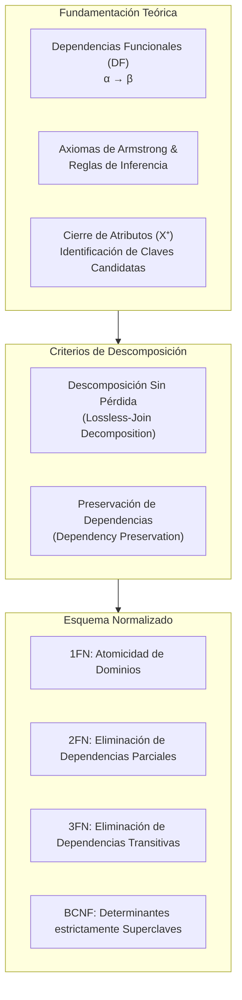

### 1.1 Definición Formal de Dependencia Funcional

Dado un esquema de relación $R(A_1, A_2, \dots, A_n)$ y dos subconjuntos de atributos $\alpha \subseteq R$ y $\beta \subseteq R$, se dice que **$\alpha$ determina funcionalmente a $\beta$** (o que $\beta$ depende funcionalmente de $\alpha$), denotado por:

$$\alpha \to \beta$$

si y solo si, en cualquier instancia legal (válida en el tiempo) $r(R)$, para cualquier par de tuplas $t_1, t_2 \in r$:

$$t_1[\alpha] = t_2[\alpha] \implies t_1[\beta] = t_2[\beta]$$

En términos algebraicos, existe una función bien definida entre el producto cartesiano de los dominios de $\alpha$ y los dominios de $\beta$:

$$f: \prod_{A_i \in \alpha} \text{dom}(A_i) \to \prod_{B_j \in \beta} \text{dom}(B_j)$$

* $\alpha$ recibe el nombre de **determinante** (lado izquierdo o *LHS*).
* $\beta$ recibe el nombre de **determinado** o dependiente (lado derecho o *RHS*).

> [!IMPORTANT]
> Una dependencia funcional es una **restricción semántica del mundo real (del negocio)** impuesta sobre el esquema de la relación $R$, **no** una propiedad accidental deducida a partir de una muestra finita de datos en una tabla. Los datos existentes pueden refutar una dependencia funcional, pero jamás pueden demostrar su validez universal.

---

## 2. Taxonomía de las Dependencias Funcionales

Para clasificar y analizar el impacto de las restricciones en la estructura de las tablas, se distinguen cuatro categorías esenciales de dependencias funcionales:

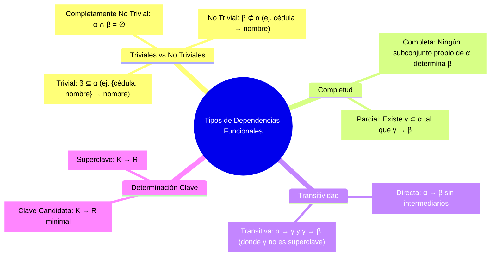

| Categoría | Condición Formal | Ejemplo en Dominio Académico / Facturación | Implicación en Normalización |
| :--- | :--- | :--- | :--- |
| **Trivial** | $\beta \subseteq \alpha$ | `{cedula, email}` $\to$ `cedula` | Siempre se cumple por reflexividad; no aporta restricciones al diseño. |
| **No Trivial** | $\beta \nsubseteq \alpha$ | `cedula` $\to$ `nombre_completo` | Define restricciones semánticas reales del negocio. |
| **Completamente No Trivial** | $\alpha \cap \beta = \emptyset$ | `codigo_curso` $\to$ `creditos` | Relación disjunta entre determinante y determinado. |
| **Dependencia Completa** | $\alpha \to \beta \land \forall \gamma \subset \alpha \; (\gamma \not\to \beta)$ | `{nro_factura, cod_producto}` $\to$ `cantidad` | Base para la **Segunda Forma Normal (2FN)**. |
| **Dependencia Parcial** | $\alpha \to \beta \land \exists \gamma \subset \alpha \; (\gamma \to \beta)$ | `{nro_factura, cod_producto}` $\to$ `nombre_producto` | Genera anomalías de actualización y redundancia en claves compuestas. |
| **Dependencia Transitiva** | $\alpha \to \gamma \land \gamma \to \beta \land \gamma \not\to \alpha \land \beta \nsubseteq \gamma$ | `cod_estudiante` $\to$ `cod_programa` $\land$ `cod_programa` $\to$ `nombre_facultad` | Causa anomalías de borrado e inserción; base de la **Tercera Forma Normal (3FN)**. |

---

## 3. Axiomas de Armstrong y Reglas de Inferencia

A partir de un conjunto inicial de dependencias funcionales $F$ declaradas sobre un esquema $R$, es posible inferir lógicamente nuevas dependencias funcionales implícitas. En 1974, William W. Armstrong demostró que existe un conjunto de tres reglas elementales que es **sólido** (no genera dependencias falsas) y **completo** (permite derivar todas las dependencias lógicamente implicadas).

### 3.1 Axiomas Primarios de Armstrong

1. **Axioma de Reflexividad**:
   Si $\beta \subseteq \alpha \subseteq R$, entonces:
   $$\alpha \to \beta$$
   *Demostración intuitiva*: Si dos tuplas coinciden en todos los atributos de $\alpha$, trivialmente coinciden en cualquier subconjunto $\beta$ de ellos.

2. **Axioma de Aumentación**:
   Si $\alpha \to \beta$ y $\gamma \subseteq R$, entonces:
   $$\alpha \gamma \to \beta \gamma \quad (\text{donde } \alpha \gamma = \alpha \cup \gamma)$$

3. **Axioma de Transitividad**:
   Si $\alpha \to \beta$ y $\beta \to \gamma$, entonces:
   $$\alpha \to \gamma$$

### 3.2 Reglas Derivadas

Aplicando los tres axiomas primarios, se deducen reglas de inferencia altamente operativas:

* **Regla de la Unión (Aditividad)**:
  $$\alpha \to \beta \land \alpha \to \gamma \implies \alpha \to \beta \gamma$$
  *Prueba*: Por aumentación sobre $\alpha \to \beta$ con $\alpha$, $\alpha \to \alpha \beta$. Por aumentación sobre $\alpha \to \gamma$ con $\beta$, $\alpha \beta \to \beta \gamma$. Por transitividad, $\alpha \to \beta \gamma$.

* **Regla de la Descomposición (Proyectividad)**:
  $$\alpha \to \beta \gamma \implies \alpha \to \beta \land \alpha \to \gamma$$
  *Prueba*: Como $\beta \subseteq \beta \gamma$, por reflexividad $\beta \gamma \to \beta$. Por transitividad con $\alpha \to \beta \gamma$, se deduce $\alpha \to \beta$.

* **Regla de la Pseudotransitividad**:
  $$\alpha \to \beta \land \gamma \beta \to \delta \implies \alpha \gamma \to \delta$$

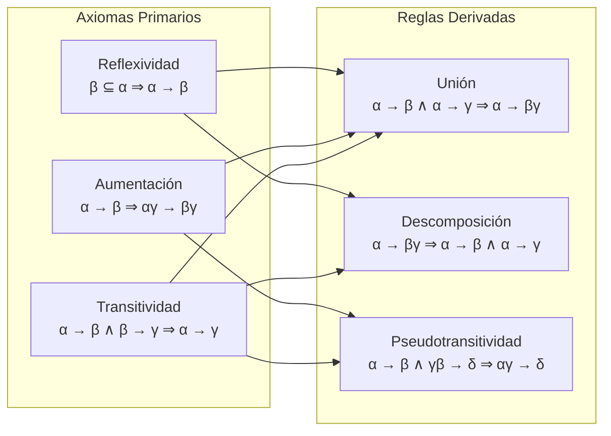

---

## 4. Algoritmo de Cierre de Atributos ($X^+$) e Identificación de Claves

El **cierre de un conjunto de atributos** $X \subseteq R$ bajo un conjunto de dependencias funcionales $F$, denotado como $X^+$, es el conjunto de todos los atributos de $R$ que son determinados funcionalmente por $X$.

$$X^+ = \{ A \in R \mid F \vDash X \to A \}$$

### 4.1 Algoritmo para Calcular $X^+$

```text
Entrada: Esquema R, conjunto de DFs F, subconjunto de atributos X ⊆ R
Salida: X⁺ (cierre de atributos de X)

1. resultado := X
2. REPETIR
3.    para cada dependencia funcional (α → β) ∈ F hacer:
4.        si α ⊆ resultado entonces:
5.            resultado := resultado ∪ β
6. HASTA QUE resultado no cambie
7. RETORNAR resultado
```

> [!TIP]
> **Complejidad Temporal**: El cálculo directo de $X^+$ se ejecuta en tiempo polinomial $O(|F| \cdot |R|)$ o lineal $O(|F|)$ con estructuras de datos indexadas, lo que permite verificar eficientemente si una dependencia $\alpha \to \beta$ se cumple simplemente evaluando si $\beta \subseteq \alpha^+$.

### 4.2 Definición Formal de Claves mediante Cierres

* **Superclave**: Un conjunto $K \subseteq R$ es una superclave de $R$ si y solo si su cierre cubre la totalidad de los atributos de la relación:
  $$K^+ = R$$
* **Clave Candidata**: Un conjunto $K \subseteq R$ es una clave candidata si es una **superclave minimal**, es decir:
  $$K^+ = R \quad \land \quad \forall A \in K \; ((K \setminus \{A\})^+ \neq R)$$
* **Atributo Primo**: Cualquier atributo $A \in R$ que pertenezca a **al menos una** clave candidata de $R$.
* **Atributo No Primo**: Atributo $A \in R$ que no forma parte de ninguna clave candidata.

---

## 5. Anomalías en Esquemas No Normalizados

Cuando un diseño relacional agrupa atributos con dependencias funcionales dispares en una única relación universal (tabla "sábana"), surgen tres anomalías operacionales críticas:

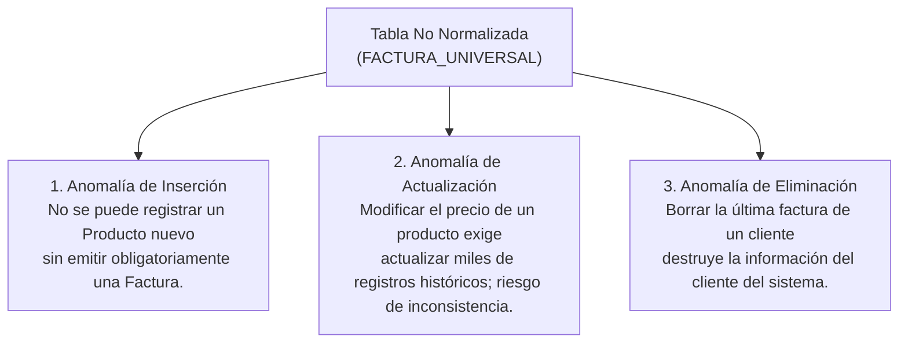

### Ejemplo Práctico: Tabla Desnormalizada de Facturación

Considérese el esquema no normalizado:
```text
VENTAS_GLOBAL(nro_factura [PK], cod_producto [PK], fecha, nit_cliente, nombre_cliente, descripcion_prod, precio_unit, cantidad)
```

1. **Anomalía de Inserción**: Si la empresa da de alta un producto en el inventario (`cod_producto = 'PROD-99'`), no es posible insertarlo en la base de datos sin inventar un `nro_factura` ficticio, pues `nro_factura` forma parte de la clave primaria (`NOT NULL`).
2. **Anomalía de Actualización**: Si el cliente con `nit_cliente = '900.123.456'` cambia su razón social o nombre, el motor debe actualizar múltiples tuplas (tantas como líneas de factura existan para dicho cliente). Si el proceso se interrumpe, la base de datos queda en un estado mutuamente inconsistente.
3. **Anomalía de Eliminación**: Si se anula la única factura que contenía la compra de un cliente esporádico, se borra irreversiblemente el nombre y NIT del cliente de la base de datos.

---

## 6. Criterios de Calidad en la Descomposición Relacional

La normalización opera descomponiendo un esquema universal $R$ en un conjunto de esquemas más pequeños $\{R_1, R_2, \dots, R_k\}$ tales que $\bigcup_{i=1}^k R_i = R$. Para que la descomposición sea válida en ingeniería de software, debe satisfacer dos teoremas fundamentales:

### 6.1 Teorema de Descomposición Sin Pérdida de Información (*Lossless-Join*)

Una descomposición de $R$ en $R_1$ y $R_2$ es **sin pérdida de información** con respecto a un conjunto de dependencias $F$ si y solo si la reunión natural ($\bowtie$) de las relaciones proyectadas recupera exactamente la instancia original $R$, sin generar tuplas espurias:

$$\Pi_{R_1}(r) \bowtie \Pi_{R_2}(r) = r$$

**Condición Necesaria y Suficiente**:
La descomposición $\{R_1, R_2\}$ es sin pérdida si y solo si el atributo común entre ambas relaciones determina funcionalmente al menos a una de ellas:

$$(R_1 \cap R_2) \to R_1 \quad \in F^+ \quad \lor \quad (R_1 \cap R_2) \to R_2 \quad \in F^+$$

En otras palabras, la intersección de atributos $(R_1 \cap R_2)$ debe ser una **superclave** de $R_1$ o de $R_2$.

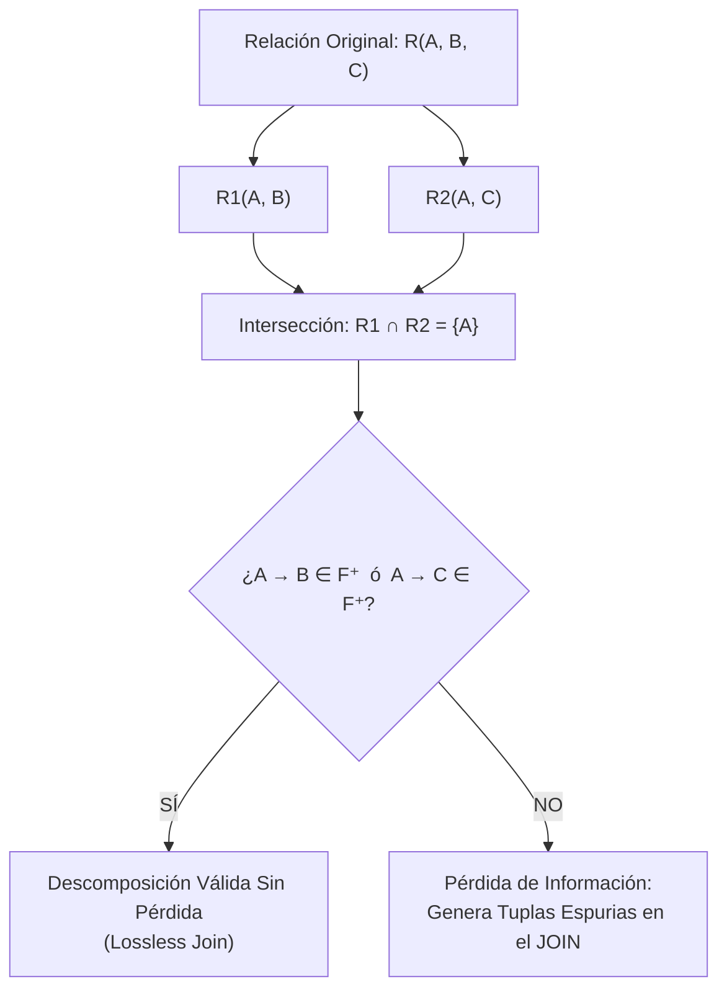

### 6.2 Preservación de Dependencias Funcionales

Sea $F$ el conjunto de dependencias sobre $R$. La restricción de $F$ sobre $R_i$, denotada $F_i$, es el conjunto de todas las dependencias $\alpha \to \beta \in F^+$ tales que $\alpha \cup \beta \subseteq R_i$.

La descomposición preserva dependencias si:

$$(F_1 \cup F_2 \cup \dots \cup F_k)^+ = F^+$$

> [!NOTE]
> La preservación de dependencias permite verificar que cada operación de `INSERT` o `UPDATE` cumpla las reglas del negocio evaluando restricciones localmente en una sola tabla, **sin necesidad de computar costosos JOINs entre múltiples tablas**.

---

## 7. Formas Normales: De 1FN a BCNF

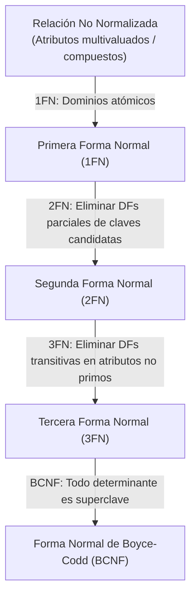

### 7.1 Primera Forma Normal (1FN)

**Definición**: Una relación $R$ está en 1FN si y solo si todos los dominios de sus atributos contienen únicamente **valores atómicos** (indivisibles) y cada atributo contiene a lo sumo un único valor por tupla (no se permiten conjuntos, listas, arrays ni atributos multivaluados/compuestos).

* **Violación**: Campo `telefonos = '3001234567, 3119876543'` o `direccion = {calle, carrera, ciudad}`.
* **Resolución**: Descomponer atributos compuestos en columnas atómicas y extraer atributos multivaluados a tablas secundarias 1:N vinculadas por clave foránea.

---

### 7.2 Segunda Forma Normal (2FN)

**Definición**: Una relación $R$ está en 2FN si:
1. Está en **1FN**.
2. **Ningún atributo no primo depende parcialmente de una clave candidata**. Es decir, todo atributo no primo depende funcionalmente de manera **completa** de cada clave candidata de $R$.

> [!TIP]
> Si todas las claves candidatas de una relación están formadas por un **único atributo (claves simples)**, la relación cumple automáticamente la 2FN si ya está en 1FN. Las violaciones de 2FN ocurren únicamente en esquemas con **claves candidatas compuestas**.

**Ejemplo de Violación y Corrección**:  
Sea el esquema no normalizado `FACTURA_DETALLE`(`nro_factura`, `cod_producto`, `fecha`, `descripcion_prod`, `cantidad`) con clave candidata compuesta `{nro_factura, cod_producto}` y las siguientes dependencias funcionales:
* `{nro_factura, cod_producto}` $\to$ `cantidad` *(Dependencia funcional completa)*
* `nro_factura` $\to$ `fecha` *(Dependencia parcial: `nro_factura` $\subset$ PK)*
* `cod_producto` $\to$ `descripcion_prod` *(Dependencia parcial: `cod_producto` $\subset$ PK)*

**Descomposición en 2FN**:
* $R_1$: `FACTURAS(`<u>`nro_factura`</u>`, fecha)`
* $R_2$: `PRODUCTOS(`<u>`cod_producto`</u>`, descripcion_prod)`
* $R_3$: `LINEAS_FACTURA(`<u>`nro_factura`</u>`, `<u>`cod_producto`</u>`, cantidad)`

---

### 7.3 Tercera Forma Normal (3FN)

**Definición Formal**: Una relación $R$ está en 3FN si está en 1FN y, para toda dependencia funcional no trivial $\alpha \to \beta \in F^+$, se cumple **al menos una** de las siguientes condiciones:

1. $\alpha$ es una **superclave** de $R$, **o**
2. Cada atributo $A \in (\beta \setminus \alpha)$ es un **atributo primo** (pertenece a alguna clave candidata de $R$).

*Definición clásica equivalente*: Una relación está en 3FN si está en 2FN y **ningún atributo no primo depende transitivamente de una clave candidata**.

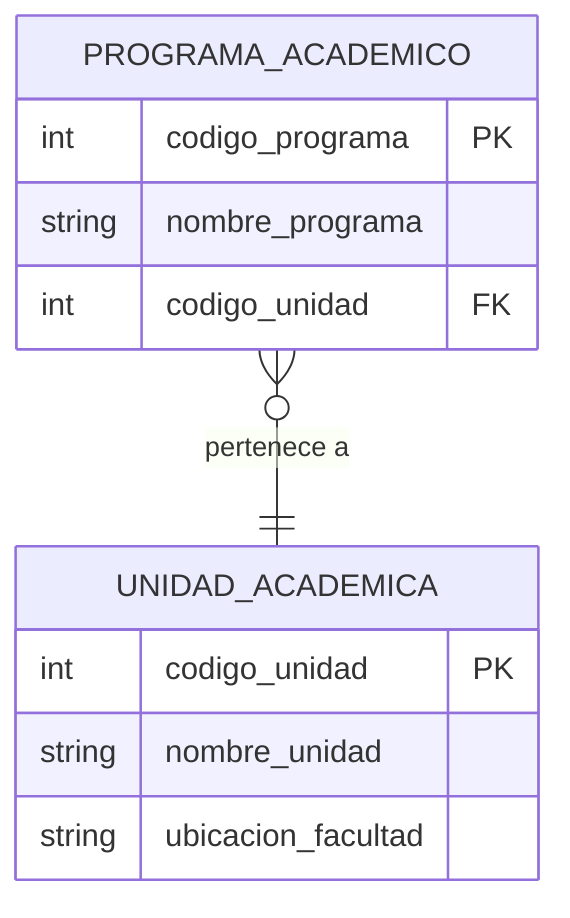

Si en una sola tabla tuviésemos el esquema no normalizado:
`PROGRAMA(`<u>`codigo_programa`</u>`, nombre_programa, codigo_unidad, nombre_unidad)`

con las dependencias funcionales:
* `codigo_programa` $\to$ `codigo_unidad`
* `codigo_unidad` $\to$ `nombre_unidad`

Como `codigo_unidad` no es superclave de `PROGRAMA` y `nombre_unidad` no es un atributo primo, se produce una dependencia transitiva que viola 3FN. Se descompone en `PROGRAMA_ACADEMICO` y `UNIDAD_ACADEMICA`.

---

### 7.4 Forma Normal de Boyce-Codd (BCNF)

**Definición Formal**: Una relación $R$ está en BCNF si está en 1FN y, para **toda** dependencia funcional no trivial $\alpha \to \beta \in F^+$:

$$\alpha \text{ es una superclave de } R$$

BCNF elimina la segunda condición permisiva de la 3FN (la excepción de que $\beta \setminus \alpha$ sea atributo primo). Por ello, BCNF es estrictamente más restrictiva que 3FN.

$$\text{BCNF} \subset \text{3FN} \subset \text{2FN} \subset \text{1FN}$$

### 7.5 Comparativa y Trade-off: 3FN vs. BCNF

Existe un teorema fundamental en el diseño de bases de datos relacionales:
* Siempre es posible descomponer cualquier relación en **3FN sin pérdida de información Y preservando todas las dependencias funcionales**.
* Siempre es posible descomponer cualquier relación en **BCNF sin pérdida de información**, pero **no siempre es posible preservar todas las dependencias funcionales**.

| Criterio | Tercera Forma Normal (3FN) | Forma Normal de Boyce-Codd (BCNF) |
| :--- | :--- | :--- |
| **Condición sobre $\alpha \to \beta$** | $\alpha$ es superclave **O** $\beta \setminus \alpha$ es primo. | $\alpha$ debe ser estrictamente **superclave**. |
| **Garantía Sin Pérdida (*Lossless*)** | 100% garantizado por algoritmo de síntesis. | 100% garantizado por algoritmo de descomposición. |
| **Preservación de Dependencias** | **Siempre garantizada** ($F^+ = (\bigcup F_i)^+$). | **No siempre garantizada** (puede requerir comprobaciones vía `JOIN`). |
| **Redundancia residual** | Puede retener una mínima redundancia si existen dependencias entre claves candidatas solapadas. | **Cero redundancia** debida a dependencias funcionales. |

---

## 8. Casos de Estudio y Talleres Prácticos de Descomposición

A continuación, se analizan tres escenarios reales modelados mediante dependencias funcionales y normalización completa.

### Caso 1: Sistema de Contratos y Alquiler de Vehículos

**Requisitos**: Un contrato formaliza el alquiler de un vehículo a un cliente. Un contrato corresponde exactamente a un vehículo y a un cliente en un rango de fechas. Un cliente tiene cédula, nombre y teléfono. Un vehículo tiene placa, modelo y categoría.

```text
Esquema Universal:
ALQUILER_AUTO(nro_contrato, cedula_cliente, nombre_cliente, tel_cliente, placa_auto, modelo_auto, categoria_auto, fecha_inicio, fecha_fin, valor_total)

Dependencias Funcionales (F):
1. nro_contrato → cedula_cliente, placa_auto, fecha_inicio, fecha_fin, valor_total
2. cedula_cliente → nombre_cliente, tel_cliente
3. placa_auto → modelo_auto, categoria_auto

Clave Candidata: {nro_contrato} (pues {nro_contrato}⁺ cubre todo el esquema).
```

* **Diagnóstico**: Las DFs 2 y 3 violan 3FN y BCNF porque sus determinantes (`cedula_cliente`, `placa_auto`) no son superclaves del esquema global.
* **Descomposición Normalizada (BCNF / 3FN)**:

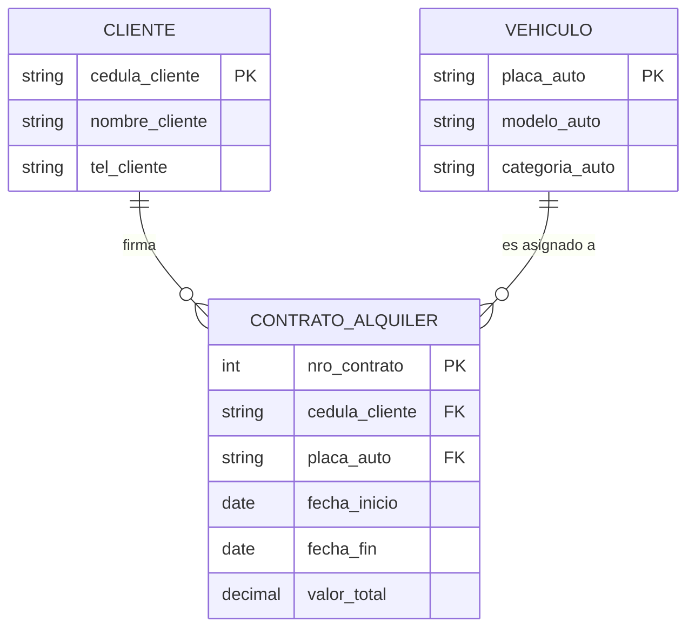

```sql
-- DDL Normalizado en BCNF / 3FN
CREATE TABLE clientes (
    cedula_cliente VARCHAR(20) PRIMARY KEY,
    nombre_cliente VARCHAR(100) NOT NULL,
    tel_cliente VARCHAR(20) NOT NULL
);

CREATE TABLE vehiculos (
    placa_auto VARCHAR(10) PRIMARY KEY,
    modelo_auto VARCHAR(50) NOT NULL,
    categoria_auto VARCHAR(30) NOT NULL
);

CREATE TABLE contratos_alquiler (
    nro_contrato INT PRIMARY KEY,
    cedula_cliente VARCHAR(20) NOT NULL REFERENCES clientes(cedula_cliente),
    placa_auto VARCHAR(10) NOT NULL REFERENCES vehiculos(placa_auto),
    fecha_inicio DATE NOT NULL,
    fecha_fin DATE NOT NULL,
    valor_total NUMERIC(12, 2) NOT NULL,
    CONSTRAINT chk_fechas CHECK (fecha_fin >= fecha_inicio)
);
```

---

### Caso 2: Capacitación y Talleres Empresariales con Claves Compuestas

**Requisitos**: Una empresa dicta talleres de formación. Un empleado puede inscribirse en múltiples talleres. Se registra la fecha de inscripción y la calificación obtenida por el empleado en cada taller.

```text
Esquema Universal:
CAPACITACION(cedula_emp, nombre_emp, cargo_emp, cod_taller, nombre_taller, horas_duracion, fecha_inscripcion, calificacion)

Dependencias Funcionales (F):
1. cedula_emp → nombre_emp, cargo_emp
2. cod_taller → nombre_taller, horas_duracion
3. {cedula_emp, cod_taller} → fecha_inscripcion, calificacion

Clave Candidata: {cedula_emp, cod_taller}
```

* **Diagnóstico de 2FN**: Las dependencias 1 y 2 son **dependencias parciales** de la clave candidata compuesta, violando 2FN.
* **Descomposición Normalizada**:

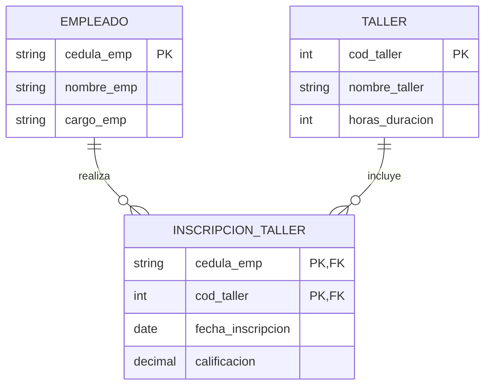

---

### Caso 3: Proveedores, Pedidos y Medicamentos (Relación M:N con Detalle)

**Requisitos**: Varios proveedores suministran medicamentos mediante órdenes de compra o pedidos. Un pedido se emite a un único proveedor en una fecha dada, pero puede solicitar múltiples medicamentos en distintas cantidades y precios pactados.

```text
Esquema Universal:
PEDIDOS_MEDICAMENTOS(nro_pedido, fecha_pedido, nit_proveedor, razon_social, cod_medicamento, nombre_generico, presentacion, cantidad_solicitada, costo_unitario)

Dependencias Funcionales (F):
1. nro_pedido → fecha_pedido, nit_proveedor
2. nit_proveedor → razon_social
3. cod_medicamento → nombre_generico, presentacion
4. {nro_pedido, cod_medicamento} → cantidad_solicitada, costo_unitario

Claves Candidatas: {nro_pedido, cod_medicamento}
```

* **Diagnóstico**:
  - `nro_pedido → fecha_pedido, nit_proveedor` viola 2FN (dependencia parcial).
  - `nit_proveedor → razon_social` viola 3FN (dependencia transitiva respecto a `nro_pedido`).
  - `cod_medicamento → nombre_generico, presentacion` viola 2FN (dependencia parcial).

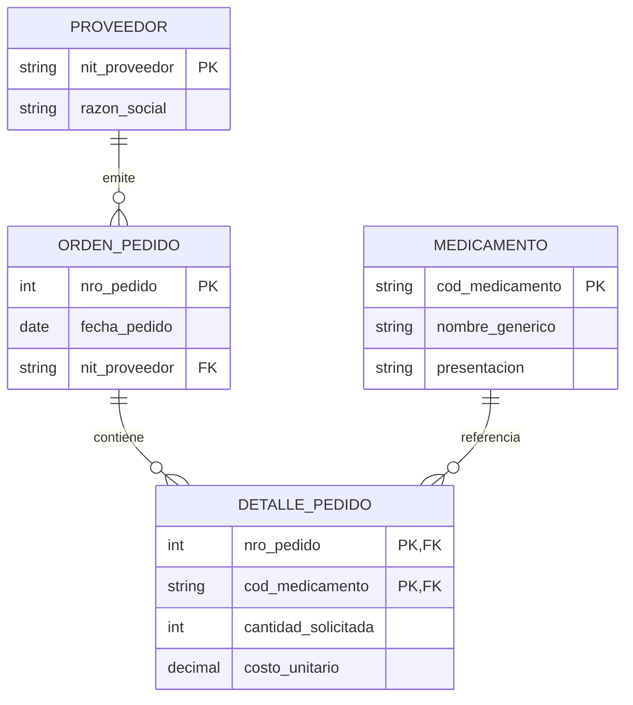

```sql
-- DDL Completo en 3FN / BCNF
CREATE TABLE proveedores (
    nit_proveedor VARCHAR(20) PRIMARY KEY,
    razon_social VARCHAR(150) NOT NULL
);

CREATE TABLE ordenes_pedido (
    nro_pedido INT PRIMARY KEY,
    fecha_pedido DATE NOT NULL,
    nit_proveedor VARCHAR(20) NOT NULL REFERENCES proveedores(nit_proveedor)
);

CREATE TABLE medicamentos (
    cod_medicamento VARCHAR(20) PRIMARY KEY,
    nombre_generico VARCHAR(100) NOT NULL,
    presentacion VARCHAR(50) NOT NULL
);

CREATE TABLE detalles_pedido (
    nro_pedido INT NOT NULL REFERENCES ordenes_pedido(nro_pedido),
    cod_medicamento VARCHAR(20) NOT NULL REFERENCES medicamentos(cod_medicamento),
    cantidad_solicitada INT NOT NULL CHECK (cantidad_solicitada > 0),
    costo_unitario NUMERIC(10, 2) NOT NULL CHECK (costo_unitario >= 0),
    PRIMARY KEY (nro_pedido, cod_medicamento)
);
```

---

## 9. Reflexión: Normalización Rigurosa en OLTP vs. Desnormalización Estratégica en OLAP y Analítica

La teoría de la normalización es la salvaguarda indispensable para sistemas **OLTP (Online Transaction Processing)**, donde la concurrencia masiva, las operaciones atómicas de escritura (`INSERT`, `UPDATE`, `DELETE`) y la integridad referencial son prioritarias. En estos entornos, normalizar hasta **3FN o BCNF** minimiza el espacio de almacenamiento físico, garantiza la consistencia ACID y elimina los bloqueos en cascada derivados de datos redundantes.

Sin embargo, en el panorama arquitectónico moderno de **Inteligencia de Negocios (BI), Data Warehouses, Lakehouses y motores OLAP (Online Analytical Processing)** como ClickHouse, Snowflake, Google BigQuery o Amazon Redshift, el paradigma se transforma:

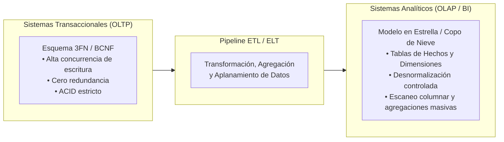

1. **El Cuello de Botella de las Reuniones Masivas (*JOINs*)**: En análisis multidimensional donde se agregan miles de millones de registros, computar 8 o 10 operaciones de `JOIN` entre tablas normalizadas introduce una sobrecarga severa en la transferencia de datos en memoria y red dentro de clusters distribuidos.
2. **Tablas Anchas (*Wide Tables*) y Almacenamiento Columnar**: Los formatos de almacenamiento columnar (Parquet, ORC) comprimen de forma extraordinariamente eficiente los valores repetidos mediante técnicas como *Run-Length Encoding (RLE)* y *Dictionary Encoding*. En este escenario, la redundancia de datos no incrementa proporcionalmente el costo de almacenamiento ni degrada el rendimiento; al contrario, permite resolver consultas complejas mediante escaneos directos sobre una sola tabla desnormalizada.
3. **Criterio Ingenieril**: La desnormalización no es un error de diseño cuando se ejecuta de forma deliberada y controlada en capas de lectura o reportería; pero pretender construir un sistema transaccional sobre un esquema desnormalizado sin comprender las dependencias funcionales conduce invariablemente a la corrupción e inconsistencia de los datos.

---

## 10. Referencias y Enlaces de Interés

1. **Armstrong, W. W.** (1974). *Dependency Structures of Data Base Relationships*. Information Processing 74, North-Holland Publishing Company, pp. 580–583.
2. **Codd, E. F.** (1972). *Further Normalization of the Data Base Relational Model*. In Data Base Systems, Courant Computer Science Symposia Series 6, Prentice-Hall, pp. 33–64.
3. **Codd, E. F.** (1970). *A Relational Model of Data for Large Shared Data Banks*. Communications of the ACM, 13(6), 377–387. [ACM Digital Library](https://dl.acm.org/doi/10.1145/362384.362685).
4. **Silberschatz, A., Korth, H. F., & Sudarshan, S.** (2020). *Database System Concepts* (7th ed.). McGraw-Hill Education. [Capítulo 7: Relational Database Design]. [Sitio Oficial db-book](https://www.db-book.com/).
5. **Ramakrishnan, R., & Gehrke, J.** (2003). *Database Management Systems* (3rd ed.). McGraw-Hill. [Capítulo 19: Schema Refinement and Normal Forms].
6. **PostgreSQL Documentation**: *Constraints and Table Partitioning*. [PostgreSQL 16 Manual - Constraints](https://www.postgresql.org/docs/current/ddl-constraints.html).

---

*Publicado por [Mateo Vargas Tirado](https://github.com/araigumadev) como parte del registro de aprendizaje en el curso Bases de Datos 2026/2 - Universidad de Antioquia.*
