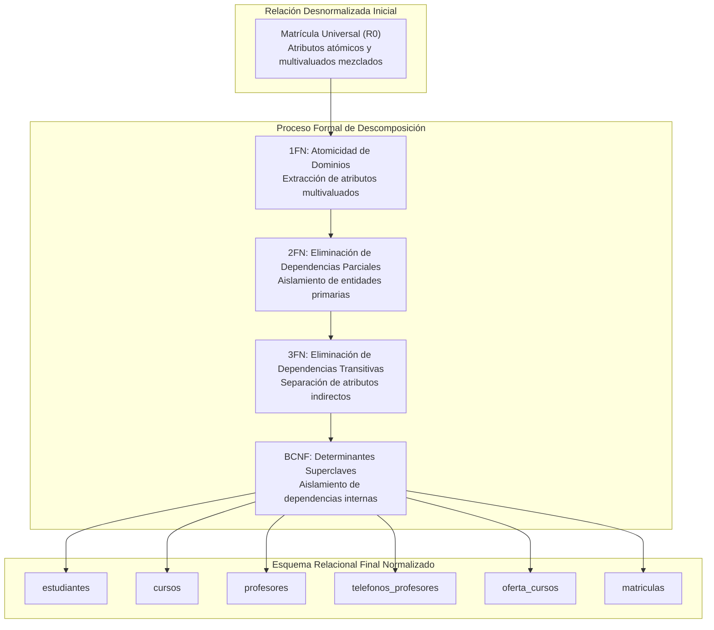
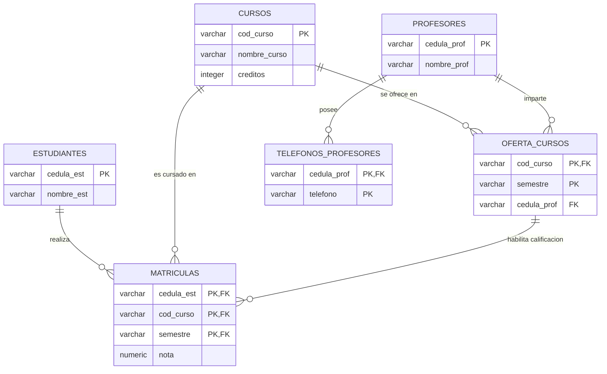
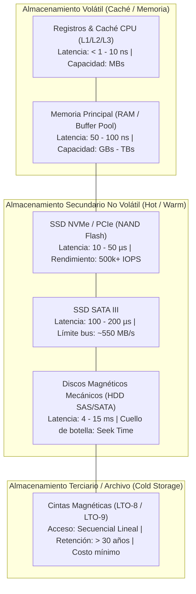
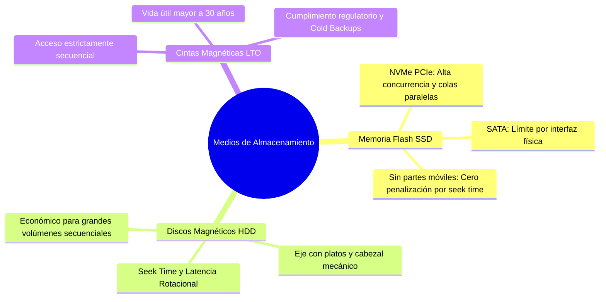
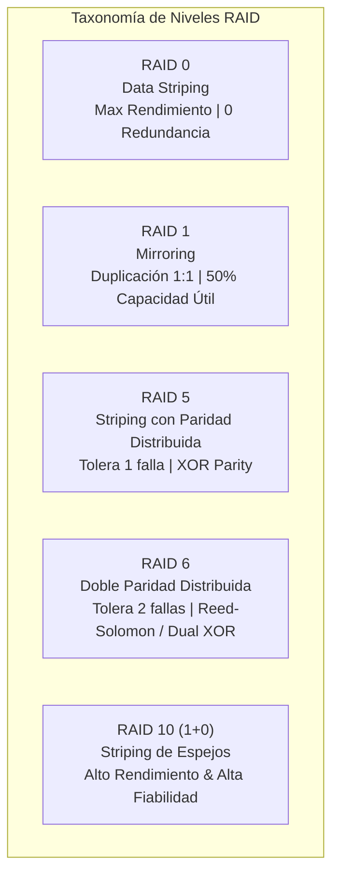
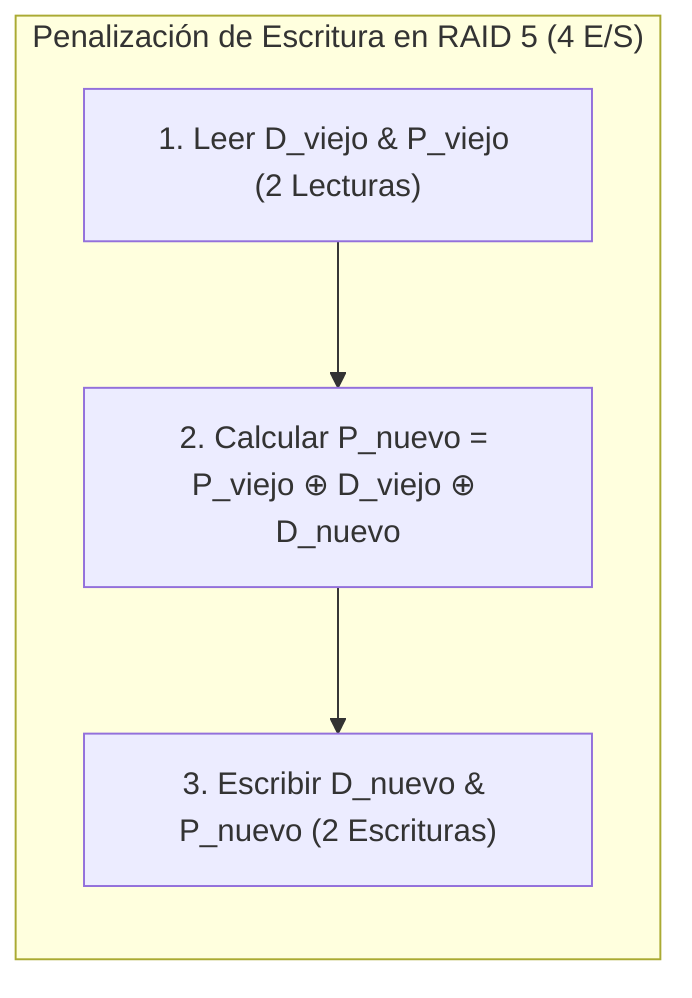

## 1. Caso de Estudio Integral: Descomposición Sistemática y Normalización a BCNF

En el diseño relacional de bases de datos, los datos crudos o estructuras desnormalizadas provenientes de fuentes legacy suelen presentarse como relaciones universales («sábanas de datos»). Estas estructuras contienen atributos multivaluados, dependencias funcionales parciales y dependencias transitivas que inducen anomalías de inserción, actualización y borrado.

A continuación, se desarrolla un caso de estudio completo de depuración y normalización formal para un sistema de gestión académica y matrículas.



### 1.1 Esquema Inicial Desnormalizado ($R_0$)

Considérese la relación universal que almacena los registros académicos de una institución:

`REGISTRO_MATRICULA_UNIVERSAL(`<u>`cedula_est`</u>`, nombre_est, `<u>`cod_curso`</u>`, nombre_curso, creditos, `<u>`semestre`</u>`, cedula_prof, nombre_prof, telefonos_profesor, nota)`

En este esquema inicial:
- El campo `telefonos_profesor` almacena listas de teléfonos separadas por comas (e.g. `"3001234567, 3109876543"`).
- Se mezclan datos de la persona estudiante, del catálogo de asignaturas, de la oferta semestral, del cuerpo docente y del historial de calificaciones.

---

### 1.2 Transición a Primera Forma Normal (1FN)

La **Primera Forma Normal (1FN)** exige que todos los dominios de los atributos sean atómicos (valores indivisibles) y que no existan grupos repetitivos ni atributos multivaluados.

Para resolver la violación generada por `telefonos_profesor`:
1. Se extrae el atributo multivaluado a una relación independiente: `telefonos_profesores`.
2. La clave primaria de esta nueva tabla debe ser la combinación del identificador del docente y el teléfono individual, garantizando unicidad y atomicidad:

`TELEFONOS_PROFESORES(`<u>`cedula_prof`</u>`, `<u>`telefono`</u>`)`

3. La relación resultante $R_1$ queda definida con atributos estrictamente atómicos:

`MATRICULA_CURSO_V1(`<u>`cedula_est`</u>`, nombre_est, `<u>`cod_curso`</u>`, nombre_curso, creditos, `<u>`semestre`</u>`, cedula_prof, nombre_prof, nota)`

---

### 1.3 Formalización del Conjunto de Dependencias Funcionales ($F$)

A partir del análisis semántico del dominio institucional, se definen las siguientes restricciones del negocio representadas como dependencias funcionales:

* $f_1$: `cedula_est` $\to$ `nombre_est`
* $f_2$: `cod_curso` $\to$ `{nombre_curso, creditos}`
* $f_3$: `{cod_curso, semestre}` $\to$ `{cedula_prof, nombre_prof}`
* $f_4$: `cedula_prof` $\to$ `nombre_prof`
* $f_5$: `{cedula_est, cod_curso, semestre}` $\to$ `nota`
* $f_6$: `{cedula_prof, telefono}` $\to$ `{cedula_prof, telefono}` *(Trivial)*

#### Determinación de la Clave Candidata de $R_1$

Calculando el cierre del conjunto de atributos $\alpha =$ `{cedula_est, cod_curso, semestre}` sobre $R_1$:

$$\alpha^+ = R_1$$

Es decir:

$$\alpha^+ = \{\text{estudiantes}, \text{cursos}, \text{profesores}, \text{oferta}, \text{matriculas}\} = R_1$$

Por lo tanto, la clave primaria de $R_1$ es compuesta: $K =$ `{cedula_est, cod_curso, semestre}`.

---

### 1.4 Transición a Segunda Forma Normal (2FN)

La **Segunda Forma Normal (2FN)** exige estar en 1FN y que **ningún atributo no primo dependa parcialmente de una clave candidata compuesta**.

Analizando $R_1$ con respecto a $K =$ `{cedula_est, cod_curso, semestre}`:
- $f_1$: `cedula_est` $\to$ `nombre_est` es una **dependencia parcial**, pues `{cedula_est}` $\subset K$.
- $f_2$: `cod_curso` $\to$ `{nombre_curso, creditos}` es una **dependencia parcial**, pues `{cod_curso}` $\subset K$.
- $f_3$: `{cod_curso, semestre}` $\to$ `{cedula_prof, nombre_prof}` es una **dependencia parcial**, pues `{cod_curso, semestre}` $\subset K$.

Para alcanzar 2FN, se proyectan las relaciones correspondientes a los determinantes parciales:

1. `ESTUDIANTES(`<u>`cedula_est`</u>`, nombre_est)`
2. `CURSOS(`<u>`cod_curso`</u>`, nombre_curso, creditos)`
3. `OFERTA_CURSOS_V1(`<u>`cod_curso`</u>`, `<u>`semestre`</u>`, cedula_prof, nombre_prof)`
4. `MATRICULAS(`<u>`cedula_est`</u>`, `<u>`cod_curso`</u>`, `<u>`semestre`</u>`, nota)`

---

### 1.5 Transición a 3FN y Forma Normal de Boyce-Codd (BCNF)

Un esquema se encuentra en **Forma Normal de Boyce-Codd (BCNF)** si y solo si, para toda dependencia funcional $\alpha \to \beta$ no trivial válida en el esquema, $\alpha$ es una **superclave**.

Evaluando la relación `OFERTA_CURSOS_V1`:
- Clave candidata: $K_{\text{oferta}} =$ `{cod_curso, semestre}`.
- En esta relación aplica la dependencia $f_4$: `cedula_prof` $\to$ `nombre_prof`.
- El determinante `{cedula_prof}` **no es superclave** de `OFERTA_CURSOS_V1`.

> [!WARNING]
> La presencia de `cedula_prof` $\to$ `nombre_prof` en `OFERTA_CURSOS_V1` genera una dependencia transitiva desde `{cod_curso, semestre}` hacia `nombre_prof` a través de `cedula_prof`. Si un profesor dicta múltiples cursos o el mismo curso en varios semestres, su nombre se duplicará en cada registro de oferta, abriendo la puerta a inconsistencias si se actualiza en unas filas y no en otras.

Para satisfacer BCNF sin pérdida de información, se descompone `OFERTA_CURSOS_V1` en dos relaciones:
1. `PROFESORES(`<u>`cedula_prof`</u>`, nombre_prof)` donde `cedula_prof` es clave primaria.
2. `OFERTA_CURSOS(`<u>`cod_curso`</u>`, `<u>`semestre`</u>`, cedula_prof)` donde `{cod_curso, semestre}` es la clave primaria y `cedula_prof` actúa como clave foránea.

---

### 1.6 Esquema Relacional Final Normalizado

El modelo relacional definitivo consta de 6 tablas en BCNF:



| Relación | Clave Primaria ($PK$) | Claves Foráneas ($FK$) | Forma Normal Alcanzada |
| :--- | :--- | :--- | :--- |
| `estudiantes` | `cedula_est` | Ninguna | BCNF / 3FN / 2FN / 1FN |
| `cursos` | `cod_curso` | Ninguna | BCNF / 3FN / 2FN / 1FN |
| `profesores` | `cedula_prof` | Ninguna | BCNF / 3FN / 2FN / 1FN |
| `telefonos_profesores` | `(cedula_prof, telefono)` | `cedula_prof` $\to$ `profesores` | BCNF / 3FN / 2FN / 1FN |
| `oferta_cursos` | `(cod_curso, semestre)` | `cod_curso` $\to$ `cursos`, `cedula_prof` $\to$ `profesores` | BCNF / 3FN / 2FN / 1FN |
| `matriculas` | `(cedula_est, cod_curso, semestre)` | `cedula_est` $\to$ `estudiantes`, `(cod_curso, semestre)` $\to$ `oferta_cursos` | BCNF / 3FN / 2FN / 1FN |

---

## 2. Mapeo Físico y Lenguaje de Definición de Datos (DDL) en PostgreSQL / Supabase

Una vez validada la arquitectura lógica mediante la teoría de normalización, el siguiente paso en la ingeniería de bases de datos consiste en materializar el esquema en un SGBD mediante **DDL (Data Definition Language)**.

### 2.1 Criterios de Selección de Tipos de Datos Físicos

1. **Claves Primarias e Identificadores**:
   - `SERIAL` / `BIGSERIAL`: Autoincrementales de 4 u 8 bytes. Adecuados para claves subrogadas locales.
   - `UUID` (`uuid_generate_v4()` o `gen_random_uuid()`): Cadenas hexadecimales de 128 bits. Esenciales en arquitecturas distribuidas, APIs desacopladas y plataformas como Supabase, ya que evitan colisiones durante la sincronización entre réplicas e impiden ataques de enumeración secuencial.
2. **Cadenas de Texto**:
   - `VARCHAR(N)`: Para cadenas de longitud acotada donde el límite es una restricción de negocio (e.g. códigos postales, identificaciones).
   - `TEXT`: Para textos de longitud variable sin límite predeterminado. En motores como PostgreSQL, no existe penalización de rendimiento respecto a `VARCHAR(N)` gracias a la compresión transparente en almacenamiento TOAST (*The Oversized-Attribute Storage Technique*).
3. **Valores Numéricos**:
   - `INTEGER` / `BIGINT`: Para conteos, cantidades discretas y relaciones cardinales.
   - `NUMERIC(p, s)` / `DECIMAL(p, s)`: Tipos de punto fijo exacto. **Obligatorios para valores monetarios, tasas financieras y notas**, evitando las aberraciones de redondeo binario inherentes a la norma IEEE 754 de los tipos `FLOAT` o `DOUBLE PRECISION`.
4. **Fechas y Tiempos**:
   - `DATE`: Fechas de calendario puras (e.g. fecha de nacimiento).
   - `TIMESTAMPTZ` (`TIMESTAMP WITH TIME ZONE`): Marcas temporales absolutas normalizadas en UTC en almacenamiento físico y convertidas al huso horario de la sesión en lectura.

---

### 2.2 Restricciones de Integridad en DDL

Las restricciones declarativas a nivel de base de datos garantizan la integridad semántica de los datos con independencia del código de aplicación:

```sql
-- Habilitar extensión para generación de UUIDs si se requiere
CREATE EXTENSION IF NOT EXISTS "pgcrypto";

-- 1. Tabla: ESTUDIANTES
CREATE TABLE estudiantes (
    cedula_est VARCHAR(20) NOT NULL,
    nombre_est VARCHAR(100) NOT NULL,
    CONSTRAINT pk_estudiantes PRIMARY KEY (cedula_est)
);

-- 2. Tabla: CURSOS
CREATE TABLE cursos (
    cod_curso VARCHAR(10) NOT NULL,
    nombre_curso VARCHAR(120) NOT NULL,
    creditos INTEGER NOT NULL DEFAULT 3,
    CONSTRAINT pk_cursos PRIMARY KEY (cod_curso),
    CONSTRAINT chk_cursos_creditos CHECK (creditos > 0 AND creditos <= 20)
);

-- 3. Tabla: PROFESORES
CREATE TABLE profesores (
    cedula_prof VARCHAR(20) NOT NULL,
    nombre_prof VARCHAR(100) NOT NULL,
    CONSTRAINT pk_profesores PRIMARY KEY (cedula_prof)
);

-- 4. Tabla: TELEFONOS_PROFESORES (1FN - Atributo multivaluado)
CREATE TABLE telefonos_profesores (
    cedula_prof VARCHAR(20) NOT NULL,
    telefono VARCHAR(20) NOT NULL,
    CONSTRAINT pk_telefonos_profesores PRIMARY KEY (cedula_prof, telefono),
    CONSTRAINT fk_telefonos_profesores_prof 
        FOREIGN KEY (cedula_prof) 
        REFERENCES profesores(cedula_prof) 
        ON DELETE CASCADE 
        ON UPDATE CASCADE
);

-- 5. Tabla: OFERTA_CURSOS (BCNF)
CREATE TABLE oferta_cursos (
    cod_curso VARCHAR(10) NOT NULL,
    semestre VARCHAR(10) NOT NULL,
    cedula_prof VARCHAR(20) NOT NULL,
    CONSTRAINT pk_oferta_cursos PRIMARY KEY (cod_curso, semestre),
    CONSTRAINT fk_oferta_cursos_curso 
        FOREIGN KEY (cod_curso) 
        REFERENCES cursos(cod_curso) 
        ON DELETE RESTRICT 
        ON UPDATE CASCADE,
    CONSTRAINT fk_oferta_cursos_prof 
        FOREIGN KEY (cedula_prof) 
        REFERENCES profesores(cedula_prof) 
        ON DELETE RESTRICT 
        ON UPDATE CASCADE,
    CONSTRAINT chk_oferta_semestre_formato 
        CHECK (semestre ~ '^[0-9]{4}-[1-2]$')
);

-- 6. Tabla: MATRICULAS
CREATE TABLE matriculas (
    cedula_est VARCHAR(20) NOT NULL,
    cod_curso VARCHAR(10) NOT NULL,
    semestre VARCHAR(10) NOT NULL,
    nota NUMERIC(3, 2) NULL,
    CONSTRAINT pk_matriculas PRIMARY KEY (cedula_est, cod_curso, semestre),
    CONSTRAINT fk_matriculas_estudiante 
        FOREIGN KEY (cedula_est) 
        REFERENCES estudiantes(cedula_est) 
        ON DELETE CASCADE 
        ON UPDATE CASCADE,
    CONSTRAINT fk_matriculas_oferta 
        FOREIGN KEY (cod_curso, semestre) 
        REFERENCES oferta_cursos(cod_curso, semestre) 
        ON DELETE RESTRICT 
        ON UPDATE CASCADE,
    CONSTRAINT chk_matriculas_rango_nota 
        CHECK (nota IS NULL OR (nota >= 0.00 AND nota <= 5.00))
);
```

> [!TIP]
> **Convenciones de Nombrado DDL**:
> 1. Nombrar las tablas en **plural** utilizando `snake_case` (e.g. `estudiantes`, `oferta_cursos`).
> 2. Asignar nombres explícitos a todas las restricciones (`pk_tabla`, `fk_tabla_origen_destino`, `chk_tabla_campo`, `uq_tabla_campo`). Esto facilita notablemente el diagnóstico de errores en logs de producción y migraciones automatizadas.

---

## 3. Jerarquías de Almacenamiento Físico en Motores de Bases de Datos

El diseño de motores de bases de datos está gobernado por el compromiso (*trade-off*) entre **latencia de acceso**, **ancho de banda (throughput)**, **volatilidad** y **costo económico por gigabyte**. La persistencia de datos se apoya en una jerarquía estratificada de medios de almacenamiento.



### 3.1 Tecnologías de Almacenamiento y su Rol en Bases de Datos



1. **Memoria Flash y Discos de Estado Sólido (NVMe / SATA)**:
   - Medios no volátiles basados en compuertas flotantes o celdas 3D NAND.
   - Al carecer de componentes mecánicos, el tiempo de búsqueda (*seek time*) es nulo, permitiendo miles de operaciones de entrada/salida por segundo (**IOPS**) concurrentes.
   - Las interfaces **NVMe (Non-Volatile Memory Express)** sobre el bus PCIe eliminan el cuello de botella del protocolo AHCI/SATA, habilitando hasta 64,000 colas de comandos con 64,000 comandos por cola. Son el estándar indiscutible para nodos transaccionales de alto rendimiento (OLTP).

2. **Discos Magnéticos Mecánicos (HDD SAS / SATA)**:
   - Almacenan información en pistas concéntricas dentro de platos magnéticos giratorios (5,400 a 15,000 RPM).
   - Su latencia está dominada por factores mecánicos:
     $$\text{Tiempo de Acceso} = \text{Seek Time (posicionar cabezal)} + \text{Latencia Rotacional (girar plato)} + \text{Tiempo de Transferencia}$$
   - Ofrecen excelente costo por terabyte en lecturas secuenciales masivas (OLAP / Data Warehousing), pero sufren una degradación crítica en accesos aleatorios debido al desplazamiento constante de los cabezales.

3. **Cintas Magnéticas (LTO - Linear Tape-Open)**:
   - Dispositivos de almacenamiento terciario con lectura y escritura estrictamente lineal/secuencial.
   - Las generaciones modernas (LTO-8, LTO-9) ofrecen capacidades nativas de hasta 18 TB (45 TB comprimidos) por cartucho.
   - **Casos de Uso Críticos**: Copias de respaldo históricas (*Cold Backups*) y cumplimiento de normativas legales de retención prolongada (e.g. conservación obligatoria de historias clínicas durante 15–20 años en el sector salud, registros contables en el sector bancario). Tienen una vida útil certificada de más de 30 años en condiciones controladas y costo energético casi nulo mientras están almacenadas fuera de línea (*Air-Gapped*).

---

### 3.2 Comparativa Técnica de Medios de Persistencia

| Parámetro | RAM (DDR4/DDR5) | SSD NVMe (PCIe 4.0/5.0) | HDD Enterprise (SAS 12G) | Cinta Magnética (LTO-9) |
| :--- | :--- | :--- | :--- | :--- |
| **Tipo de Acceso** | Aleatorio | Aleatorio | Aleatorio / Secuencial | Estrictamente Secuencial |
| **Latencia Típica** | $10 - 80 \text{ ns}$ | $10 - 50 \ \mu\text{s}$ | $4 - 10 \text{ ms}$ | Segundos a minutos (rebobinado) |
| **Throughput Secuencial** | $40 - 100 \text{ GB/s}$ | $3.5 - 7.5 \text{ GB/s}$ | $200 - 280 \text{ MB/s}$ | $400 \text{ MB/s}$ (nativo) |
| **IOPS de Lectura Aleatoria 4K** | Millones | $500,000 - 1,000,000+$ | $150 - 400$ | N/A (inviable para accesos aleatorios) |
| **Volatilidad** | Volátil | No Volátil | No Volátil | No Volátil |
| **Costo por Terabyte** | Muy Alto | Medio | Bajo | Extremadamente Bajo |
| **Rol en Bases de Datos** | Buffer Pool, WAL Buffer, Índices en memoria | Datos OLTP, Índices B-Tree, Logs WAL | Almacenamiento histórico, respaldos secundarios | Copias de seguridad frías, auditoría legal a largo plazo |

---

## 4. Arreglos Redundantes de Discos Independientes (RAID)

El concepto de **RAID (Redundant Array of Independent Disks)**, propuesto formalmente en 1988 por David Patterson, Garth Gibson y Randy Katz (UC Berkeley), combina múltiples unidades de almacenamiento físico en una o más unidades lógicas para lograr:
1. **Fiabilidad y Tolerancia a Fallos**: Continuidad operativa ante la pérdida física de uno o más discos.
2. **Aumento de Rendimiento**: Paralelización de operaciones de lectura y escritura distribuidas en múltiples canales.
3. **Agregación de Capacidad**: Presentación de un único espacio de direccionamiento al sistema de archivos del SGBD.



### 4.1 Modos de Implementación: Hardware vs Software

- **Hardware RAID**: Gestionado por una controladora dedicada (PCIe) dotada de un procesador específico (ASIC/SoC), memoria caché de alta velocidad (**NVRAM**) protegida por batería (**BBU - Battery Backup Unit**) o supercondensadores. Realiza el cálculo de paridades sin consumir ciclos de la CPU principal y permite la reconstrucción transparente (*hot-swap*).
- **Software RAID**: Gestionado directamente por el kernel del sistema operativo (e.g. `mdadm` en Linux, ZFS *RAID-Z*, Storage Spaces en Windows). Elimina la dependencia de hardware propietario y permite crear arreglos sobre cualquier conjunto de dispositivos de bloque mapeados (`/dev/sda`, `/dev/sdb`, `/dev/nvme0n1`).

---

### 4.2 Arquitectura y Análisis Formal de los Niveles RAID

#### RAID 0 (Data Striping / Fraccionamiento)
- Los datos se dividen en bloques homogéneos (*stripes*) que se escriben de manera alternada a lo largo de $N$ discos.
- **Capacidad Útil**: $C_{\text{util}} = N \times S$ (donde $S$ es el tamaño del disco menor).
- **Tolerancia a Fallos**: **0 discos**. Si falla un solo disco, todo el arreglo se corrompe irrecuperablemente.
- **Probabilidad de Falla**: Si cada disco tiene probabilidad independiente de fallo $p$, la probabilidad de falla global del arreglo es:
  $$P(\text{Fallo}) = 1 - (1 - p)^N$$

#### RAID 1 (Mirroring / Espejo)
- Cada bloque de datos se escribe de forma redundante e idéntica en 2 (o más) discos.
- **Capacidad Útil**: $C_{\text{util}} = S$.
- **Tolerancia a Fallos**: $N - 1$ discos (mientras sobreviva al menos una réplica completa).
- **Lectura**: Altamente concurrente (se pueden despachar lecturas independientes a cada disco en paralelo).
- **Escritura**: Penalizada por la velocidad del disco más lento del par.

#### RAID 5 (Block-level Striping con Paridad Distribuida)
- Los datos se fraccionan en bloques a lo largo de $N$ discos ($N \ge 3$), intercalando bloques de datos y bloques de **paridad calculados mediante la función XOR ($\oplus$)**.
- La paridad no se almacena en un disco dedicado (lo que crearía un cuello de botella), sino que se distribuye rotativamente entre todos los discos del arreglo.
- **Capacidad Útil**: $C_{\text{util}} = (N - 1) \times S$.
- **Tolerancia a Fallos**: **1 disco**. El arreglo entra en modo degradado si falla un disco y puede reconstruir los datos en tiempo real mediante el cálculo XOR de los discos restantes.
- **Penalización de Escritura (*Write Penalty*)**: Modificar un bloque de datos aislado requiere 4 operaciones de E/S físicas:
  1. Leer el bloque de datos viejo ($D_{\text{viejo}}$).
  2. Leer el bloque de paridad viejo ($P_{\text{viejo}}$).
  3. Calcular la nueva paridad: $P_{\text{nuevo}} = P_{\text{viejo}} \oplus D_{\text{viejo}} \oplus D_{\text{nuevo}}$.
  4. Escribir el nuevo bloque de datos ($D_{\text{nuevo}}$) y la nueva paridad ($P_{\text{nuevo}}$).



#### RAID 6 (Block-level Striping con Doble Paridad Distribuida)
- Extiende RAID 5 añadiendo un segundo esquema de paridad independiente ($P$ y $Q$) sobre $N$ discos ($N \ge 4$).
- El bloque $P$ es la paridad XOR convencional, mientras que el bloque $Q$ se calcula mediante polinomios sobre Campos de Galois ($GF(2^8)$) o algoritmos Reed-Solomon.
- **Capacidad Útil**: $C_{\text{util}} = (N - 2) \times S$.
- **Tolerancia a Fallos**: **2 discos simultáneos**.
- **Penalización de Escritura**: Requiere 6 operaciones de E/S por escritura aleatoria modificada.

#### RAID 10 (RAID 1+0 / Striping de Espejos)
- Combina la velocidad de RAID 0 con la redundancia de RAID 1. Se crean pares de discos en espejo (RAID 1) y sobre ellos se construye una capa fraccionada (RAID 0).
- **Capacidad Útil**: $C_{\text{util}} = \frac{N}{2} \times S$ (con $N$ par, $N \ge 4$).
- **Tolerancia a Fallos**: Tolera la falla de hasta 1 disco por cada sub-arreglo en espejo.
- **Rendimiento**: Es el nivel recomendado por excelencia para motores de bases de datos relacionales transaccionales (PostgreSQL, Oracle, SQL Server) gracias a que **no sufre de la penalización de cálculo de paridad** de RAID 5/6.

---

### 4.3 Tabla Comparativa de Arquitecturas RAID

| Nivel RAID | Mínimo Discos | Capacidad Útil ($N$ discos de tamaño $S$) | Tolerancia a Fallos | Rendimiento Lectura | Rendimiento Escritura | Penalización Escritura | Caso de Uso Óptimo en BD |
| :--- | :--- | :--- | :--- | :--- | :--- | :--- | :--- |
| **RAID 0** | 2 | $N \times S$ | 0 discos | $N \times \text{Speed}$ | $N \times \text{Speed}$ | Ninguna | Caché temporal, tablas intermedias volátiles, `tempdb`. |
| **RAID 1** | 2 | $1 \times S$ | $N - 1$ discos | $N \times \text{Speed}$ | $1 \times \text{Speed}$ | Ninguna | Almacenamiento exclusivo de logs WAL / Redo Logs. |
| **RAID 5** | 3 | $(N - 1) \times S$ | 1 disco | Alto (lectura paralela) | Moderado / Bajo | 4 E/S por bloque | Data Warehouses (OLAP), lectura intensiva con pocas escrituras. |
| **RAID 6** | 4 | $(N - 2) \times S$ | 2 discos | Alto | Bajo | 6 E/S por bloque | Almacenamiento masivo de respaldos y archivos de auditoría. |
| **RAID 10** | 4 (par) | $\frac{N}{2} \times S$ | 1 disco por sub-espejo | Muy Alto | Muy Alto | Ninguna | **Bases de datos transaccionales (OLTP) de alta concurrencia**. |

---

## 5. Álgebra de Paridad XOR y Algoritmos de Recuperación de Fallos

La protección de datos en arreglos RAID 5 se fundamenta en las propiedades algebraicas del operador binario **XOR (Exclusive OR / Suma Módulo 2)**, denotado por $\oplus$.

### 5.1 Propiedades Fundamentales del Operador XOR

Dado un conjunto de vectores de bits en el espacio vectorial $\mathbb{Z}_2^n$:

1. **Conmutatividad**:
   $$A \oplus B = B \oplus A$$
2. **Asociatividad**:
   $$(A \oplus B) \oplus C = A \oplus (B \oplus C)$$
3. **Elemento Neutro (Identidad)**:
   $$A \oplus 0 = A$$
4. **Elemento Inverso (Auto-inversión)**:
   $$A \oplus A = 0$$

A partir de estas propiedades se deriva el principio algebraico de cancelación:

$$(A \oplus B) \oplus B = A \oplus (B \oplus B) = A \oplus 0 = A$$

---

### 5.2 Algoritmo de Generación y Reconstrucción de Paridad en RAID 5

#### 1. Generación del Bloque de Paridad
Considérese un arreglo de $N$ discos, donde $k = N - 1$ discos contienen bloques de datos $D_1, D_2, \dots, D_k$ y el disco restante almacena el bloque de paridad $P$. El vector de paridad se calcula como:

$$P = D_1 \oplus D_2 \oplus \dots \oplus D_k = \bigoplus_{i=1}^{k} D_i$$

#### 2. Reconstrucción ante Falla de un Disco ($D_m$)
Supóngase que el disco que aloja el bloque de datos $D_m$ ($1 \le m \le k$) sufre una avería física catastrófica. La reconstrucción exacta del bloque $D_m$ se logra aplicando XOR entre el bloque de paridad $P$ y todos los bloques de datos sobrevivientes:

$$D_m = P \oplus \left( \bigoplus_{j \neq m} D_j \right)$$

#### Demostración Formal:

$$\begin{aligned}
P \oplus \left( \bigoplus_{j \neq m} D_j \right) &= \left( \bigoplus_{i=1}^{k} D_i \right) \oplus \left( \bigoplus_{j \neq m} D_j \right) \\
&= \left( D_m \oplus \bigoplus_{j \neq m} D_j \right) \oplus \left( \bigoplus_{j \neq m} D_j \right) \\
&= D_m \oplus \left[ \left( \bigoplus_{j \neq m} D_j \right) \oplus \left( \bigoplus_{j \neq m} D_j \right) \right] \\
&= D_m \oplus 0 = D_m \quad \blacksquare
\end{aligned}$$

---

### 5.3 Ejemplo Numérico y Simulación de Reconstrucción

Considérese un arreglo RAID 5 compuesto por 4 discos (3 discos de datos $D_1, D_2, D_3$ y 1 disco de paridad $P$). Se analiza un byte específico en cada bloque:

$$\begin{aligned}
D_1 &= 11001010_2 \\
D_2 &= 10110011_2 \\
D_3 &= 01101101_2
\end{aligned}$$

#### Paso 1: Cálculo de la Paridad $P$

$$P = D_1 \oplus D_2 \oplus D_3$$

Efectuando la operación bit a bit:

$$\begin{array}{r@{\quad}l}
D_1: & 1 \ 1 \ 0 \ 0 \ 1 \ 0 \ 1 \ 0 \\
D_2: & 1 \ 0 \ 1 \ 1 \ 0 \ 0 \ 1 \ 1 \\
\hline
(D_1 \oplus D_2): & 0 \ 1 \ 1 \ 1 \ 1 \ 0 \ 0 \ 1 \\
D_3: & 0 \ 1 \ 1 \ 0 \ 1 \ 1 \ 0 \ 1 \\
\hline
P: & \mathbf{0 \ 0 \ 0 \ 1 \ 0 \ 1 \ 0 \ 0}_2
\end{array}$$

El valor del bloque de paridad almacenado es $P = 00010100_2$.

#### Paso 2: Simulación de Pérdida del Disco 2 y Reconstrucción

Se asume la falla total del disco $D_2$. El controlador lee los discos sobrevivientes $D_1$, $D_3$ y el disco de paridad $P$:

$$D_2^{\text{reconstruido}} = P \oplus D_1 \oplus D_3$$

Efectuando el cómputo bit a bit:

$$\begin{array}{r@{\quad}l}
P: & 0 \ 0 \ 0 \ 1 \ 0 \ 1 \ 0 \ 0 \\
D_1: & 1 \ 1 \ 0 \ 0 \ 1 \ 0 \ 1 \ 0 \\
\hline
(P \oplus D_1): & 1 \ 1 \ 0 \ 1 \ 1 \ 1 \ 1 \ 0 \\
D_3: & 0 \ 1 \ 1 \ 0 \ 1 \ 1 \ 0 \ 1 \\
\hline
D_2^{\text{reconstruido}}: & \mathbf{1 \ 0 \ 1 \ 1 \ 0 \ 0 \ 1 \ 1}_2
\end{array}$$

El resultado recuperado coincide bit a bit con el contenido original de $D_2 = 10110011_2$, demostrando la capacidad de recuperación determinística del arreglo sin pérdida de datos.

---

## 6. Referencias y Enlaces de Interés

1. **Patterson, D. A., Gibson, G., & Katz, R. H. (1988)**. *A Case for Redundant Arrays of Inexpensive Disks (RAID)*. University of California, Berkeley & CMU Archive. [https://www.cs.cmu.edu/~garth/RAIDpaper/Patterson88.pdf](https://www.cs.cmu.edu/~garth/RAIDpaper/Patterson88.pdf).
2. **Codd, E. F. (1970)**. *A Relational Model of Data for Large Shared Data Banks*. Communications of the ACM, 13(6), 377–387. [https://en.wikipedia.org/wiki/A_Relational_Model_of_Data_for_Large_Shared_Data_Banks](https://en.wikipedia.org/wiki/A_Relational_Model_of_Data_for_Large_Shared_Data_Banks).
3. **PostgreSQL Global Development Group (2026)**. *PostgreSQL Documentation: Chapter 73 - Database Physical Storage and TOAST*. [https://www.postgresql.org/docs/current/storage.html](https://www.postgresql.org/docs/current/storage.html).
4. **LTO Program Technology Provider Companies (HP, IBM, Quantum) (2026)**. *Linear Tape-Open Ultrium Specifications & Roadmap*. [https://www.lto.org/technology/](https://www.lto.org/technology/).
5. **Linux Kernel Documentation (2026)**. *RAID and mdadm administration in Linux Storage Subsystem*. [https://docs.kernel.org/admin-guide/md.html](https://docs.kernel.org/admin-guide/md.html).

---

*Publicado por [Mateo Vargas Tirado](https://github.com/araigumadev) como parte del registro de aprendizaje en el curso Bases de Datos 2026/2 - Universidad de Antioquia.*
