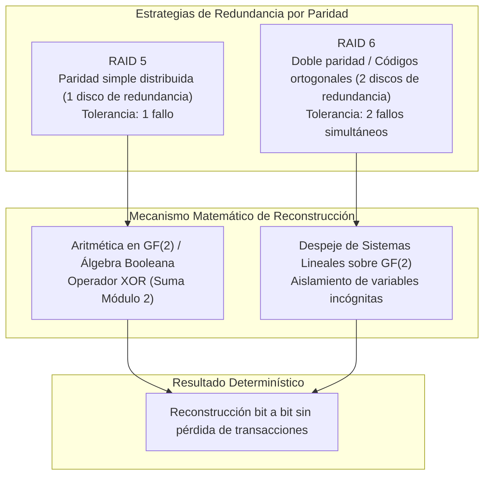
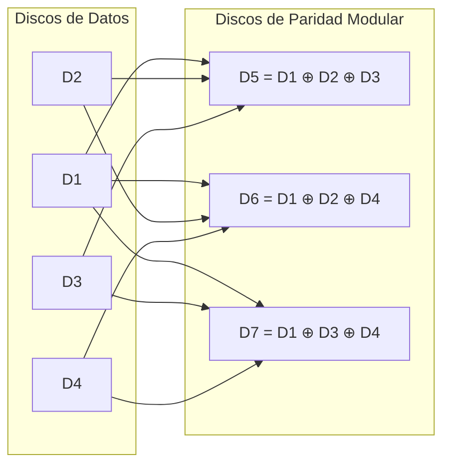
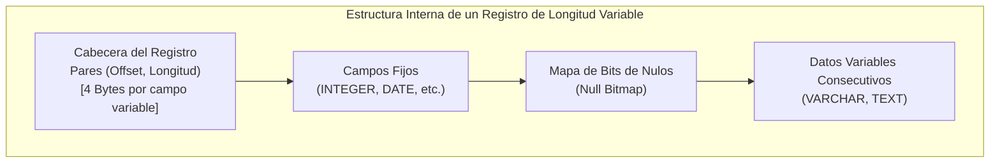
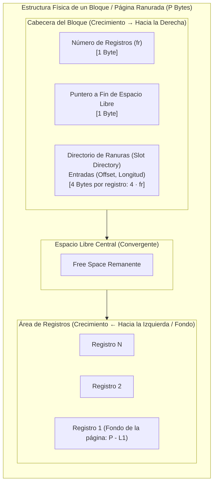
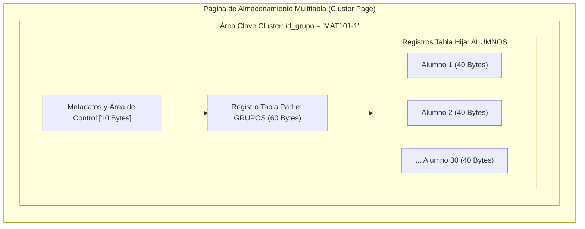
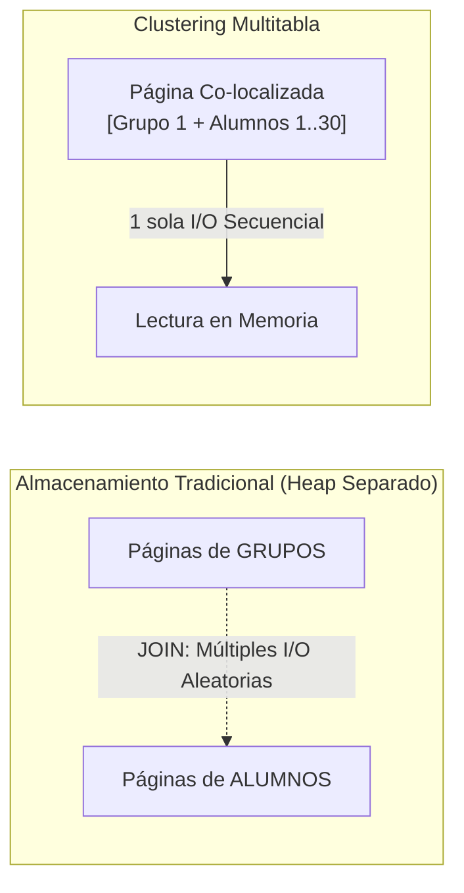

## 1. Tolerancia a Fallos y Reconstrucción Algebraica en Arreglos de Discos (RAID 5 y RAID 6)

Los sistemas de bases de datos dependen de la capa de almacenamiento secundario para garantizar durabilidad y disponibilidad. Cuando se gestionan grandes volúmenes de datos mediante arreglos redundantes de discos independientes (**RAID**), la pérdida imprevista de una o más unidades de disco no debe provocar indisponibilidad ni corrupción de datos.

---

### 1.1 Recuperación de un Disco en RAID 5 mediante Paridad Simple

En un arreglo **RAID 5** con $N$ unidades ($k = N - 1$ discos de datos y 1 bloque de paridad), la paridad $P$ se calcula mediante la operación $\text{XOR}$ ($\oplus$, suma módulo 2) sobre los bloques de datos concurrentes:

$$P = D_1 \oplus D_2 \oplus \dots \oplus D_k = \bigoplus_{i=1}^{k} D_i$$

La tabla de verdad del operador $\text{XOR}$ en el cuerpo de Galois $\text{GF}(2)$ posee las propiedades de conmutatividad, asociatividad y elemento neutro autoinverso ($A \oplus A = 0$, $A \oplus 0 = A$):

| Entrada $A$ | Entrada $B$ | Salida $A \oplus B$ |
| :---: | :---: | :---: |
| `0` | `0` | `0` |
| `0` | `1` | `1` |
| `1` | `0` | `1` |
| `1` | `1` | `0` |

#### Procedimiento de Reconstrucción ante Falla de $D_m$

Si una unidad $D_m$ sufre una falla catastrófica, su reconstrucción exacta se obtiene operando la paridad $P$ contra los $k - 1$ discos sobrevivientes:

$$D_m = P \oplus \left( \bigoplus_{j \neq m} D_j \right)$$

#### Ejemplo Numérico de Recuperación en RAID 5:
Considérese un arreglo de 8 discos (7 discos de datos $D_1, \dots, D_7$ y 1 disco de paridad $P$). Se analiza un bit específico:

* Datos leídos: $D_1 = 1$, $D_2 = 1$, $D_4 = 0$, $D_5 = 0$, $D_6 = 1$, $D_7 = 1$, $P = 1$.
* Falla: Se desconoce el valor almacenado en $D_3$.

Aplicando la ecuación de aislamiento:

$$\begin{aligned}
D_3 &= P \oplus D_1 \oplus D_2 \oplus D_4 \oplus D_5 \oplus D_6 \oplus D_7 \\
&= 1 \oplus 1 \oplus 1 \oplus 0 \oplus 0 \oplus 1 \oplus 1 \\
&= (1 \oplus 1) \oplus 1 \oplus 0 \oplus 0 \oplus 1 \oplus 1 \\
&= 0 \oplus 1 \oplus 0 \oplus 0 \oplus 1 \oplus 1 \\
&= 1 \oplus 0 \oplus 0 \oplus 1 \oplus 1 \\
&= 1 \oplus 1 \oplus 1 = 0 \oplus 1 = \mathbf{1}
\end{aligned}$$

El bit perdido se recupera de manera determinística como $D_3 = 1$.

---

### 1.2 Recuperación ante Doble Fallo Simultáneo en RAID 6

**RAID 6** amplía la tolerancia a fallos incorporando dos conjuntos de paridades independientes (por ejemplo, paridad horizontal $P$ y paridad diagonal/síndrome $Q$, o códigos de paridad modular sobre subconjuntos de discos), permitiendo al sistema sobrevivir a la pérdida total y simultánea de dos unidades de almacenamiento cualesquiera.

Considérese un esquema representativo de 7 discos con 4 discos de datos ($D_1, D_2, D_3, D_4$) y 3 discos de paridad modular ($D_5, D_6, D_7$) definidos por las siguientes ecuaciones de paridad sobre $\text{GF}(2)$:

$$\begin{cases}
D_5 = D_1 \oplus D_2 \oplus D_3 \\
D_6 = D_1 \oplus D_2 \oplus D_4 \\
D_7 = D_1 \oplus D_3 \oplus D_4
\end{cases}$$

#### Escenario de Falla Crítica: Pérdida Simultánea de $D_2$ y $D_5$

Supóngase que colapsan simultáneamente los discos $D_2$ y $D_5$. El procedimiento sistemático de resolución exige:

1. **Selección de Ecuaciones con Incógnita Única**:
   * La ecuación de $D_5$ involucra a $D_5$ y $D_2$ (dos incógnitas perdidas $\implies$ no se puede usar directamente).
   * La ecuación de $D_7$ no involucra a $D_2$ ni $D_5$ (no aporta despeje directo para $D_2$).
   * La ecuación de $D_6 = D_1 \oplus D_2 \oplus D_4$ contiene únicamente a **$D_2$** como incógnita, ya que $D_6$, $D_1$ y $D_4$ están disponibles.

2. **Despeje Algebraico de $D_2$**:

$$D_2 = D_6 \oplus D_1 \oplus D_4$$

3. **Reconstrucción Posterior de $D_5$**:
   Con $D_2$ recuperado, se evalúa la ecuación de $D_5$ con todos sus operandos disponibles ($D_1, D_2, D_3$):

$$D_5 = D_1 \oplus D_2 \oplus D_3$$

#### Simulación de Cómputo Vectorial Bit a Bit:

Considérense las secuencias binarias de 8 bits leídas de los discos sobrevivientes:

* $D_1 = [1, 1, 1, 0, 0, 0, 0, 1]$
* $D_4 = [0, 1, 0, 0, 0, 0, 0, 1]$
* $D_6 = [1, 0, 1, 0, 0, 0, 0, 0]$
* $D_3 = [0, 0, 1, 1, 0, 1, 0, 0]$

**Paso 1: Reconstrucción de $D_2$ ($D_2 = D_6 \oplus D_1 \oplus D_4$)**:

$$\begin{array}{r@{\quad}l}
D_6: & 1 \ 0 \ 1 \ 0 \ 0 \ 0 \ 0 \ 0 \\
D_1: & 1 \ 1 \ 1 \ 0 \ 0 \ 0 \ 0 \ 1 \\
\hline
(D_6 \oplus D_1): & 0 \ 1 \ 0 \ 0 \ 0 \ 0 \ 0 \ 1 \\
D_4: & 0 \ 1 \ 0 \ 0 \ 0 \ 0 \ 0 \ 1 \\
\hline
D_2^{\text{recuperado}}: & \mathbf{0 \ 0 \ 0 \ 0 \ 0 \ 0 \ 0 \ 0}
\end{array}$$

**Paso 2: Reconstrucción de $D_5$ ($D_5 = D_1 \oplus D_2 \oplus D_3$)**:

$$\begin{array}{r@{\quad}l}
D_1: & 1 \ 1 \ 1 \ 0 \ 0 \ 0 \ 0 \ 1 \\
D_2: & 0 \ 0 \ 0 \ 0 \ 0 \ 0 \ 0 \ 0 \\
\hline
(D_1 \oplus D_2): & 1 \ 1 \ 1 \ 0 \ 0 \ 0 \ 0 \ 1 \\
D_3: & 0 \ 0 \ 1 \ 1 \ 0 \ 1 \ 0 \ 0 \\
\hline
D_5^{\text{recuperado}}: & \mathbf{1 \ 1 \ 0 \ 1 \ 0 \ 1 \ 0 \ 1}
\end{array}$$

Ambas unidades quedan completamente reconstruidas sin comprometer la continuidad operativa del motor de base de datos.

---

## 2. Organización Física de Archivos en Disco y Representación de Registros

A nivel de subsistema de almacenamiento del SGBD, los datos no se transfieren byte a byte, sino en unidades de asignación de longitud fija denominadas **bloques** o **páginas de disco** ($P$ bytes, típicamente de 4096 B = 4 KB u 8192 B = 8 KB).

Dentro de cada página, las tablas relacionales se materializan como colecciones de registros. Cuando los esquemas contienen tipos de datos como `VARCHAR`, `TEXT` o atributos opcionales (`NULLABLE`), los registros tienen **longitud variable**.

### 2.1 Componentes de un Registro de Longitud Variable

1. **Cabecera del Registro (*Record Header*)**:
   Contiene un arreglo de pares `(offset, longitud)` para direccionar cada campo de longitud variable dentro del cuerpo del registro. Cada par ocupa **4 bytes** (2 bytes para el desplazamiento relativo y 2 bytes para la longitud del campo).
2. **Atributos de Longitud Fija**:
   Almacenados consecutivamente con su tamaño estático (e.g. `INTEGER` = 4 B, `DATE` = 6 B u 8 B, `CHAR(13)` = 13 B).
3. **Mapa de Bits de Nulos (*Null Bitmap*)**:
   Vector de bits que indica si cada atributo contiene un valor nulo (`0` = NULL, `1` = NOT NULL / asignado). Para un esquema con $N_{\text{atr}}$ atributos, el tamaño mínimo ocupado en bytes es:

$$\text{Tam}_{\text{bitmap}} = \left\lceil \frac{N_{\text{atr}}}{8} \right\rceil \text{ bytes}$$

4. **Área de Datos Variables**:
   Secuencia contigua de bytes donde se almacenan los caracteres y cadenas reales referenciadas por la cabecera.

---

### 2.2 Formulación Analítica de la Longitud Típica de un Registro ($L$)

Para modelar la capacidad y predecir el crecimiento en disco, se define la fórmula analítica de longitud estimada de registro $L$:

$$L = 4 \cdot V + \sum_{i=1}^{F} \text{tam}(F_i) + \left\lceil \frac{N_{\text{atr}}}{8} \right\rceil + \sum_{j=1}^{V} \text{tam}_{\text{estimado}}(V_j)$$

Donde:
* $V$: Número de atributos de longitud variable.
* $F$: Número de atributos de longitud fija.
* $N_{\text{atr}} = V + F$: Número total de atributos del esquema.
* $\text{tam}(F_i)$: Tamaño en bytes del $i$-ésimo atributo de longitud fija.
* $\text{tam}_{\text{estimado}}(V_j)$: Estimación promedio en bytes del $j$-ésimo campo variable según el diccionario de datos.

---

### 2.3 Casos de Estudio de Estimación de Longitud de Registros

| Esquema Relacional | Atributos Fijos ($F$) | Atributos Variables ($V$) | Desglose de Cálculo | Longitud Típica ($L$) |
| :--- | :--- | :--- | :--- | :---: |
| `ESTUDIANTES` | `fecha_nac` (6 B) | `cedula` (10 B), `nombre` (22 B), `celular` (12 B) | $4(3) + 6 + 1 + (10 + 22 + 12) = 12 + 6 + 1 + 44$ | **63 B** |
| `LIBROS` | `isbn` (13 B), `fecha_pub` (6 B) | `titulo` (30 B), `autor` (20 B) | $4(2) + (13 + 6) + 1 + (30 + 20) = 8 + 19 + 1 + 50$ | **78 B** |
| `PRODUCTOS` | `cod_prod` (8 B), `precio` (4 B) | `nombre_prod` (25 B), `categoria` (15 B) | $4(2) + (8 + 4) + 1 + (25 + 15) = 8 + 12 + 1 + 40$ | **61 B** |
| `CLIENTES` | `nit` (10 B) | `razon_social` (40 B), `direccion` (25 B), `telefono` (10 B) | $4(3) + 10 + 1 + (40 + 25 + 10) = 12 + 10 + 1 + 75$ | **98 B** |

---

## 3. Arquitectura de Páginas Ranuradas (*Slotted-Page Architecture*)

Para almacenar eficientemente múltiples registros de longitud variable en un bloque de tamaño $P$ sin incurrir en fragmentación interna ni requerir reubicación de punteros externos ante actualizaciones, los motores relacionales implementan la **arquitectura de página ranurada (*slotted page*)**.

### 3.1 Mecánica de Distribución Bidireccional

1. **Cabecera y Directorio de Ranuras (*Slot Directory*)**:
   * Ocupa el inicio del bloque y crece hacia adelante (**izquierda a derecha**).
   * Contiene metadatos de control (contador de tuplas y puntero al fin del espacio libre, 2 bytes de sobrecosto base).
   * Almacena una entrada de **4 bytes** `(offset, longitud)` por cada registro contenido en la página.
2. **Cuerpo de Registros**:
   * Los registros reales se ubican contiguamente desde el extremo final del bloque hacia el inicio (**derecha a izquierda / fondo hacia cabecera**).
3. **Espacio Libre (*Free Space*)**:
   * Reside en el segmento intermedio. A medida que se insertan registros, el directorio y los datos convergen, consumiendo el espacio libre hasta agotarlo.

> [!NOTE]
> Esta arquitectura permite mover o compactar registros dentro del bloque tras operaciones de `DELETE` o `UPDATE` modificando únicamente la entrada `offset` en el *slot directory*, manteniendo intactas las referencias externas (RID: `PageID:SlotNumber`).

---

### 3.2 Deducción Formal del Factor de Bloqueo ($f_r$)

El **factor de almacenamiento o factor de bloqueo ($f_r$)** representa el número máximo de registros completos de longitud típica $L$ que pueden alojarse en una página de $P$ bytes.

El espacio total ocupado por $f_r$ registros en la página ranurada satisface:

$$P \ge 2 + 4 \cdot f_r + f_r \cdot L$$

Agrupando términos dependientes de $f_r$:

$$P - 2 \ge f_r \cdot (4 + L)$$

Despejando $f_r$ con la restricción de que solo pueden almacenarse tuplas completas (función piso $\lfloor \cdot \rfloor$):

$$f_r = \left\lfloor \frac{P - 2}{4 + L} \right\rfloor$$

---

### 3.3 Ejemplos Numéricos de Capacidad de Página y Espacio Remanente

#### Caso 1: Página estándar de 4096 Bytes con registros de $L = 61\text{ B}$

1. Cálculo de $f_r$:

$$f_r = \left\lfloor \frac{4096 - 2}{4 + 61} \right\rfloor = \left\lfloor \frac{4094}{65} \right\rfloor = \lfloor 62.9846 \rfloor = \mathbf{62\text{ registros/bloque}}$$

2. Espacio total consumido por metadatos y registros:

$$\text{Espacio Ocupado} = 2 + 62 \cdot (4 + 61) = 2 + 62 \cdot 65 = 2 + 4030 = \mathbf{4032\text{ bytes}}$$

3. Espacio libre remanente disponible para crecimiento o tuplas adicionales:

$$\text{Espacio Libre} = 4096 - 4032 = \mathbf{64\text{ bytes}}$$

#### Caso 2: Matriz Comparativa de Factores de Bloqueo según Configuración de Página

| Tamaño Página ($P$) | Longitud Registro ($L$) | Denominador ($4 + L$) | $f_r$ Teórico | Factor de Bloqueo ($f_r$) | Espacio Ocupado | Espacio Libre |
| :---: | :---: | :---: | :---: | :---: | :---: | :---: |
| **1024 B** | 71 B | 75 B | $\frac{1022}{75} = 13.62$ | **13** | 977 B | 47 B |
| **2048 B** | 78 B | 82 B | $\frac{2046}{82} = 24.95$ | **24** | 1970 B | 78 B |
| **4096 B** | 61 B | 65 B | $\frac{4094}{65} = 62.98$ | **62** | 4032 B | 64 B |
| **4096 B** | 98 B | 102 B | $\frac{4094}{102} = 40.13$ | **40** | 4082 B | 14 B |
| **8192 B** | 63 B | 67 B | $\frac{8190}{67} = 122.23$ | **122** | 8176 B | 16 B |

---

### 3.4 Estimación de Páginas Totales de una Relación ($b_r$)

Dada una relación $R$ con una cardinalidad de $n_r$ tuplas y un factor de bloqueo $f_r$, el número de páginas o bloques en disco ($b_r$) requeridos se calcula mediante la función techo $\lceil \cdot \rceil$:

$$b_r = \left\lceil \frac{n_r}{f_r} \right\rceil$$

---

## 4. Co-localización Física mediante Clustering Multitabla (*Multitable Clustering*)

En el diseño relacional estándar, cada tabla se almacena en su propio conjunto independiente de páginas de disco (*heap files*). Sin embargo, cuando dos tablas fuertemente asociadas mediante una relación $1:N$ (ej. `GRUPOS` y `ESTUDIANTES_GRUPO`) se consultan frecuentemente mediante operaciones `JOIN`, el motor debe ejecutar múltiples lecturas de E/S aleatorias a través de diferentes bloques de disco.

El **Clustering Multitabla** (*Multitable Clustering*) resuelve este cuello de botella almacenando físicamente en las **mismas páginas de disco** los registros relacionados de ambas tablas bajo una misma clave de agrupamiento (**cluster key**).

### 4.1 Modelo Matemático de Dimensionamiento de un Cluster

El espacio físico $E_{\text{cluster}}$ requerido para almacenar una instancia completa de la clave cluster se formula como:

$$E_{\text{cluster}} = L_{\text{padre}} \cdot N_{\text{padre}} + L_{\text{hijo}} \cdot N_{\text{hijo}} + \text{Área}_{\text{control}}$$

Donde:
* $L_{\text{padre}}, L_{\text{hijo}}$: Longitud típica de los registros de las tablas padre e hija respectivamente.
* $N_{\text{padre}}$: Número de registros padre asociados a la clave (habitualmente $N_{\text{padre}} = 1$).
* $N_{\text{hijo}}$: Promedio de registros hijos asociados a la clave cluster.
* $\text{Área}_{\text{control}}$: Sobrecosto de punteros e índices internos del cluster (típicamente $10\text{ B}$).

---

### 4.2 Ejemplo Integral de Dimensionamiento y Requerimiento de Páginas

Considérese un sistema académico con las siguientes especificaciones:
* Registro padre (`GRUPOS`): $L_{\text{grupos}} = 60\text{ bytes}$, con $N_{\text{grupos}} = 1$.
* Registro hijo (`ALUMNOS`): $L_{\text{alumnos}} = 40\text{ bytes}$, con un promedio de $N_{\text{alumnos}} = 30$ alumnos por grupo.
* Sobrecosto de control: $\text{Área}_{\text{control}} = 10\text{ bytes}$.
* Cardinalidad total del sistema: $K = 500\text{ grupos}$.
* Tamaño de página configurado: $P = 8192\text{ bytes}$.

#### Paso 1: Cálculo del Espacio por Clave Cluster ($E_{\text{cluster}}$)

$$E_{\text{cluster}} = 60 \cdot 1 + 40 \cdot 30 + 10 = 60 + 1200 + 10 = \mathbf{1270\text{ bytes por grupo}}$$

#### Paso 2: Cálculo del Espacio Total del Cluster ($E_{\text{total}}$)

$$E_{\text{total}} = K \cdot E_{\text{cluster}} = 500 \cdot 1270\text{ bytes} = \mathbf{635\,000\text{ bytes}} \approx 620.11\text{ KB}$$

#### Paso 3: Determinación del Número de Páginas en Disco ($B_{\text{cluster}}$)

$$B_{\text{cluster}} = \left\lceil \frac{E_{\text{total}}}{P} \right\rceil = \left\lceil \frac{635\,000}{8192} \right\rceil = \lceil 77.5146 \rceil = \mathbf{78\text{ páginas de } 8192\text{ bytes}}$$

---

### 4.3 Análisis Comparativo: Clustering Multitabla vs. Heap Files Separados

| Criterio de Evaluación | Almacenamiento Tradicional (*Heap Files*) | Clustering Multitabla (*Co-localizado*) |
| :--- | :--- | :--- |
| **Operaciones `JOIN` por clave cluster** | Alto costo en E/S (múltiples lecturas aleatorias en bloques distintos). | **Mínimo costo en E/S** (padre e hijos se transfieren en la misma página de disco). |
| **Escaneo secuencial de tabla padre (`SELECT * FROM GRUPOS`)** | **Óptimo**: Lee únicamente páginas densas con tuplas de grupos. | **Degradado**: Debe leer bloques que contienen miles de tuplas hijas intercaladas. |
| **Sobrecosto de inserción / migración** | Bajo (inserción libre al final de cualquier bloque con espacio). | Medio-Alto (si un cluster crece, puede desbordar la página y requerir bloques encadenados). |
| **Casos de uso ideales** | Cargas analíticas (OLAP) o tablas con relaciones poco consultadas en conjunto. | Cargas transaccionales (OLTP) con jerarquías estrictas $1:N$ leídas frecuentemente en lote. |

---

## 5. Referencias y Enlaces de Interés

1. **Silberschatz, A., Korth, H. F., & Sudarshan, S. (2020)**. *Database System Concepts* (7th ed.). McGraw-Hill Education. Chapter 12: *Physical Storage Systems & File Structure*. [https://www.db-book.com/](https://www.db-book.com/).
2. **Ramakrishnan, R., & Gehrke, J. (2003)**. *Database Management Systems* (3rd ed.). McGraw-Hill. Chapter 9: *Storing Data: Disks and Files (Slotted Page Architecture)*. [http://pages.cs.wisc.edu/~dbbook/](http://pages.cs.wisc.edu/~dbbook/).
3. **Patterson, D. A., Gibson, G., & Katz, R. H. (1988)**. *A Case for Redundant Arrays of Inexpensive Disks (RAID)*. ACM SIGMOD International Conference on Management of Data, 109–116. [https://doi.org/10.1145/50202.50214](https://doi.org/10.1145/50202.50214).
4. **PostgreSQL Global Development Group (2026)**. *PostgreSQL Documentation: Chapter 73 - Database Physical Storage and Page Layout (PageHeaderData & ItemIdData)*. [https://www.postgresql.org/docs/current/storage-page-layout.html](https://www.postgresql.org/docs/current/storage-page-layout.html).
5. **Oracle Corporation (2026)**. *Oracle Database Concepts: Schema Objects - Overview of Table Clusters and Cluster Keys*. [https://docs.oracle.com/en/database/oracle/oracle-database/19/cncpt/table-clusters.html](https://docs.oracle.com/en/database/oracle/oracle-database/19/cncpt/table-clusters.html).

---

*Publicado por [Mateo Vargas Tirado](https://github.com/araigumadev) como parte del registro de aprendizaje en el curso Bases de Datos 2026/2 - Universidad de Antioquia.*
