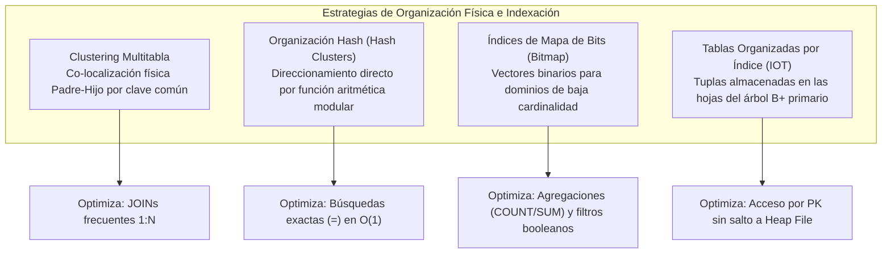
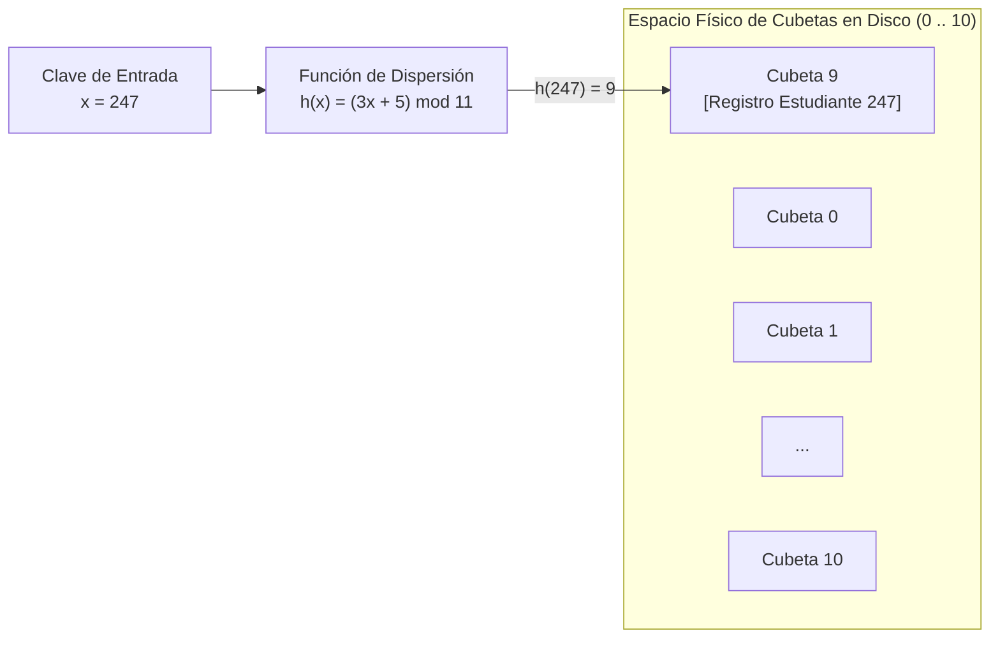
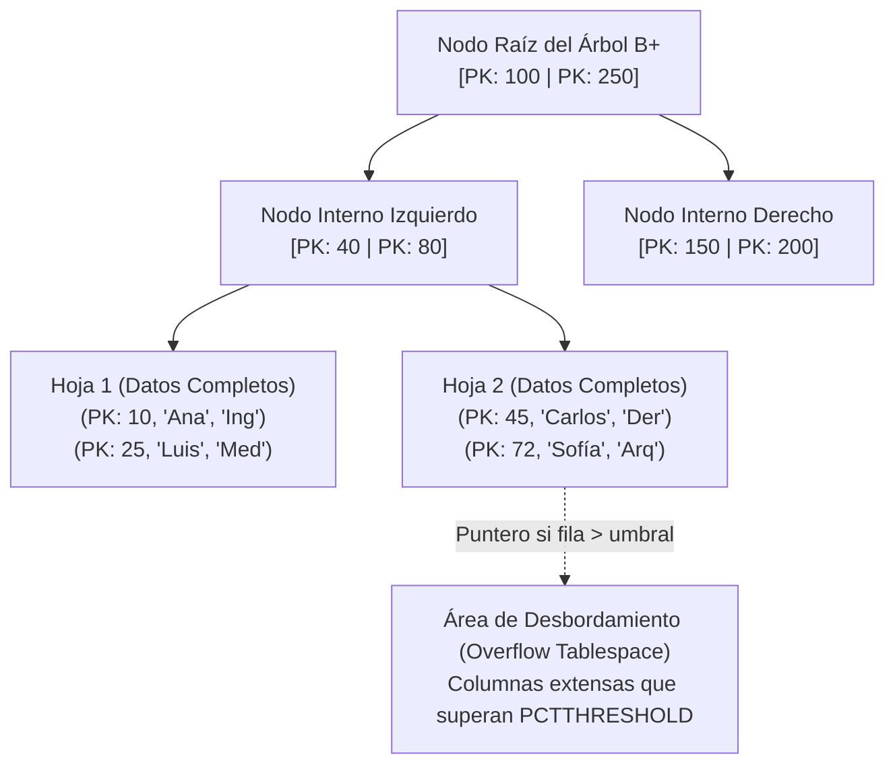
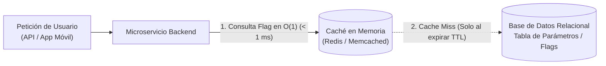
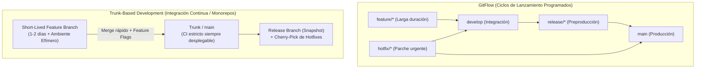
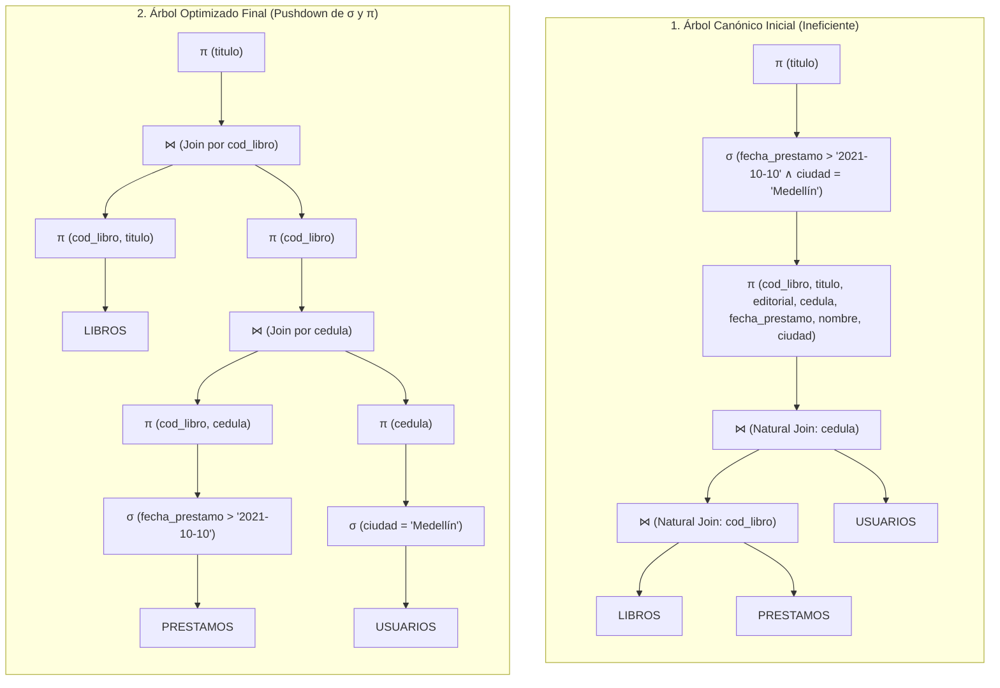
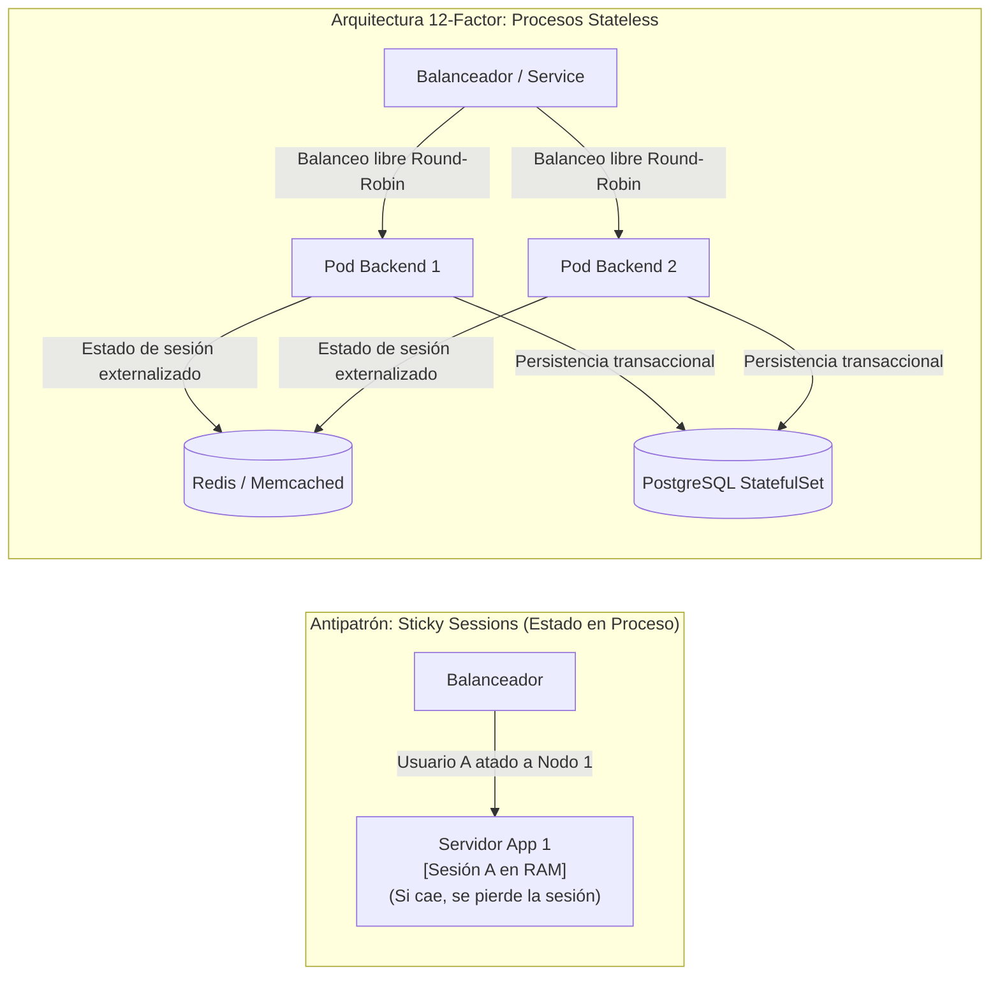
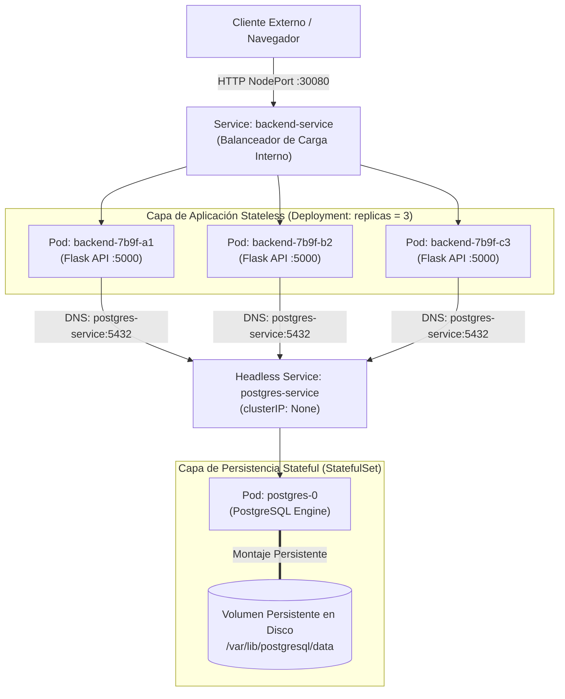

## 1. Estructuras Físicas Avanzadas de Organización de Tablas e Índices

Más allá del almacenamiento convencional en archivos de montón (*heap files*) combinados con índices secundarios $B^+$, los motores de bases de datos relacionales proveen estructuras físicas especializadas para cargas de trabajo con patrones de acceso determinísticos, baja cardinalidad o lecturas intensivas por clave primaria.



---

### 1.1 Implementación Física de Clustering Multitabla (DDL en Oracle)

Retomando el modelo matemático de **Clustering Multitabla** analizado en el diseño físico de páginas, su materialización en motores como Oracle exige tres pasos secuenciales: declarar el contenedor físico (*cluster*) especificando la clave de agrupamiento y los parámetros de crecimiento de bloques (`INITIAL`, `NEXT`), adscribir las tablas relacionales al cluster y construir el índice del cluster antes de ejecutar operaciones DML.

```sql
-- 1. Creación del contenedor físico (Cluster) basado en el atributo de enlace
CREATE CLUSTER cluster_grupos_alumnos (
    id_grupo VARCHAR2(10)
)
SIZE 1270
STORAGE (
    INITIAL 640K
    NEXT 128K
    PCTINCREASE 0
);

-- 2. Creación del índice del cluster (obligatorio antes de insertar tuplas)
CREATE INDEX idx_cluster_grupos_alumnos
ON CLUSTER cluster_grupos_alumnos;

-- 3. Adscripción de la tabla Padre (GRUPOS) al cluster físico
CREATE TABLE grupos (
    id_grupo     VARCHAR2(10) PRIMARY KEY,
    nombre_curso VARCHAR2(50) NOT NULL,
    semestre     VARCHAR2(6)  NOT NULL
)
CLUSTER cluster_grupos_alumnos (id_grupo);

-- 4. Adscripción de la tabla Hija (ALUMNOS) compartiendo las mismas páginas de disco
CREATE TABLE alumnos_grupo (
    cedula_est   VARCHAR2(15),
    id_grupo     VARCHAR2(10) REFERENCES grupos(id_grupo),
    nombre_est   VARCHAR2(40) NOT NULL,
    PRIMARY KEY (cedula_est, id_grupo)
)
CLUSTER cluster_grupos_alumnos (id_grupo);
```

---

### 1.2 Organización de Tablas mediante Funciones Hash (*Hash Clusters*)

Cuando el volumen de registros de una tabla es conocido o acotado de antemano y las consultas de producción consisten de forma predominante en **búsquedas por igualdad exacta** (`WHERE clave = valor`), atravesar los niveles de un árbol $B^+$ introduce lecturas de bloques de índice que pueden evitarse mediante **direccionamiento por dispersión (*hashing*)**.

En una organización **Hash**, el archivo físico se divide en $P$ contenedores o **cubetas (*buckets*)** numeradas de $0$ a $P - 1$. Una función de dispersión lineal modular transforma la clave de búsqueda $x$ en la dirección física de la cubeta correspondiente:

$$h(x) = (a \cdot x + b) \bmod P$$

Donde:
* $x$: Valor numérico (o representación entera) de la clave del registro (*hash key*).
* $a, b \in \mathbb{Z}^+$: Constantes enteras de dispersión ($a \neq 0$).
* $P$: Número primo que define la cantidad total de cubetas disponibles en el espacio de almacenamiento, elegido como primo para minimizar colisiones periódicas y garantizar una distribución uniforme sobre el anillo modular $\mathbb{Z}_P$.



#### Ejemplo Numérico de Direccionamiento Directo:
Considérese una tabla organizada en $P = 11$ cubetas (numeradas de $0$ a $10$) gobernada por la función de dispersión:

$$h(x) = (3x + 5) \bmod 11$$

Se requiere determinar la ubicación física del registro correspondiente al estudiante con código $x = 247$:

$$\begin{aligned}
h(247) &= (3 \cdot 247 + 5) \bmod 11 \\
&= (741 + 5) \bmod 11 \\
&= 746 \bmod 11
\end{aligned}$$

Efectuando la división entera: $746 = 11 \times 67 + 9$. Por consiguiente:

$$h(247) = \mathbf{9}$$

El motor de base de datos direcciona la lectura o escritura directamente a la **cubeta número 9** en tiempo constante $\mathcal{O}(1)$ en términos de E/S de disco, sin consultar estructuras arbóreas intermedias.

> **Colisiones y Búsquedas por Rango**: Si múltiples claves distintas producen el mismo residuo modular ($h(x_1) = h(x_2)$), se produce una **colisión**. El SGBD aloja los registros colisionados en la misma cubeta hasta agotar su capacidad, momento en el cual encadena páginas de desbordamiento (*overflow blocks*), degradando el tiempo de acceso. Asimismo, las estructuras Hash **no preservan el orden secuencial** ($x_1 < x_2 \nRightarrow h(x_1) < h(x_2)$), por lo que resultan ineficientes para búsquedas por rangos (`BETWEEN`, `<`, `>`).

```sql
-- Declaración de un Hash Cluster en Oracle para 1000 claves esperadas
CREATE CLUSTER cluster_estudiantes_hash (
    cod_estudiante NUMBER(10)
)
SIZE 512
HASHKEYS 1009; -- Se redondea internamente al número primo inmediato (1009)

CREATE TABLE estudiantes_hash (
    cod_estudiante NUMBER(10) PRIMARY KEY,
    nombre         VARCHAR2(60) NOT NULL,
    programa       VARCHAR2(40) NOT NULL
)
CLUSTER cluster_estudiantes_hash (cod_estudiante);
```

---

### 1.3 Índices de Mapa de Bits (*Bitmap Indexes*)

Los **índices de mapa de bits (*Bitmap Indexes*)** están diseñados para atributos con **baja cardinalidad** (atributos cuyo dominio $D$ posee un número reducido de valores discretos posibles, similares a enumeraciones como `estado_civil`, `genero`, `tipo_contrato` o indicadores booleanos).

En lugar de almacenar listas de identificadores de fila (`RID`) en un árbol $B^+$, el índice construye un **vector de bits (*bitmap*)** independiente por cada valor distinto del dominio. Si la tabla tiene $n_r$ registros, cada vector tiene exactamente $n_r$ bits: el bit $k$-ésimo vale `1` si la tupla en la posición $k$ posee dicho valor, y `0` en caso contrario.

#### Representación Matricial de un Índice Bitmap:
Considérese una relación `PERSONAS` con el atributo `estado_civil` cuyo dominio es $\{\text{Casado}, \text{Soltero}, \text{Viudo}\}$:

| Posición (RID) | `cedula` | `estado_civil` | Vector `Casado` | Vector `Soltero` | Vector `Viudo` |
| :---: | :---: | :---: | :---: | :---: | :---: |
| **1** | `'1001'` | `Casado` | `1` | `0` | `0` |
| **2** | `'1002'` | `Soltero` | `0` | `1` | `0` |
| **3** | `'1003'` | `Viudo` | `0` | `0` | `1` |
| **4** | `'1004'` | `Soltero` | `0` | `1` | `0` |
| **5** | `'1005'` | `Casado` | `1` | `0` | `0` |

#### Ejecución de Consultas mediante Aritmética Bit a Bit:
Cuando el motor procesa consultas analíticas o de agregación sobre columnas indexadas con *bitmaps*, opera directamente sobre los vectores binarios mediante instrucciones nativas de CPU (`AND`, `OR`, `XOR`, `NOT` y conteo de población `POPCNT`), sin necesidad de leer las páginas de datos de la tabla:

```sql
-- Creación de un índice Bitmap sobre un atributo de baja cardinalidad
CREATE BITMAP INDEX idx_bmp_estado_civil
ON personas (estado_civil);

-- Consulta 1: Conteo directo sumando los bits en '1' del vector correspondiente
SELECT estado_civil, COUNT(*)
FROM personas
GROUP BY estado_civil;

-- Consulta 2: Filtro específico resuelto leyendo únicamente el vector 'Soltero' [0, 1, 0, 1, 0]
SELECT COUNT(*)
FROM personas
WHERE estado_civil = 'Soltero';
```

> **Penalización en Entornos Transaccionales (OLTP)**: Los índices *Bitmap* son ideales para bodegas de datos (*Data Warehouses* / OLAP) y tablas de parámetros de solo lectura. Sin embargo, son **contraproducentes en tablas con alta concurrencia de `INSERT`, `UPDATE` o `DELETE`**, ya que bloquear una entrada de un vector de bits comprimido bloquea simultáneamente cientos de filas adyacentes, serializando las transacciones concurrentes.

---

### 1.4 Tablas Organizadas por Índice (*Index-Organized Tables - IOT*)

En una tabla convencional (*heap-organized table*) con clave primaria, una búsqueda indexada requiere dos accesos lógicos: recorrer el árbol $B^+$ para obtener el `RID` y luego saltar a la página de datos del *heap file* para recuperar el resto de columnas.

Una **Tabla Organizada por Índice (*Index-Organized Table - IOT*)** —denominada *Clustered Index Table* en SQL Server o MySQL/InnoDB— elimina por completo el *heap file* separado: **las tuplas completas de la tabla se almacenan directamente dentro de los nodos hoja del árbol $B^+$ ordenadas físicamente por su clave primaria**.



#### Beneficios, Limitaciones y Control de Desbordamiento (`PCTTHRESHOLD`):
* **Ventajas**:
  1. **Acceso directo en una sola estructura**: Tanto las búsquedas puntuales como los escaneos por rango sobre la clave primaria se resuelven directamente en las hojas del índice.
  2. **Ahorro de almacenamiento**: No se duplica el valor de la clave primaria entre el archivo de índice y el archivo de tabla, ni se requiere almacenar punteros `RID` hacia un *heap*.
* **Limitaciones y Cuándo Usarla**:
  1. Se recomienda para tablas delgadas (pocas columnas adicionales a la clave primaria) con baja tasa de actualización sobre la clave.
  2. Restricciones estructurales en motores como Oracle: no pueden formar parte de un cluster multitabla convencional y presentan restricciones en la creación de índices secundarios adicionales.
* **Umbral de Porcentaje (`PCTTHRESHOLD`)**: Si una tupla contiene atributos adicionales que crecen demasiado, inflarían el nodo hoja del árbol $B^+$, reduciendo el número de claves por página (*fan-out*) y aumentando la altura del árbol. El parámetro `PCTTHRESHOLD n` especifica el porcentaje máximo del bloque de índice que puede ocupar una sola fila; si una tupla supera ese límite, las columnas no clave a partir de la columna `INCLUDING` se envían automáticamente a un segmento físico separado (`OVERFLOW TABLESPACE`).

```sql
-- Creación de una Tabla Organizada por Índice (IOT) con control de desbordamiento
CREATE TABLE parametros_sistema (
    cod_parametro   VARCHAR2(30),
    valor_corto     VARCHAR2(50) NOT NULL,
    descripcion_ext VARCHAR2(1000),
    CONSTRAINT pk_parametros PRIMARY KEY (cod_parametro)
)
ORGANIZATION INDEX
PCTTHRESHOLD 20
INCLUDING valor_corto
OVERFLOW TABLESPACE tbs_overflow_datos;
```

---

### 1.5 Matriz de Decisión Arquitectónica de Estructuras de Almacenamiento

| Estructura Física | Cuándo Utilizarla (Caso de Uso Óptimo) | Cuándo Evitarla (Antipatrón) |
| :--- | :--- | :--- |
| **Heap + Índice $B^+$** | Propósito general; tablas pequeñas o grandes con actualizaciones frecuentes y consultas variadas por múltiples criterios. | Cuando dos tablas maestro-detalle gigantes se consultan casi exclusivamente unidas mediante `JOIN`. |
| **Cluster Multitabla** | Tablas jerárquicas $1:N$ consultadas juntas de forma intensiva mediante `JOIN` sobre la clave del cluster. | Cuando se realizan frecuentes escaneos completos (`FULL SCAN`) de una sola de las tablas de manera aislada, o el cluster sufre desbordamientos constantes. |
| **Organización Hash** | Se conoce de antemano el número aproximado de registros y predominan las búsquedas por **igualdad exacta** (`=`). | Cuando el volumen de datos crece de forma impredecible o se ejecutan **búsquedas por rangos** (`BETWEEN`, `<`, `>`). |
| **Índice Bitmap** | Atributos de **baja cardinalidad** (pocos valores posibles) en tablas de solo lectura o baja modificación (consultas `COUNT`, `SUM`, `GROUP BY`). | Atributos de alta cardinalidad (ej. `cedula`, `email`) o tablas transaccionales que reciben alta concurrencia de `INSERT` / `UPDATE`. |
| **Tabla en Índice (IOT)** | Tablas con pocas columnas adicionales a la clave primaria, accedidas siempre por PK (exacto o rango) y con baja frecuencia de alteración estructural. | Tablas muy anchas con decenas de atributos volátiles o que requieren múltiples caminos de indexación secundaria independiente. |

---

## 2. Ingeniería de Software en Producción: Feature Flags, Caché y Estrategias de Ramificación

Las decisiones sobre estructuras de datos y acceso a bases de datos están directamente condicionadas por las prácticas modernas de despliegue continuo (**CI/CD**) y arquitectura de aplicaciones en producción.

### 2.1 Feature Flags, Despliegues Canary e Impacto en la Base de Datos

Un **Feature Flag (*Feature Toggle*)** es un mecanismo de control condicional en tiempo de ejecución que permite **activar o desactivar funcionalidades específicas del software en producción sin necesidad de recompilar ni redesplegar la aplicación**.

Este patrón se combina frecuentemente con **Despliegues Canary (*Canary Releases*)**: cuando se libera una nueva funcionalidad o versión de un microservicio, el enrutador o evaluador de *flags* habilita el cambio únicamente para una fracción reducida de usuarios reales (por ejemplo, el $2\%$ o $5\%$ del tráfico). Si las métricas de telemetría no registran errores ni regresiones de rendimiento, la funcionalidad se despliega progresivamente al $100\%$ de la población; en caso de fallo, se apaga instantáneamente cambiando el estado del *flag*.



> **El Cuello de Botella de los Feature Flags en Bases de Datos Relacionales**: Si el estado de los *Feature Flags* se almacena en una tabla de parámetros dentro de la base de datos transaccional principal (por ejemplo, PostgreSQL u Oracle) y cada petición HTTP de los usuarios ejecuta un `SELECT habilitado FROM feature_flags WHERE codigo = '...'`, una aplicación con miles de peticiones por segundo saturará de inmediato el pool de conexiones y las lecturas de la base de datos.  
> **Solución Arquitectónica**: Interponer obligatoriamente una **capa de caché en memoria (*In-Memory Data Store*)** como **Redis** o **Memcached** delante de la base de datos transaccional, de modo que la evaluación de *flags* se resuelva en memoria RAM y el motor relacional solo sea consultado ante un *cache miss* o invalidación explícita.

---

### 2.2 Monolito vs. Monorepo y Estrategias de Ramificación (*GitFlow* vs. *Trunk-Based Development*)

En la ingeniería de software industrial es fundamental distinguir dos conceptos frecuentemente confundidos:

* **Monolito (Concepto de Arquitectura de Software)**: Sistema en el cual todos los componentes funcionales (interfaz de usuario/vistas, lógica de negocio/controladores y capa de acceso a datos/modelos, como en un proyecto tradicional Django o Spring MVC) están acoplados, compilados y desplegados como una única unidad ejecutable.
* **Monorepo (Concepto de Organización de Control de Versiones)**: Estrategia en la cual múltiples proyectos independientes (múltiples microservicios, aplicaciones frontend, librerías compartidas e infraestructura como código) coexisten dentro de un único repositorio de Git, permitiendo trazabilidad atómica pero desplegando únicamente los artefactos cuyos directorios hayan sufrido cambios en el pipeline de CI/CD.



| Criterio | GitFlow | Trunk-Based Development (TBD) |
| :--- | :--- | :--- |
| **Estructura de Ramas** | Múltiples ramas permanentes (`main`, `develop`) y auxiliares (`feature/*`, `release/*`, `hotfix/*`). | Una única rama central (`trunk` / `main`) y ramas de funcionalidad de vida muy corta (*short-lived feature branches*). |
| **Frecuencia de Integración** | Las ramas `feature` pueden vivir semanas antes de fusionarse en `develop`, aumentando el riesgo de conflictos complejos (*merge hell*). | Integración diaria hacia el tronco previa aprobación de pruebas automatizadas en **ambientes efímeros** conectados a bases de datos de *staging*. |
| **Gestión de Código Incompleto** | El código permanece aislado en ramas no fusionadas hasta estar $100\%$ terminado. | El código se integra continuamente al tronco desactivado detrás de **Feature Flags**, manteniendo `main` siempre apto para producción. |
| **Gestión de Hotfixes** | Se crea una rama `hotfix/*` desde `main` y luego se fusiona tanto en `main` como en `develop`. | El defecto se corrige primero en el `trunk` y se traslada a la rama de lanzamiento activa mediante `git cherry-pick`, generando una versión menor (`x.y.z`). |

---

## 3. Procesamiento y Optimización Algebraica de Consultas (*Query Optimization*)

Cuando un usuario o aplicación envía una sentencia declarativa en **SQL**, indica **qué** conjunto de datos desea obtener, pero no **cómo** debe recuperarlo eficientemente el motor. El subsistema encargado de transformar dicha sentencia en la secuencia de operaciones físicas de menor costo se denomina **Procesador y Optimizador de Consultas**.


1. **Analizador y Traductor (*Parser & Translator*)**: Verifica la sintaxis gramatical y comprueba en el catálogo del sistema la existencia de las relaciones y atributos referenciados, produciendo un **árbol inicial (canónico) de operadores de álgebra relacional**.
2. **Optimización Algebraica (Heurística)**: Aplica leyes matemáticas de equivalencia del álgebra relacional para reestructurar el árbol canónico, reduciendo drásticamente el número de tuplas y columnas intermedias antes de ejecutar operaciones costosas de reunión (`JOIN`).
3. **Optimización Basada en Costos**: Evalúa las estadísticas del motor (cardinalidades, histogramas, factores de bloqueo e índices disponibles) para elegir el algoritmo físico óptimo para cada nodo del árbol.

---

### 3.1 Leyes de Transformación y Equivalencia en Álgebra Relacional

Sean $E, E_1, E_2, E_3$ expresiones de álgebra relacional, $p, p_1, p_2$ predicados lógicos de selección y $X, Y$ conjuntos de atributos de proyección. Dos expresiones son equivalentes ($E_a \equiv E_b$) si producen exactamente el mismo conjunto de tuplas para cualquier instancia válida de la base de datos.

#### 1. Descomposición de Selecciones Conjuntivas en Cascada (Ley 2)
Una selección con múltiples condiciones unidas por conjunción ($\land$) puede descomponerse en una secuencia de selecciones individuales anidadas:

$$\sigma_{p_1 \land p_2}(E) \equiv \sigma_{p_1}(\sigma_{p_2}(E))$$

*Propósito*: Permite separar un predicado compuesto para desplazar cada condición individual hacia la tabla específica a la que pertenecen sus atributos.

#### 2. Conmutatividad del Operador de Selección
El orden en que se aplican selecciones sucesivas no altera el resultado final:

$$\sigma_{p_1}(\sigma_{p_2}(E)) \equiv \sigma_{p_2}(\sigma_{p_1}(E))$$

*Propósito*: Permite evaluar primero el predicado más restrictivo (el que filtra mayor cantidad de filas) o aquel que cuenta con un índice físico.

#### 3. Intercambio entre Selección y Proyección (Ley 3)
Una selección y una proyección pueden conmutar **únicamente si todos los atributos evaluados en el predicado $p$ están incluidos dentro de la lista de atributos proyectados $X$**:

$$\pi_{X}(\sigma_{p}(E)) \equiv \sigma_{p}(\pi_{X}(E)) \quad \Longleftrightarrow \quad \text{atrib}(p) \subseteq X$$

#### 4. Empuje de Selección (*Selection Pushdown*) sobre la Reunión (Leyes 4 y 5)
Si todos los atributos mencionados en el predicado $p$ pertenecen exclusivamente al esquema de la relación $E_1$, la selección puede aplicarse sobre $E_1$ **antes** de calcular la reunión (`JOIN`):

$$\sigma_{p}(E_1 \bowtie E_2) \equiv (\sigma_{p}(E_1)) \bowtie E_2 \quad \text{si } \text{atrib}(p) \subseteq \text{esquema}(E_1)$$

Si se tiene un predicado conjuntivo $p_1 \land p_2$ donde $p_1$ referencia solo atributos de $E_1$ y $p_2$ referencia solo atributos de $E_2$, ambas selecciones se empujan hacia sus respectivas hojas:

$$\sigma_{p_1 \land p_2}(E_1 \bowtie E_2) \equiv (\sigma_{p_1}(E_1)) \bowtie (\sigma_{p_2}(E_2))$$

> **Impacto en Rendimiento del *Selection Pushdown***: Reducir la cardinalidad de los operandos $E_1$ y $E_2$ antes del `JOIN` disminuye de forma multiplicativa el tamaño de las tablas temporales en memoria y el costo de emparejamiento de tuplas.

#### 5. Eliminación de Proyecciones Redundantes en Cascada (Ley 8)
En una cascada de proyecciones donde el conjunto final de atributos $X$ es un subconjunto del conjunto intermedio $Y$ ($X \subseteq Y$), las proyecciones externas absorben a las internas:

$$\pi_{X}(\pi_{Y}(E)) \equiv \pi_{X}(E) \quad \text{si } X \subseteq Y$$

*Propósito*: Evita arrastrar atributos innecesarios desde las hojas del árbol que posteriormente serán descartados en la raíz.

#### 6. Empuje de Proyección (*Projection Pushdown*) sobre la Reunión
Sea $X = X_1 \cup X_2$ el conjunto de atributos finales requeridos tras el `JOIN` (con $X_1 \subseteq \text{esquema}(E_1)$ y $X_2 \subseteq \text{esquema}(E_2)$), y sea $J = \text{esquema}(E_1) \cap \text{esquema}(E_2)$ el conjunto de atributos de enlace (*clave primaria / clave foránea*) necesarios para efectuar la reunión. Se cumple que:

$$\pi_{X}(E_1 \bowtie E_2) \equiv \pi_{X}\Big( \pi_{X_1 \cup J}(E_1) \bowtie \pi_{X_2 \cup J}(E_2) \Big)$$

> **Regla de Supervivencia de Atributos en el *Projection Pushdown***: Al proyectar sobre una rama inferior antes de un `JOIN`, **jamás se debe eliminar el atributo de enlace $J$ (clave foránea/primaria)** aunque no aparezca en el `SELECT` final del usuario; de lo contrario, el operador $\bowtie$ superior perdería la columna común para emparejar las tuplas y degeneraría en un producto cartesiano ($\times$).

#### 7. Conmutatividad y Asociatividad de las Reuniones ($\bowtie$)
Las reuniones naturales y reuniones theta son conmutativas y asociativas:

$$E_1 \bowtie E_2 \equiv E_2 \bowtie E_1$$

$$(E_1 \bowtie E_2) \bowtie E_3 \equiv E_1 \bowtie (E_2 \bowtie E_3)$$

*Propósito*: Permite al optimizador reordenar la secuencia en que se unen tres o más tablas, ejecutando primero el `JOIN` que produzca la relación intermedia más pequeña.

---

### 3.2 Algoritmo General de Optimización Heurística

El procedimiento sistemático para optimizar cualquier consulta relacional consta de cuatro etapas:

1. **Construcción del Árbol Canónico Inicial**: Traducir la cláusula `FROM` en reuniones ($\bowtie$), la cláusula `WHERE` en un único nodo de selección conjuntiva ($\sigma_{p_1 \land \dots \land p_n}$) sobre las reuniones, y la cláusula `SELECT` en el nodo raíz de proyección ($\pi$).
2. **Bajar las Selecciones (*Pushdown Selections*)**: Descomponer las condiciones conjuntivas (Ley 2) y desplazar cada selección $\sigma_{p_i}$ tan abajo en el árbol como sea posible, colocándola inmediatamente encima de la tabla hoja que contiene sus atributos (Leyes 4 y 5).
3. **Bajar las Proyecciones (*Pushdown Projections*)**: Insertar proyecciones intermedias encima de las selecciones de cada hoja, conservando **exclusivamente** los atributos solicitados en la raíz y los atributos de enlace (claves primarias/foráneas) requeridos por los nodos $\bowtie$ superiores, eliminando cualquier proyección redundante (Ley 8).
4. **Reordenar las Reuniones (Opcional / Basado en Cardinalidad)**: Aplicar asociatividad y conmutatividad para asociar primero las sub-ramas más selectivas.

---

## 4. Casos de Estudio Paso a Paso de Optimización de Árboles de Consulta

### 4.1 Caso de Estudio 1: Sistema Bibliotecario (Reunión de 3 Tablas)

Considérese el esquema relacional de una biblioteca compuesto por tres tablas:

* `` `LIBROS(`<u>`cod_libro`</u>`, titulo, editorial)` ``
* `` `PRESTAMOS(`<u>`cod_libro, cedula`</u>`, fecha_prestamo)` ``
* `` `USUARIOS(`<u>`cedula`</u>`, nombre, ciudad)` ``

**Requerimiento**: *Obtener el título de los libros prestados después del `'2021-10-10'` a usuarios residentes en la ciudad de `'Medellín'`*.

```sql
SELECT L.titulo
FROM libros L
NATURAL JOIN prestamos P
NATURAL JOIN usuarios U
WHERE P.fecha_prestamo > '2021-10-10'
  AND U.ciudad = 'Medellín';
```

#### Expresión Algebraica Canónica (Sin Optimizar):

$$\pi_{\text{titulo}}\Big( \sigma_{\text{fecha} > \text{'2021-10-10'} \ \land \ \text{ciudad} = \text{'Medellin'}}\big( (\text{LIBROS} \bowtie \text{PRESTAMOS}) \bowtie \text{USUARIOS} \big) \Big)$$

#### Evolución del Árbol de Operadores: Canónico vs. Optimizado



#### Trazabilidad Matemática de la Optimización:
1. **Descomposición y Empuje de Selecciones ($\sigma$)**:
   * El predicado `fecha_prestamo > '2021-10-10'` depende exclusivamente de `PRESTAMOS`, por lo que se desplaza directamente sobre la hoja `PRESTAMOS`.
   * El predicado `ciudad = 'Medellín'` depende exclusivamente de `USUARIOS`, desplazándose directamente sobre la hoja `USUARIOS`.
2. **Empuje de Proyecciones ($\pi$) y Eliminación de Columnas Muertas**:
   * Sobre `USUARIOS`: Una vez evaluado el filtro `ciudad = 'Medellín'`, los atributos `nombre` y `ciudad` no se requieren en ningún nodo superior; únicamente se proyecta la clave de enlace `cedula` ($\pi_{\text{cedula}}$).
   * Sobre `PRESTAMOS`: Tras filtrar por `fecha_prestamo`, la fecha ya no se necesita arriba; únicamente se proyectan las dos claves foráneas de enlace `(cod_libro, cedula)`.
   * Sobre el resultado de `PRESTAMOS` $\bowtie$ `USUARIOS`: El atributo `cedula` ya cumplió su función de emparejamiento, por lo que antes de cruzar con `LIBROS` se proyecta exclusivamente `cod_libro` ($\pi_{\text{codLibro}}$).
   * Sobre `LIBROS`: Se descarta el atributo `editorial` desde la base, proyectando solo `(cod_libro, titulo)`.

#### Expresión Algebraica Optimizada Equivalente:

$$\pi_{\text{titulo}}\left( \pi_{\text{codLibro, titulo}}(\text{LIBROS}) \bowtie \pi_{\text{codLibro}}\Big( \pi_{\text{codLibro, cedula}}\big(\sigma_{\text{fechaPrestamo} > \text{'2021-10-10'}}(\text{PRESTAMOS})\big) \bowtie \pi_{\text{cedula}}\big(\sigma_{\text{ciudad} = \text{'Medellin'}}(\text{USUARIOS})\big) \Big) \right)$$

---

### 4.2 Caso de Estudio 2: Empleados y Departamentos en RelaX (Colisión de Atributos y Operador $\rho$)

Considérese el esquema empresarial:

* `` `EMPLEADOS(`<u>`id_empleado`</u>`, nombre, id_departamento, salario)` `` (10 registros iniciales).
* `` `DEPARTAMENTOS(`<u>`id_departamento`</u>`, nombre, ciudad)` `` (4 registros iniciales).

**Requerimiento**: *Obtener el nombre de los empleados que devengan un salario superior a $\$5\,000\,000$ y trabajan en un departamento ubicado en `'Medellín'`*.

> **Trampa Semántica del `NATURAL JOIN` ante Atributos Homónimos**: Tanto `EMPLEADOS` como `DEPARTAMENTOS` poseen un atributo llamado `nombre`. Si se aplica directamente `EMPLEADOS ⋈ DEPARTAMENTOS`, el operador de reunión natural emparejará por `id_departamento` **y simultáneamente exigirá que `EMPLEADOS.nombre = DEPARTAMENTOS.nombre`**, produciendo un conjunto vacío o erróneo. Para evitarlo en álgebra relacional, es obligatorio aplicar primero el **operador de renombramiento ($\rho$)** sobre el atributo homónimo de `DEPARTAMENTOS`.

#### Script Ejecutable en RelaX (Comparativa Consulta Canónica vs. Consulta Optimizada):

```text
-- 1. Consulta Canónica Inicial (Arrastra 4 + 3 columnas y cruza 10 x 4 tuplas antes de filtrar)
pi nombre (
    sigma salario > 5000000 and ciudad = 'Medellín' (
        EMPLEADOS
        natural join
        rho nombre_depto <- nombre (DEPARTAMENTOS)
    )
)

-- 2. Consulta Optimizada (Selection Pushdown + Projection Pushdown)
pi nombre (
    (
        pi nombre, id_departamento (
            sigma salario > 5000000 (EMPLEADOS)
        )
    )
    natural join
    (
        pi id_departamento (
            sigma ciudad = 'Medellín' (DEPARTAMENTOS)
        )
    )
)
```

Al observar que en la versión optimizada se proyecta únicamente `id_departamento` sobre `DEPARTAMENTOS` (descartando `DEPARTAMENTOS.nombre` y `ciudad` inmediatamente después del filtro $\sigma$), no solo se reduce el número de tuplas que entran al `JOIN` (pasando de $10 \times 4$ filas a solo $6 \times 2$ filas filtradas), sino que además **desaparece la colisión del atributo `nombre`** sin siquiera necesitar el operador $\rho$.

---

### 4.3 Caso de Estudio 3: Clientes y Pedidos (Análisis de Supervivencia de Atributos)

Considérese el esquema comercial:

* `` `CLIENTES(`<u>`id_cliente`</u>`, nombre, ciudad)` ``
* `` `PEDIDOS(`<u>`id_pedido`</u>`, id_cliente, fecha_pedido, valor_pedido)` ``

Se analizan dos variantes de consulta para demostrar cómo la proyección raíz condiciona las proyecciones intermedias en las ramas del árbol:

| Variante de Consulta | Atributos Proyectados en Rama `CLIENTES` | Atributos Proyectados en Rama `PEDIDOS` | Expresión en Álgebra Relacional Optimizada |
| :--- | :--- | :--- | :--- |
| **Variante A**: *Obtener únicamente el `valor_pedido` de clientes de `'Bogotá'` realizados después de `'2026-09-01'`*. | Solo `id_cliente` (para poder ejecutar el $\bowtie$). | `id_cliente` (para el $\bowtie$) y `valor_pedido` (para el $\pi$ final). | $\pi_{\text{valorPedido}}\big( \pi_{\text{idCliente}}(\sigma_{\text{ciudad}=\text{'Bogota'}}(\text{CLIENTES})) \bowtie \pi_{\text{idCliente, valorPedido}}(\sigma_{\text{fechaPedido}>\text{'2026-09-01'}}(\text{PEDIDOS})) \big)$ |
| **Variante B**: *Obtener tanto el `nombre` del cliente como el `valor_pedido` bajo las mismas condiciones*. | `id_cliente` (para el $\bowtie$) **y `nombre`** (para que sobreviva hasta la raíz). | `id_cliente` (para el $\bowtie$) y `valor_pedido`. | $\pi_{\text{nombre, valorPedido}}\big( \pi_{\text{idCliente, nombre}}(\sigma_{\text{ciudad}=\text{'Bogota'}}(\text{CLIENTES})) \bowtie \pi_{\text{idCliente, valorPedido}}(\sigma_{\text{fechaPedido}>\text{'2026-09-01'}}(\text{PEDIDOS})) \big)$ |

---

## 5. Despliegue de Bases de Datos y Aplicaciones Cloud-Native en Kubernetes

En infraestructuras de producción modernas, los motores de bases de datos y los microservicios que los consumen no se despliegan manualmente sobre servidores aislados, sino mediante plataformas de orquestación de contenedores como **Kubernetes (`k8s`)**.

### 5.1 De Sesiones Acopladas (*Sticky Sessions*) a Procesos Sin Estado (*Twelve-Factor App*)

En arquitecturas heredadas con múltiples servidores de aplicación detrás de un balanceador de carga, era común almacenar la sesión del usuario en la memoria RAM local del servidor que atendió su primer inicio de sesión, obligando al balanceador a enrutar todas las peticiones futuras de ese usuario al mismo nodo físico (**Sticky Sessions / Afinidad de Sesión**).



El sexto principio de la metodología **The Twelve-Factor App (VI. Processes)** establece que **los procesos de la aplicación deben ser completamente sin estado (*stateless*) y no compartir nada en memoria local (*share-nothing*)**. Cualquier dato que deba persistir entre peticiones debe externalizarse hacia un almacén con tiempos de expiración (como **Redis** para sesiones) o hacia un motor de base de datos relacional (**PostgreSQL**) con almacenamiento persistente compartido.

---

### 5.2 Arquitectura de Componentes en Kubernetes: `Deployment` vs. `StatefulSet`

Kubernetes distingue rigurosamente entre cargas de trabajo sin estado (*stateless*, como un servidor web Nginx o una API REST en Python/Flask) y cargas de trabajo con estado (*stateful*, como un motor de base de datos **PostgreSQL**):

| Característica Técnica | `Deployment` (Para Microservicios / APIs) | `StatefulSet` (Para Bases de Datos) |
| :--- | :--- | :--- |
| **Identidad de los Pods** | Efímera e intercambiable con sufijos aleatorios (`backend-584d9f-x7k2p`). | **Determinística y secuencial con índice ordinal fijo** (`postgres-0`, `postgres-1`). |
| **Red y DNS Interno** | Se expone mediante un `Service` estándar con balanceo de carga sobre una IP virtual (`ClusterIP` / `NodePort`). | Requiere un **`Headless Service` (`clusterIP: None`)** que resuelve directamente la identidad DNS de cada instancia de base de datos. |
| **Almacenamiento** | Efímero o compartido; si el pod muere, su sistema de archivos local desaparece. | Acoplado a volúmenes persistentes dedicados (`PersistentVolume` / `PVC`). **Si el pod `postgres-0` se destruye, al recrearse se reconecta exactamente al mismo disco físico sin perder una sola transacción**. |
| **Escalado Horizontal** | Inmediato y simétrico (`kubectl scale deployment backend --replicas=8`). | Ordenado y secuencial; cada réplica requiere sincronización de estado o replicación primaria-secundaria. |



---

### 5.3 Manifiestos Declarativos para Desplegar PostgreSQL y un Backend en Kubernetes

En un entorno de **Kubernetes** (ejecutado localmente con **Minikube** o en la nube con EKS/GKE/AKS), la infraestructura se define de forma declarativa mediante archivos YAML aplicados con `kubectl apply -f`:

#### 1. Definición del `Headless Service` y el `StatefulSet` para PostgreSQL

```yaml
# postgres-service.yaml: Servicio Headless para direccionamiento interno de la BD
apiVersion: v1
kind: Service
metadata:
  name: postgres-service
  labels:
    app: postgres
spec:
  clusterIP: None # Define un Headless Service (sin IP virtual de balanceo genérico)
  selector:
    app: postgres
  ports:
    - port: 5432
      targetPort: 5432
      name: postgres
---
# postgres-statefulset.yaml: Despliegue con estado e identidad determinística (postgres-0)
apiVersion: apps/v1
kind: StatefulSet
metadata:
  name: postgres
spec:
  serviceName: "postgres-service"
  replicas: 1
  selector:
    matchLabels:
      app: postgres
  template:
    metadata:
      labels:
        app: postgres
    spec:
      containers:
        - name: postgres
          image: postgres:16-alpine
          ports:
            - containerPort: 5432
          env:
            - name: POSTGRES_DB
              valueFrom:
                secretKeyRef:
                  name: app-secrets
                  key: db_name
            - name: POSTGRES_USER
              valueFrom:
                secretKeyRef:
                  name: app-secrets
                  key: db_user
            - name: POSTGRES_PASSWORD
              valueFrom:
                secretKeyRef:
                  name: app-secrets
                  key: db_password
          volumeMounts:
            - name: postgres-storage
              mountPath: /var/lib/postgresql/data
      volumes:
        - name: postgres-storage
          hostPath:
            path: /data/postgres
            type: DirectoryOrCreate
```

#### 2. Conexión desde el `Deployment` del Backend hacia `postgres-service`

El microservicio backend nunca codifica direcciones IP estáticas ni credenciales en texto plano dentro del repositorio Git; resuelve la ubicación de la base de datos por su nombre DNS interno (`DB_HOST: postgres-service`) e inyecta las credenciales desde objetos `Secret`:

```yaml
# backend-deployment.yaml: Microservicio stateless escalable horizontalmente
apiVersion: apps/v1
kind: Deployment
metadata:
  name: backend-deployment
spec:
  replicas: 3
  selector:
    matchLabels:
      app: backend
  template:
    metadata:
      labels:
        app: backend
    spec:
      containers:
        - name: flask-backend
          image: mi-org/flask-visitas:1.0.0
          ports:
            - containerPort: 5000
          env:
            - name: DB_HOST
              value: "postgres-service" # Resolución DNS automática hacia postgres-0
            - name: DB_PORT
              value: "5432"
            - name: DB_NAME
              valueFrom:
                secretKeyRef:
                  name: app-secrets
                  key: db_name
            - name: DB_USER
              valueFrom:
                secretKeyRef:
                  name: app-secrets
                  key: db_user
            - name: DB_PASSWORD
              valueFrom:
                secretKeyRef:
                  name: app-secrets
                  key: db_password
```

---

### 5.4 Evolución del Despliegue en Kubernetes: `kubectl`, Helm Charts y GitOps (ArgoCD)

En la industria, la gestión de estos manifiestos escala a través de tres niveles de madurez operativa:

1. **Despliegue Directo (`kubectl apply -f`)**: Ejecución manual o desde pipelines básicos de CI enviando los manifiestos YAML hacia el API Server del clúster.
2. **Gestor de Paquetes con Helm (*Helm Charts*)**: Empaqueta colecciones de manifiestos parametrizados mediante plantillas (*templates*), permitiendo instalar arquitecturas complejas de bases de datos o aplicaciones con un solo comando versionado.
3. **Entrega Continua Declarativa mediante GitOps (ArgoCD)**: En lugar de utilizar un modelo *Push* (donde un script externo ejecuta comandos contra el clúster), se instala un agente controlador dentro del clúster de Kubernetes (**ArgoCD**) bajo un modelo **Pull**. El agente monitorea continuamente un repositorio de Git; cuando detecta un cambio en los manifiestos del repositorio, sincroniza automáticamente el estado real del clúster con el estado deseado declarado en Git.

---


## 6. Reflexión: Coherencia Integral entre el Diseño Físico, el Optimizador de Consultas y la Infraestructura Cloud

El recorrido técnico de esta semana evidencia que el rendimiento y la confiabilidad de un sistema intensivo en datos no dependen de un único componente aislado, sino de la sinergia entre tres capas de ingeniería:

1. **Capa Física de Almacenamiento**: Elegir entre un *Heap File*, un *Cluster Multitabla*, una organización *Hash*, un índice *Bitmap* o una *Index-Organized Table (IOT)* determina cuántas operaciones de E/S de disco requerirá cada acceso elemental.
2. **Capa Lógica y Algebraica**: Escribir consultas conscientes del árbol de operadores —permitiendo que el optimizador aplique *Selection Pushdown* y *Projection Pushdown* sin bloqueos semánticos— reduce órdenes de magnitud el volumen de memoria intermedia procesada en cada `JOIN`.
3. **Capa de Plataforma y Despliegue Cloud-Native**: Incluso la base de datos mejor normalizada y optimizada colapsará en producción si la aplicación satura el motor consultando *Feature Flags* sin una capa de caché en memoria como **Redis**, o si el contenedor del motor se despliega sin garantías de persistencia de estado mediante **StatefulSets** en Kubernetes. Dominar el ciclo completo —desde el bit en el índice Bitmap y el álgebra relacional hasta la orquestación declarativa con Kubernetes y GitOps— es lo que distingue al ingeniero de software integral en la industria actual.

---

## 7. Referencias y Enlaces de Interés

1. **Silberschatz, A., Korth, H. F., & Sudarshan, S. (2020)**. *Database System Concepts* (7th ed.). McGraw-Hill Education. Chapter 14: *Indexing (Bitmap Indices & Hash Organization)* & Chapter 16: *Query Optimization (Equivalence Rules)*. [https://www.db-book.com/](https://www.db-book.com/).
2. **Oracle Corporation (2026)**. *Oracle Database Concepts: Overview of Index-Organized Tables (IOT) and Hash Clusters*. [https://docs.oracle.com/en/database/oracle/oracle-database/19/cncpt/indexes-and-index-organized-tables.html](https://docs.oracle.com/en/database/oracle/oracle-database/19/cncpt/indexes-and-index-organized-tables.html).
3. **Kessler, M., & UIBK DBIS Group (2026)**. *RelaX - Relational Algebra Calculator*. University of Innsbruck. [https://dbis-uibk.github.io/relax/landing](https://dbis-uibk.github.io/relax/landing).
4. **Wiggins, A. (2017)**. *The Twelve-Factor App: VI. Processes — Execute the app as one or more stateless processes*. [https://12factor.net/processes](https://12factor.net/processes).
5. **The Kubernetes Authors (2026)**. *Kubernetes Documentation: Workloads — StatefulSets & Headless Services*. [https://kubernetes.io/docs/concepts/workloads/controllers/statefulset/](https://kubernetes.io/docs/concepts/workloads/controllers/statefulset/).
6. **Rey, A. (2026)**. *Kubernetes Fundamentals & Stateful Database Deployment Lab*. GitHub Repository. [https://github.com/afreydev/k8s-fundamentals](https://github.com/afreydev/k8s-fundamentals).

---

*Publicado por [Mateo Vargas Tirado](https://github.com/araigumadev) como parte del registro de aprendizaje en el curso Bases de Datos 2026/2 - Universidad de Antioquia.*
