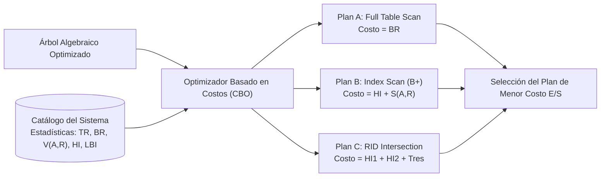
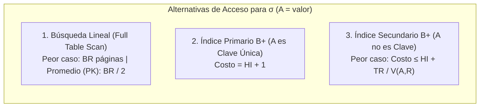
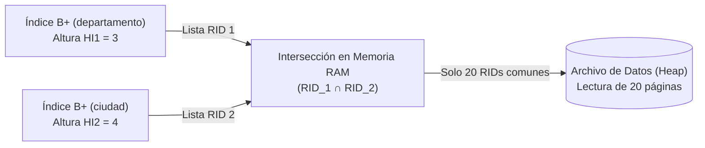
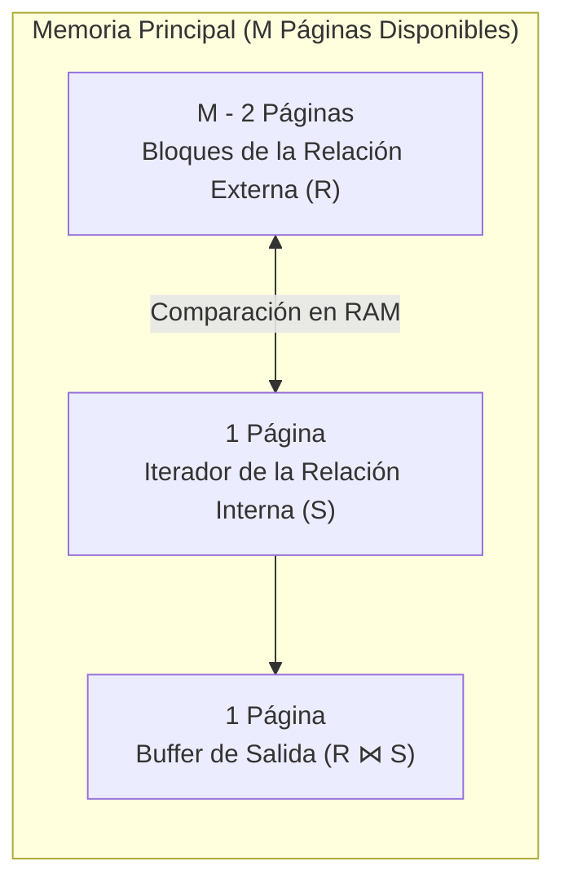
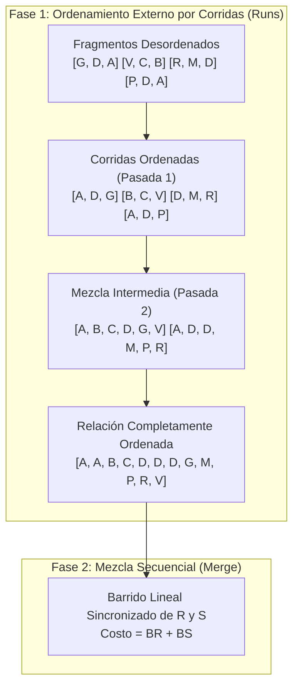
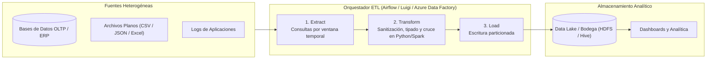
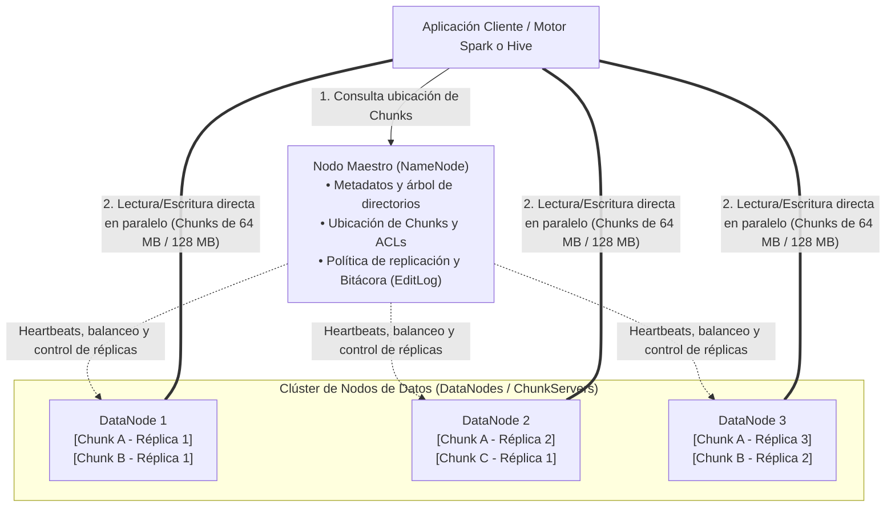
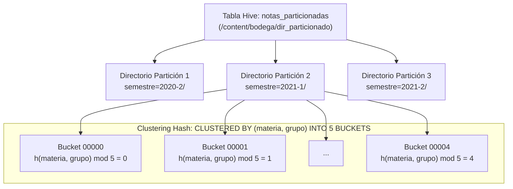

## 1. Optimización de Consultas Basada en Costos (*Cost-Based Optimization*)

Una vez que el optimizador algebraico ha reestructurado el árbol de consulta aplicando leyes de equivalencia heurísticas (*Selection Pushdown* y *Projection Pushdown*), el motor de base de datos debe decidir **qué algoritmo físico y qué estructura de acceso** utilizar para evaluar cada operador del árbol. Esta fase se denomina **Optimización Basada en Costos (*Cost-Based Optimization - CBO*)**.

A diferencia del análisis algorítmico clásico en memoria RAM —donde la complejidad se mide en ciclos de CPU—, en sistemas de bases de datos el cuello de botella dominante es la **latencia de Entrada/Salida (E/S)**. Por consiguiente, **el costo de una consulta se mide en el número de páginas o bloques de disco que deben transferirse entre el almacenamiento secundario y la memoria principal**.



---

### 1.1 Estadísticas del Catálogo del Sistema y Selectividad

Para estimar el costo de cualquier plan de ejecución sin necesidad de leer las tablas reales, el SGBD mantiene en su diccionario de datos un conjunto de métricas estadísticas actualizadas periódicamente sobre cada relación $R$ y cada atributo $A$:

| Métrica / Símbolo | Definición Formal | Caso Especial / Propiedad |
| :---: | :--- | :--- |
| $T_R$ | Número total de tuplas (registros) almacenadas en la relación $R$. | Cardinalidad total de la tabla. |
| $B_R$ | Número total de páginas o bloques en disco ocupados por las tuplas de $R$. | $B_R = \lceil T_R / f_r \rceil$, donde $f_r$ es el factor de bloqueo. |
| $V(A, R)$ | Número de **valores distintos** que toma el atributo $A$ dentro de la relación $R$. | Si $A$ es clave primaria (`PK`), entonces $V(A, R) = T_R$. |
| $S(A, R)$ | **Selectividad absoluta por igualdad**: número esperado de tuplas de $R$ que satisfacen una condición $\sigma_{A = v}(R)$ asumiendo distribución uniforme. | $$S(A, R) = \frac{T_R}{V(A, R)}$$ Si $A$ es `PK`, $S(A, R) = 1$. |
| $H_I$ | Altura del índice $I$ (número de niveles del árbol $B^+$ desde la raíz hasta las hojas). | Típicamente $2 \le H_I \le 4$. |
| $LB_I$ | Número de páginas de disco que ocupan las hojas (*leaf blocks*) del índice $I$. | Nivel inferior completo del árbol $B^+$. |
| $\min(A, R), \max(A, R)$ | Valores mínimo y máximo que toma el atributo indexado $A$ en los extremos de las hojas del índice. | Define el intervalo total del dominio activo. |

---

## 2. Modelos Matemáticos de Costo para el Operador de Selección ($\sigma$)

### 2.1 Selección por Igualdad ($\sigma_{A = v}(R)$) en Archivos en Pila (*Heap Files*)

Considérese una relación $R$ almacenada en un archivo en pila (*heap file*, sin orden físico garantizado) con $B_R$ páginas de datos y eventuales índices $B^+$ primarios o secundarios.



1. **Búsqueda Lineal (*Full Table Scan*)**:
   * **Peor caso** (el atributo no es único o el registro buscado está en el último bloque): Es obligatorio leer todas las páginas de la relación:
     $$\text{Costo}_{\text{lineal}} = B_R$$
   * **Caso promedio** (cuando se busca por un atributo único/clave primaria sin índice): En promedio se recorre la mitad del archivo:
     $$\text{Costo}_{\text{promedio}} = \frac{B_R}{2}$$

2. **Búsqueda con Índice Primario en $A$ (Árbol $B^+$ sobre Clave Primaria)**:
   Se desciende por los $H_I$ niveles del árbol $B^+$ hasta ubicar el puntero en la hoja y se realiza $1$ lectura adicional para recuperar la única página de datos que aloja la tupla:
   $$\text{Costo}_{\text{idxPrimario}} = H_I + 1$$

3. **Búsqueda con Índice Secundario en $A$ (Árbol $B^+$ sobre Atributo No Clave)**:
   Al no ser clave primaria, existen en promedio $S(A, R) = \frac{T_R}{V(A, R)}$ tuplas que cumplen la condición. En el **peor escenario**, dado que el archivo principal no está ordenado por $A$, cada una de esas tuplas reside en una página de disco diferente:
   $$\text{Costo}_{\text{idxSecundario}} \le H_I + \frac{T_R}{V(A, R)} = H_I + S(A, R)$$

---

#### Caso Práctico 1: ¿Cuándo un Índice Secundario es Más Costoso que una Búsqueda Lineal?

Se tiene la tabla `EMPLEADOS` con las siguientes estadísticas en el catálogo:
* $T_R = 50\,000\text{ tuplas}$.
* $B_R = 2\,000\text{ paginas}$.
* El atributo `departamento` posee $V(\text{departamento}, R) = 25$ valores distintos y cuenta con un índice secundario $B^+$ de altura $H_I = 3$.

Se desea evaluar el costo de la consulta:

$$\sigma_{\text{departamento} = \text{'Ventas'}}(\text{EMPLEADOS})$$

1. **Costo por Búsqueda Lineal**:
   * Peor caso: $B_R = \mathbf{2\,000\text{ paginas}}$.
   * Caso promedio (si se buscara la primera aparición): $\frac{2\,000}{2} = \mathbf{1\,000\text{ paginas}}$.
2. **Selectividad del Atributo `departamento`**:
   $$S(\text{departamento}, R) = \frac{T_R}{V(\text{departamento}, R)} = \frac{50\,000}{25} = \mathbf{2\,000\text{ tuplas}}$$
3. **Costo mediante el Índice Secundario (Peor Caso)**:
   $$\text{Costo}_{\text{idxSecundario}} = H_I + S(\text{departamento}, R) = 3 + 2\,000 = \mathbf{2\,003\text{ paginas}}$$

> **Lección de Ingeniería de Optimización**: Usar el índice secundario exige leer **2003 páginas** (con accesos aleatorios en disco), superando el costo de leer la tabla completa de forma secuencial (**2000 páginas**). Esto demuestra por qué los optimizadores de motores como PostgreSQL u Oracle ignoran deliberadamente los índices secundarios cuando el atributo tiene baja cardinalidad ($V(A, R)$ pequeño) y alta proporción de filas coincidentes.

---

### 2.2 Selección por Rango ($\sigma_{v_1 \le A \le v_2}(R)$) con Índice $B^+$

Cuando una consulta filtra un intervalo cerrado $[v_1, v_2]$ sobre un atributo numérico o de fecha respaldado por un árbol $B^+$, el optimizador estima primero la **fracción proporcional del rango ($c$)** con respecto a los extremos globales indexados:

$$c = \frac{v_2 - v_1}{\max(A, R) - \min(A, R)}$$

El árbol $B^+$ permite descender desde la raíz hasta la primera hoja que contiene $v_1$ ($H_I$ páginas) y luego recorrer secuencialmente las hojas enlazadas hasta alcanzar $v_2$ ($c \cdot LB_I$ páginas), recuperando finalmente las páginas de datos correspondientes a las tuplas dentro del intervalo ($c \cdot T_R$ en el peor caso de un índice secundario):

$$\text{Costo}_{\text{rango}} = H_I + c \cdot LB_I + c \cdot T_R$$

---

### 2.3 Selección Conjuntiva ($\sigma_{p_1 \land p_2}(R)$) mediante Intersección de Identificadores (`RID`)

Considérese una selección con múltiples condiciones unidas por el operador lógico de **conjunción ($\land$, `AND`)**, donde cada atributo cuenta con su propio índice secundario $B^+$ ($I_1, I_2$).

En lugar de acceder al archivo de datos tras evaluar solo el primer índice, el motor ejecuta el algoritmo de **Intersección de Índices en Memoria**:
1. Recorre el índice $I_1$ (costo $H_{I_1}$) y extrae la lista de punteros `RID` (`PageID:SlotNumber`) que cumplen $p_1$.
2. Recorre el índice $I_2$ (costo $H_{I_2}$) y extrae la lista de punteros `RID` que cumplen $p_2$.
3. Calcula en memoria RAM la **intersección de conjuntos ($L_1 \cap L_2$)** de ambos listados de `RID`.
4. Accede al archivo de datos en disco **únicamente** para las tuplas sobrevivientes a la intersección ($T_{\text{res}}$). Cualquier condición adicional no indexada se filtra directamente en memoria sobre dichas tuplas.



Asumiendo independencia estadística entre las condiciones $p_1$ y $p_2$, la probabilidad o selectividad relativa conjunta es el producto de las selectividades relativas individuales ($s_i = \frac{1}{V(A_i, R)}$):

$$T_{\text{res}} = T_R \cdot s_1 \cdot s_2 = T_R \cdot \left(\frac{1}{V(A_1, R)}\right) \cdot \left(\frac{1}{V(A_2, R)}\right)$$

$$\text{Costo}_{\text{conjuncion}} = H_{I_1} + H_{I_2} + T_{\text{res}}$$

#### Caso Práctico 2: Evaluación de Conjunción con Dos Índices Secundarios
Sobre la misma tabla `EMPLEADOS` ($T_R = 50\,000$, $B_R = 2\,000$):
* Atributo `departamento`: Índice secundario $I_1$ con $H_{I_1} = 3$ y $V(\text{departamento}, R) = 25$.
* Atributo `ciudad`: Índice secundario $I_2$ con $H_{I_2} = 4$ y $V(\text{ciudad}, R) = 100$.
* Consulta: $\sigma_{\text{departamento} = \text{'Ventas'} \ \land \ \text{ciudad} = \text{'Medellin'}}(\text{EMPLEADOS})$.

1. **Selectividades Relativas Individuales**:
   $$s_1 = \frac{1}{25} = 0.04 \ (4\%), \qquad s_2 = \frac{1}{100} = 0.01 \ (1\%)$$
2. **Selectividad Conjunta y Tuplas Resultantes ($T_{\text{res}}$)**:
   $$s_{1 \land 2} = 0.04 \times 0.01 = 0.0004$$
   $$T_{\text{res}} = 50\,000 \times 0.0004 = \mathbf{20\text{ tuplas}}$$
3. **Costo Total de E/S (Peor Caso)**:
   $$\text{Costo}_{\text{conjuncion}} = H_{I_1} + H_{I_2} + T_{\text{res}} = 3 + 4 + 20 = \mathbf{27\text{ paginas}}$$

Mientras que el índice de `departamento` por sí solo requería $2\,003$ páginas, combinarlo en memoria mediante intersección con el índice de `ciudad` reduce el costo a tan solo **27 páginas**.

---

### 2.4 Costo de Selección en Almacenamiento con Cluster Multitabla

Cuando una relación padre (`GRUPOS`) y su relación hija (`ALUMNOS_GRUPO`) están co-localizadas físicamente en un **Cluster Multitabla** y se consulta por igualdad sobre la clave del cluster (`id_grupo = '1035'`), el costo de recuperar tanto el grupo como todos sus estudiantes asociados es la suma de la altura del índice del cluster más el número de páginas que ocupa una instancia del área cluster ($E_{\text{cluster}}$):

$$E_{\text{cluster}} = L_{\text{grupo}} \cdot N_{\text{grupo}} + L_{\text{alumno}} \cdot N_{\text{alumnos}} + \text{Area}_{\text{control}}$$

$$\text{Costo}_{\text{cluster}} = H_{I_{\text{cluster}}} + \left\lceil \frac{E_{\text{cluster}}}{P} \right\rceil$$

#### Caso Práctico 3: Recuperación de un Grupo y sus Alumnos en Cluster
* Tamaño del registro `GRUPO`: $L_{\text{grupo}} = 50\text{ B}$ ($N_{\text{grupo}} = 1$).
* Tamaño del registro `ALUMNO`: $L_{\text{alumno}} = 30\text{ B}$ (promedio $N_{\text{alumnos}} = 30$ alumnos por grupo).
* Área de control del cluster: $15\text{ B}$.
* Tamaño de página en disco: $P = 8\,192\text{ B}$.
* Altura del índice sobre la clave del cluster: $H_{I_{\text{cluster}}} = 2$.

1. **Espacio físico por clave cluster ($E_{\text{cluster}}$)**:
   $$E_{\text{cluster}} = 50 \cdot 1 + 30 \cdot 30 + 15 = 50 + 900 + 15 = \mathbf{965\text{ bytes}}$$
2. **Páginas ocupadas por el área cluster**:
   $$\text{Paginas}_{\text{datos}} = \left\lceil \frac{965}{8\,192} \right\rceil = \lceil 0.1177 \rceil = \mathbf{1\text{ pagina}}$$
3. **Costo total de la consulta**:
   $$\text{Costo}_{\text{cluster}} = 2 + 1 = \mathbf{3\text{ paginas}}$$

---

## 3. Estimación de Cardinalidad y Algoritmos Físicos para Reuniones (`JOIN` / $\bowtie$)

La reunión natural ($R \bowtie S$) sobre un atributo común $B$ es una de las operaciones más costosas en bases de datos, ya que debe emparejar tuplas provenientes de dos colecciones de páginas independientes.

### 3.1 Estimación del Tamaño de Salida de una Reunión ($|R \bowtie S|$)

1. **Si el atributo común $B$ es clave primaria en $S$ (y clave foránea en $R$)**:
   Cada tupla de $R$ se empareja con a lo sumo una única tupla de $S$. Por lo tanto:
   $$|R \bowtie S| \le T_R$$
2. **Si $B$ no es clave primaria en ninguna de las dos relaciones**:
   Bajo distribución uniforme en $S$, cada tupla de $R$ coincide con $\frac{T_S}{V(B, S)}$ tuplas de $S$, por lo que la cardinalidad estimada de la salida es:
   $$|R \bowtie S| = T_R \cdot \frac{T_S}{V(B, S)}$$

---

### 3.2 Reunión por Ciclos Anidados por Bloques (*Block Nested-Loop Join*)

Cuando no existen índices aprovechables sobre el atributo de unión, el motor ejecuta ciclos anidados cargando bloques completos en memoria RAM. Si el sistema dispone de **$M$ páginas de memoria RAM** para la operación:
* Se reservan **$M - 2$ páginas** para cargar un fragmento de la relación externa $R$.
* Se utiliza **1 página** para ir leyendo secuencialmente un bloque a la vez de la relación interna $S$.
* Se reserva **1 página** como buffer de escritura para las tuplas emparejadas de salida.



El ciclo externo divide las $B_R$ páginas de la relación externa en $\left\lceil \frac{B_R}{M - 2} \right\rceil$ pasadas. En cada pasada se lee por completo la relación interna $S$ ($B_S$ páginas). En consecuencia, el costo total de E/S es:

$$\text{Costo}_{\text{BNLJ}}(R \text{ externa}, S \text{ interna}) = B_R + \left\lceil \frac{B_R}{M - 2} \right\rceil \cdot B_S$$

#### Caso Práctico 4: Impacto de la Elección de la Tabla Externa (Izquierda vs. Derecha)
Considérense dos relaciones con $B_R = 100\text{ paginas}$ y $B_S = 20\text{ paginas}$, disponiendo de $M = 12\text{ paginas}$ de memoria RAM ($M - 2 = 10\text{ paginas}$ para el ciclo externo):

* **Opción A: Usando la relación grande $R$ ($100\text{ paginas}$) como ciclo externo**:
  $$\text{Costo}(R \bowtie S) = 100 + \left\lceil \frac{100}{12 - 2} \right\rceil \cdot 20 = 100 + 10 \cdot 20 = \mathbf{300\text{ paginas}}$$

* **Opción B: Usando la relación pequeña $S$ ($20\text{ paginas}$) como ciclo externo**:
  $$\text{Costo}(S \bowtie R) = 20 + \left\lceil \frac{20}{12 - 2} \right\rceil \cdot 100 = 20 + 2 \cdot 100 = \mathbf{220\text{ paginas}}$$

* **Caso Ideal (Reunión en Memoria)**: Si la relación más pequeña cupiera íntegramente en los $M - 2$ buffers de memoria ($B_S \le M - 2$), solo habría $1$ iteración externa y el costo caería al mínimo absoluto:
  $$\text{Costo}_{\text{memoria}} = B_S + B_R = 20 + 100 = \mathbf{120\text{ paginas}}$$

> **Regla de Oro en Reuniones de Ciclos Anidados**: Siempre debe colocarse en el **ciclo externo (a la izquierda)** la relación de **menor tamaño en páginas** (habitualmente la tabla maestra que posee la clave primaria o aquella ya filtrada por una selección previa), reduciendo el número de barridos repetitivos sobre la relación grande.

---

### 3.3 Reunión por Ciclos Anidados con Índices (*Index Nested-Loop Join*)

Si al menos una de las relaciones (o ambas) posee un índice $B^+$ sobre el atributo de unión $B$, se elige como relación externa aquella con **menor número de tuplas ($T_R$)** y, por cada tupla de $R$, se realiza una búsqueda indexada en el índice $I_S$ de la relación interna $S$:

$$\text{Costo}_{\text{INLJ}} = B_R + T_R \cdot \Big( H_{I_S} + S(B, S) \Big)$$

---

### 3.4 Reunión por Ordenamiento y Mezcla (*Sort-Merge Join*)

Cuando ambas tablas son grandes y no existen índices sobre el atributo común (o la consulta incluye una cláusula `ORDER BY` sobre dicho atributo), el algoritmo **Sort-Merge Join** divide el problema en dos fases:



1. **Fase de Ordenamiento Externo (*External Merge-Sort*)**: Se divide cada relación en corridas iniciales de tamaño $M$ bloques, se ordenan en RAM y luego se fusionan en pasadas sucesivas de factor $M - 1$. El costo de ordenar una relación $R$ es:
   $$\text{Costo}_{\text{ordenar}}(R) = 2 \cdot B_R \cdot \left( 1 + \left\lceil \log_{M-1}\left(\frac{B_R}{M}\right) \right\rceil \right)$$
2. **Fase de Emparejamiento (*Merge*)**: Una vez que tanto $R$ como $S$ están físicamente ordenadas por el atributo de unión, basta con recorrerlas linealmente una sola vez en paralelo ($B_R + B_S$):

$$\text{Costo}_{\text{SortMerge}} = \text{Costo}_{\text{ordenar}}(R) + \text{Costo}_{\text{ordenar}}(S) + B_R + B_S$$

---

## 4. Arquitecturas Distribuidas de Datos, Pipelines ETL y Sistemas de Archivos Distribuidos

Cuando el volumen de datos supera la capacidad de almacenamiento y procesamiento de un único servidor vertical, las organizaciones transitan hacia arquitecturas analíticas distribuidas (**Data Warehouses** y **Data Lakes**).

### 4.1 Procesos ETL (*Extract, Transform, Load*) y Orquestación de Flujos

Un pipeline **ETL** automatiza el flujo de información desde los sistemas operacionales hacia los repositorios analíticos a través de tres etapas:



* **Herramientas de Orquestación**: Plataformas como **Apache Airflow**, **Luigi** o servicios cloud como **Azure Data Factory** permiten programar grafos acíclicos dirigidos (**DAGs**) de tareas ejecutadas mediante *cronjobs* que extraen maestros de datos (ej. clientes, notas académicas), los sanitizan y los depositan en lagos de datos.

---

### 4.2 Almacenamiento Compartido en Red (NAS/NFS vs. SAN/GlusterFS) y Clústeres de Cómputo

Un clúster de procesamiento distribuido consta de múltiples **nodos de computación** (servidores con CPU, RAM y arreglos RAID locales) agrupados en **racks** e interconectados mediante switches de red dedicados de alta velocidad ($1\text{ Gbps}$ en cobre o $\ge 10\text{ Gbps}$ mediante fibra óptica).

| Tecnología de Almacenamiento | Nivel de Abstracción | Mecánica de Operación y Rendimiento |
| :--- | :--- | :--- |
| **NAS / NFS (*Network File System*) y SMB** | Sistema de archivos remoto por red | Permite compartir directorios remotos entre servidores Linux (NFS) o Windows (SMB), pero introduce sobrecosto de protocolo de red en cada operación de archivo. |
| **SAN (*Storage Area Network*) / GlusterFS** | Bloque / Sistema de archivos distribuido en clúster | Presenta el almacenamiento distribuido al sistema operativo como si fuera un dispositivo montado localmente, permitiendo replicación entre nodos y acceso concurrente de múltiples servidores. |
| **GFS (*Google File System*) / HDFS (*Hadoop Distributed File System*)** | Sistema de archivos distribuido para Big Data | Divide archivos masivos en fragmentos de gran tamaño (***chunks***) distribuidos y replicados a lo largo de los discos locales de los propios nodos de cómputo (*co-localización de datos y procesamiento*). |

---

### 4.3 Arquitectura Interna de GFS y HDFS (*Hadoop Distributed File System*)

Los sistemas de archivos distribuidos para *Big Data*, como **GFS** y **HDFS**, fueron diseñados para ejecutar procesamiento masivo sobre hardware estándar asumiendo que las fallas de nodos son frecuentes y deben manejarse por software:



1. **Fragmentación en *Chunks* y Factor de Replicación**:
   Los archivos se dividen en bloques grandes denominados ***chunks*** (típicamente de **64 MB** o **128 MB**, muy superiores a las páginas de 8 KB de un SGBD transaccional). Cada *chunk* se replica por defecto **3 veces** en **3 nodos de datos distintos**, garantizando alta disponibilidad y permitiendo que múltiples tareas lean el mismo bloque en paralelo.
2. **Roles del Nodo Maestro (*NameNode*)**:
   * Almacena los metadatos del sistema de archivos, la correspondencia `Archivo -> Chunks -> DataNodes` y las listas de control de acceso (**ACL**).
   * Gestiona la política de réplicas, el balanceo del ancho de banda de red para evitar saturación y la bitácora transaccional de cambios sobre el árbol de archivos.
3. **Roles de los Nodos de Datos (*DataNodes*)**:
   * Almacenan físicamente los *chunks* en sus discos locales y atienden directamente las solicitudes de lectura y escritura de los clientes.
4. **Modelo de Escritura WORM (*Write-Once, Read-Many*)**:
   Optimizado para cargas analíticas donde los datos se escriben una sola vez (o se anexan al final, *append-only*) y se leen miles de veces. Un archivo en escritura permanece bloqueado para lectores hasta que se cierra formalmente y todas sus réplicas confirman la persistencia exitosa de sus *chunks*.

---

## 5. Bodegas de Datos con Apache Hive sobre Apache Spark: Particionamiento y Clustering

**Apache Hive** es una infraestructura de bodega de datos (*Data Warehouse*) construida originalmente sobre Hadoop y ejecutada hoy de forma predominante sobre **Apache Spark**. Su ventaja fundamental radica en permitir consultar y estructurar archivos distribuidos masivos utilizando **SQL declarativo (HiveQL)** sin tener que programar manualmente tareas de bajo nivel.

### 5.1 Inicialización de una Sesión Unificada de Spark con Soporte para Hive

Mediante `PySpark`, se instancia un objeto `SparkSession` habilitando el catálogo y soporte de metadatos de Hive (respaldado sobre la máquina virtual de Java - JVM):

```python
from pyspark.sql import SparkSession

# Creación de la sesión de Apache Spark con soporte nativo para bodegas Apache Hive
spark = (
    SparkSession.builder
    .appName("Bodega_Academica_Hive_Spark")
    .config("spark.sql.warehouse.dir", "/content/spark-warehouse")
    .enableHiveSupport()
    .getOrCreate()
)

# Creación y selección de la base de datos analítica
spark.sql("DROP DATABASE IF EXISTS bd_academica CASCADE")
spark.sql("CREATE DATABASE bd_academica")
spark.sql("USE bd_academica")
```

---

### 5.2 Tablas Sin Particionar vs. Tablas Particionadas y Clusterizadas (*Bucketing*)

Considérese un conjunto de archivos CSV provenientes de un proceso ETL que contienen el registro histórico de calificaciones estudiantiles (`materia, grupo, alumno, nota`), donde los archivos de los semestres `2021-1` y `2021-2` no incluyen la columna `semestre` dentro de sus filas, pero la codifican en el nombre del archivo (`notas_2020-2.csv`, `notas_2021-1.csv`, `notas_2021-2.csv`).

#### Enfoque 1: Tabla Sin Especificar Particiones (Distribución Plana / *Round-Robin*)
Si se crea una tabla convencional sin cláusulas de particionamiento y se vuelcan directamente los archivos CSV:
* Todos los archivos quedan depositados en un único directorio plano sin jerarquía lógica.
* Los archivos que carecen de la cuarta columna asignan `NULL` al atributo `semestre`.
* Cualquier consulta que filtre por un semestre específico (`WHERE semestre = '2021-1'`) obligará a Spark/Hive a escanear la totalidad de los archivos de todos los años.

```sql
-- Tabla plana sin particionamiento físico definido
CREATE TABLE notas_sin_particion (
    materia STRING,
    grupo   INT,
    alumno  STRING,
    nota     DOUBLE,
    semestre STRING
)
ROW FORMAT DELIMITED
FIELDS TERMINATED BY ','
LOCATION '/content/bodega/dir_sin_particion';
```

---

#### Enfoque 2: Diseño Físico en Dos Niveles (Partición por Lista + Clustering Hash en *Buckets*)

Para optimizar radicalmente las consultas analíticas, se diseña una arquitectura física de almacenamiento en **dos niveles jerárquicos**:

1. **Nivel 1 — Particionamiento por Lista de Valores (`PARTITIONED BY (semestre STRING)`)**:
   Hive crea físicamente **una carpeta de sistema de archivos independiente por cada semestre** (`semestre=2020-2/`, `semestre=2021-1/`, `semestre=2021-2/`). Cuando una consulta incluye `WHERE semestre = '2021-1'`, el motor aplica **Poda de Particiones (*Partition Pruning*)**, leyendo exclusivamente el subdirectorio de ese semestre e ignorando el resto de la bodega.
2. **Nivel 2 — Clustering / Bucketing por Función Hash (`CLUSTERED BY (materia, grupo) INTO 5 BUCKETS`)**:
   Dentro de la carpeta de cada semestre, Hive aplica una función Hash sobre la clave compuesta `(materia, grupo)` para distribuir los registros en **5 cubetas (*buckets*)** físicas. Así, todos los alumnos matriculados en el mismo grupo de una materia quedan co-localizados dentro de la misma cubeta.



#### Implementación en PySpark + HiveQL con Extracción de Metadatos por Expresión Regular (`Regex`):

```python
import os
import re

# 1. Creación de la tabla en Hive con Particionamiento por semestre y 5 Buckets Hash por (materia, grupo)
spark.sql("""
    CREATE TABLE notas_particionadas (
        materia STRING,
        grupo   INT,
        alumno  STRING,
        nota    DOUBLE
    )
    PARTITIONED BY (semestre STRING)
    CLUSTERED BY (materia, grupo) INTO 5 BUCKETS
    ROW FORMAT DELIMITED
    FIELDS TERMINATED BY ','
    LOCATION '/content/bodega/dir_particionado'
""")

# 2. Ingesta ETL: Extracción del semestre desde el nombre del archivo mediante Regex (\d{4}-\d)
archivos_csv = ["notas_2020-2.csv", "notas_2021-1.csv", "notas_2021-2.csv"]
patron_semestre = re.compile(r"(\d{4}-\d)")

for archivo in archivos_csv:
    coincidencia = patron_semestre.search(archivo)
    semestre_extraido = coincidencia.group(1) if coincidencia else "SIN_SEMESTRE"
    ruta_completa = os.path.abspath(archivo)

    # Carga directa asignando el archivo a su partición física correspondiente
    spark.sql(f"""
        LOAD DATA LOCAL INPATH '{ruta_completa}'
        INTO TABLE notas_particionadas
        PARTITION (semestre = '{semestre_extraido}')
    """)

# 3. Verificación de las particiones creadas en el catálogo de la bodega
spark.sql("SHOW PARTITIONS notas_particionadas").show(truncate=False)

# 4. Consulta SQL analítica transparente sobre la estructura particionada y clusterizada
spark.sql("""
    SELECT semestre, materia, grupo, ROUND(AVG(nota), 2) AS promedio_grupo
    FROM notas_particionadas
    WHERE semestre = '2021-1'
    GROUP BY semestre, materia, grupo
""").show()
```

> **Transparencia Física en Consultas Analíticas**: Aunque `semestre` no existe como columna dentro de los archivos CSV originales sino como nombre del directorio físico de partición (`semestre=2021-1`), Hive lo proyecta virtualmente como una columna más del esquema relacional, permitiendo filtrar y agrupar en SQL de manera completamente transparente para el analista.

---

## 6. Reflexión: Del Costo de Página en un SGBD Local al Particionamiento en Sistemas Distribuidos

El análisis conjunto del **optimizador basado en costos** y de las **arquitecturas distribuidas de Big Data (HDFS, Apache Hive y Spark)** demuestra que los principios matemáticos de organización física de datos son invariantes a la escala tecnológica:

1. **La Paradoja del Índice Secundario**: Como se demostró analíticamente en el modelo de costos ($H_I + S(A, R)$ vs. $B_R$), un índice no es una garantía universal de rapidez. Cuando una consulta recupera una fracción alta de la tabla sobre un atributo no clusterizado, saltar aleatoriamente entre páginas de disco guiado por un árbol $B^+$ resulta más costoso que realizar una lectura secuencial continua.
2. **Equivalencia Conceptual entre Motores Relacionales y Bodegas Distribuidas**: Los mismos mecanismos estudiados a nivel de bloque en un motor relacional reaparecen a escala de clúster en **Apache Hive y Spark**: el *Clustering Multitabla* y los *Hash Clusters* de Oracle o PostgreSQL tienen su contraparte exacta en el `PARTITIONED BY` (poda de directorios completos en HDFS) y el `CLUSTERED BY ... INTO N BUCKETS` (distribución Hash para co-localizar datos de un mismo grupo y acelerar operaciones `JOIN` y `GROUP BY` entre nodos). Comprender las ecuaciones de transferencia de bloques permite al ingeniero diseñar esquemas eficientes tanto en una base de datos OLTP de gigabytes como en un *Data Lakehouse* distribuido de petabytes.

---

## 7. Referencias y Enlaces de Interés

1. **Silberschatz, A., Korth, H. F., & Sudarshan, S. (2020)**. *Database System Concepts* (7th ed.). McGraw-Hill Education. Chapter 15: *Query Processing (Selection Operation, Sorting, Join Operation)* & Chapter 16: *Query Optimization (Cost-Based Optimization)*. [https://www.db-book.com/](https://www.db-book.com/).
2. **Ghemawat, S., Gobioff, H., & Leung, S.-T. (2003)**. *The Google File System*. Proceedings of the 19th ACM Symposium on Operating Systems Principles (SOSP '03), 29–43. [https://research.google/pubs/the-google-file-system/](https://research.google/pubs/the-google-file-system/).
3. **Shvachko, K., Kuang, H., Radia, S., & Chansler, R. (2010)**. *The Hadoop Distributed File System*. IEEE 26th Symposium on Mass Storage Systems and Technologies (MSST), 1–10. [https://hadoop.apache.org/docs/stable/hadoop-project-dist/hadoop-hdfs/HdfsDesign.html](https://hadoop.apache.org/docs/stable/hadoop-project-dist/hadoop-hdfs/HdfsDesign.html).
4. **Thusoo, A., Sarma, J. S., Jain, N., Shao, Z., Chakka, P., Anthony, S., Liu, H., Wyckoff, P., & Murthy, R. (2009)**. *Hive: A Warehousing Solution Over a Map-Reduce Framework*. Proceedings of the VLDB Endowment, 2(2), 1626–1629. [https://hive.apache.org/](https://hive.apache.org/).
5. **Apache Software Foundation (2026)**. *Spark SQL, DataFrames and Datasets Guide: Hive Tables, Partitioning and Bucketing*. [https://spark.apache.org/docs/latest/sql-data-sources-hive-tables.html](https://spark.apache.org/docs/latest/sql-data-sources-hive-tables.html).

---

*Publicado por [Mateo Vargas Tirado](https://github.com/araigumadev) como parte del registro de aprendizaje en el curso Bases de Datos 2026/2 - Universidad de Antioquia.*
