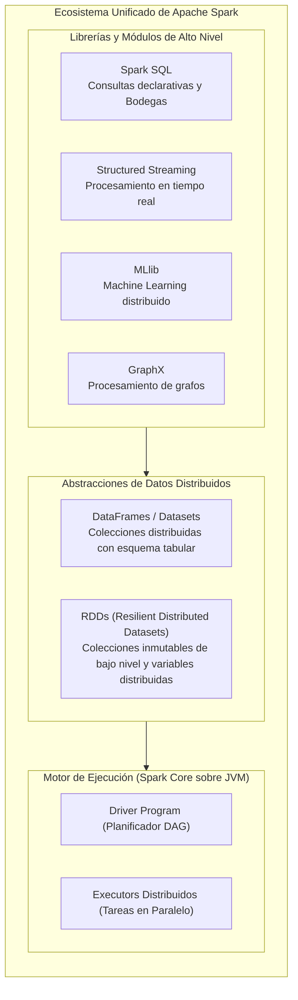
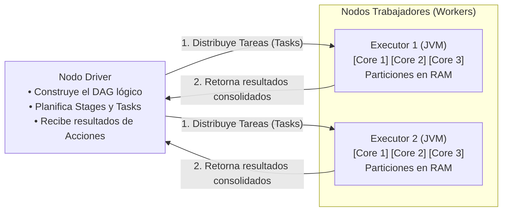
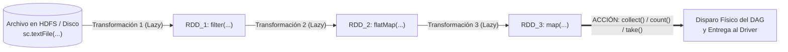
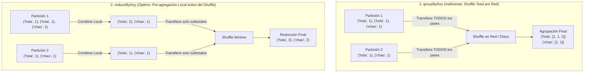
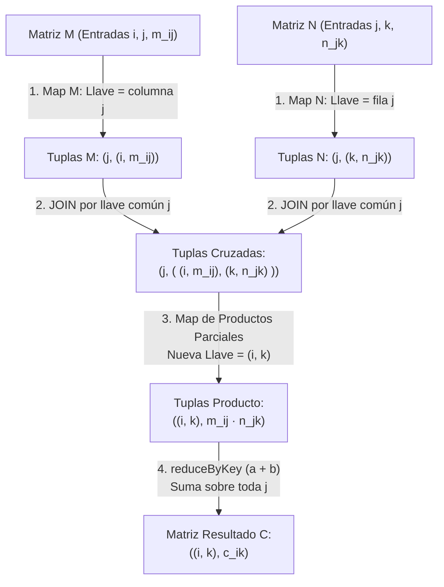

## 1. Fundamentos de Apache Spark y Evolución del Paradigma MapReduce

El procesamiento de volúmenes masivos de datos (*Big Data*) que exceden la capacidad de almacenamiento y memoria de un único servidor dio origen al paradigma **MapReduce** sobre sistemas de archivos distribuidos como **HDFS**. Sin embargo, en la implementación clásica de MapReduce en Hadoop, cada etapa intermedia de cómputo debe materializar sus resultados en disco físico antes de que la siguiente etapa pueda leerlos, generando un cuello de botella de Entrada/Salida (E/S).

**Apache Spark** resuelve esta limitación ejecutando los flujos de procesamiento **directamente en memoria RAM** a través de un motor unificado, recurriendo a la escritura en disco únicamente cuando es necesario consolidar barajados de red (*Shuffle*) o persistir resultados finales.



---

### 1.1 Abstracciones de Datos: RDDs, Datasets y DataFrames

Spark ofrece tres estructuras fundamentales para representar colecciones de datos partidas en fragmentos (**particiones**) distribuidos a lo largo de los nodos de un clúster:

| Abstracción | Estructura y Tipado | Disponibilidad por Lenguaje | Características Técnicas |
| :--- | :--- | :--- | :--- |
| **RDD (*Resilient Distributed Dataset*)** | Colección distribuida de objetos sin esquema tabular estricto. | Scala, Java, **Python (PySpark)**, R. | Nivel más bajo de abstracción; control explícito de particiones y transformaciones funcionales (`map`, `flatMap`, `filter`, `reduceByKey`). |
| **Dataset** | Colección distribuida con **tipado estático fuerte** validado en tiempo de compilación. | Exclusivo de **Scala y Java** (lenguajes nativos de la JVM). | No existe en Python debido a la naturaleza dinámicamente tipada del lenguaje. |
| **DataFrame** | Colección distribuida de filas organizadas en **columnas con nombre** (equivalente a una tabla relacional). | Scala, Java, **Python (PySpark)**, R. | Optimizado automáticamente por el motor *Catalyst* de Spark SQL. |

---

### 1.2 Inmutabilidad y Resiliencia mediante Grafos Acíclicos Dirigidos (DAG)

Todas las abstracciones de datos en Spark comparten tres propiedades arquitectónicas esenciales:

1. **Inmutabilidad**: Al igual que las tuplas en Python o el paradigma de *Infraestructura Inmutable* (donde un contenedor o servidor con Docker/Terraform no se modifica en caliente, sino que se destruye y se recrea a partir de una nueva definición), **un RDD o DataFrame jamás se modifica in-situ**. Cada transformación aplicada sobre un RDD produce un **nuevo RDD** independiente.
2. **Particionamiento Distribuido**: Los datos se dividen lógicamente en particiones que se alojan en la memoria RAM de distintos nodos ejecutores del clúster.
3. **Resiliencia Basada en Linaje (*Lineage* / DAG)**: En lugar de replicar costosas copias en memoria de cada transformación intermedia, Spark registra el historial exacto de operaciones que dieron origen a cada conjunto de datos en un **Grafo Acíclico Dirigido (*Directed Acyclic Graph - DAG*)**. Si un nodo físico falla y se pierde una partición en memoria, Spark consulta el DAG y recalcula únicamente la partición perdida aplicando las transformaciones sobre el bloque original.

---

### 1.3 Arquitectura de Ejecución y Grado de Paralelismo Real

Un clúster de Spark opera bajo una topología coordinada por un proceso **Driver** y múltiples procesos **Executors**:



El **grado de paralelismo real** (número máximo de tareas que el clúster puede ejecutar de manera verdaderamente simultánea en un instante dado) está determinado por el producto del número de ejecutores activos y la cantidad de núcleos de CPU (*cores*) asignados a cada ejecutor:

$$\text{Tareas Simultaneas} = N_{\text{executors}} \times N_{\text{cores por executor}}$$

Por ejemplo, una sesión configurada con $N_{\text{executors}} = 2$ ejecutores y $N_{\text{cores}} = 3$ núcleos por ejecutor procesará exactamente **$6\text{ tareas concurrentes}$** en paralelo.

---

## 2. Evaluación Perezosa (*Lazy Evaluation*): Transformaciones vs. Acciones

El motor de ejecución de Spark separa estrictamente las operaciones sobre RDDs en dos categorías: **Transformaciones** y **Acciones**.



* **Transformaciones (*Lazy / Perezosas*)**: Operaciones como `map`, `flatMap`, `filter`, `distinct`, `sample`, `join` o `reduceByKey` **no ejecutan ningún procesamiento inmediato cuando son invocadas en el código**. Únicamente añaden un nuevo paso al plan de ejecución del grafo **DAG**.
* **Acciones (*Eager / Inmediatas*)**: Operaciones como `collect()`, `count()`, `take(n)` o `saveAsTextFile()` **disparan la compilación y ejecución física de todo el DAG acumulado**, recolectando los resultados desde los ejecutores hacia el programa principal (*Driver*).

> **Precaución Operativa con la Acción `collect()`**: La acción `collect()` transfiere la totalidad de los elementos de todas las particiones del clúster hacia la memoria RAM de la máquina donde corre el *Driver*. Si se invoca `collect()` sobre un RDD de varios gigabytes o terabytes sin haberlo filtrado o reducido previamente, el nodo *Driver* colapsará por desbordamiento de memoria (`OutOfMemoryError`). Para inspeccionar datos durante el desarrollo debe preferirse siempre `take(n)`.

---

### 2.1 Catálogo de Transformaciones y Acciones sobre RDDs en PySpark

#### 1. Diferencia Estructural entre `map` y `flatMap`
Ambas transformaciones aplican una función (habitualmente definida mediante una expresión anónima `lambda`) a cada elemento del RDD origen, pero difieren en la dimensionalidad de su salida:
* **`map(func)` (Relación $1:1$)**: Si el RDD de entrada contiene $N$ líneas de texto y se aplica `line.split(" ")`, el RDD resultante contendrá exactamente $N$ listas de palabras (una lista por cada línea).
* **`flatMap(func)` (Relación $1:M$ con aplanamiento)**: Aplica la función a cada elemento y **aplana (*flattens*)** las colecciones devueltas en un único flujo continuo de elementos individuales. Si entran líneas de texto, `flatMap` entrega directamente todas las palabras sueltas del documento.

```python
# Ejemplo comparativo en PySpark: map vs. flatMap sobre un archivo de 6 líneas
lines_rdd = sc.textFile("data/mensajes.txt")

# 1. map: Devuelve una lista de palabras por cada línea (6 elementos tipo list)
mapped_rdd = lines_rdd.map(lambda line: line.split(" "))
print(mapped_rdd.take(2))
# Salida: [['coffee', 'panda'], ['happy', 'panda']]
print(mapped_rdd.count()) # 6 listas

# 2. flatMap: Aplana la salida entregando cada palabra como un elemento independiente
flat_rdd = lines_rdd.flatMap(lambda line: line.split(" "))
print(flat_rdd.collect())
# Salida: ['coffee', 'panda', 'happy', 'panda', 'coffee', 'party', ...]
```

#### 2. Filtrado Booleano (`filter`), Unicidad (`distinct`) y Muestreo Estadístico (`sample`)

```python
# Lectura de un archivo de logs / código con más de 14 000 líneas
log_rdd = sc.textFile("data/comments.txt")

# 1. filter: Conserva únicamente las líneas que NO contienen el carácter '#'
clean_lines_rdd = log_rdd.filter(lambda line: "#" not in line)
print("Líneas sin comentarios:", clean_lines_rdd.count()) # Ej: 12482

# 2. distinct: Elimina líneas duplicadas en todo el dataset distribuido
unique_lines_rdd = log_rdd.distinct()
print("Líneas únicas:", unique_lines_rdd.count()) # Ej: 2200

# 3. sample(withReplacement, fraction, seed): Extrae una muestra aleatoria del 10% reproducible con semilla 4
sample_rdd = log_rdd.sample(withReplacement=False, fraction=0.10, seed=4)
print(sample_rdd.take(5))
```

---

## 3. Pares Clave-Valor (*Pair RDDs*), el Costo del *Shuffle* y `reduceByKey` vs. `groupByKey`

El paradigma MapReduce opera transformando los datos de entrada en tuplas de la forma **`(llave, valor)`**, donde el primer elemento (`x[0]`) actúa como clave de agrupación y el segundo elemento (`x[1]`) contiene el dato o acumulador numérico.

### 3.1 Anatomía del *Shuffle* y Comparativa `reduceByKey` vs. `groupByKey`

Cuando Spark necesita agrupar o sumar todos los valores asociados a una misma llave $k$, y las tuplas con llave $k$ se encuentran dispersas en diferentes nodos ejecutores, el motor debe ejecutar una operación de **barajado (*Shuffle*)**: redistribuir físicamente los datos a través de la red y consolidar archivos intermedios en disco para que todas las tuplas de una misma llave converjan en el mismo ejecutor.

Existen dos transformaciones para consolidar pares por llave, cuyo comportamiento interno en red difiere drásticamente:



| Operación | Mecánica Interna de Red y Memoria | Impacto en Rendimiento |
| :--- | :--- | :--- |
| **`groupByKey()`** | No realiza ninguna reducción previa; envía **absolutamente todas las tuplas `(k, v)`** a través de la red hacia los nodos destino para construir listas en memoria `(k, [v1, v2, ...])`. | **Alto costo de red y memoria**: Puede saturar el ancho de banda y causar errores de memoria en llaves muy frecuentes. |
| **`reduceByKey(func)`** | Ejecuta primero una **reducción local (*Map-side Combine*)** dentro de cada partición en memoria antes del *Shuffle*, enviando por la red únicamente un subtotal por llave y partición. | **Óptimo**: Minimiza la transferencia de red y el almacenamiento intermedio en disco. |

---

### 3.2 Caso de Estudio 1: Conteo Distribuido de Palabras (*WordCount*)

El caso canónico de MapReduce consiste en contabilizar la frecuencia de aparición de cada palabra dentro de un corpus textual masivo (por ejemplo, la obra completa *Pride and Prejudice* o terabytes de logs de kernel de miles de servidores):

1. **Fase `flatMap`**: Divide cada línea del texto en palabras individuales.
2. **Fase `map`**: Transforma cada palabra `w` en una tupla clave-valor `(w, 1)`.
3. **Fase `reduceByKey`**: Agrupa por la llave `w` y acumula la suma de los unos mediante `lambda a, b: a + b`.

```python
# Pipeline MapReduce completo para conteo distribuido de palabras
texto_rdd = sc.textFile("data/pride_and_prejudice.txt")

conteo_palabras_rdd = (
    texto_rdd
    .flatMap(lambda line: line.split(" "))       # 1. Aplana líneas en palabras individuales
    .map(lambda word: (word, 1))                 # 2. Crea tupla (llave=palabra, valor=1)
    .reduceByKey(lambda a, b: a + b)             # 3. Suma acumulativa por llave con pre-agregación local
)

# Disparo del DAG mediante la acción take(20)
print(conteo_palabras_rdd.take(20))
# Ejemplo de salida: [('of', 3554), ('the', 4052), ('to', 4088), ...]
```

---

## 4. Álgebra Lineal Distribuida: Multiplicación de Matrices mediante MapReduce

Cuando las dimensiones de dos matrices son del orden de millones de filas y columnas (como ocurre en motores de recomendación, grafos web o entrenamiento de modelos a gran escala), la multiplicación matricial no cabe en la memoria RAM de una sola máquina y debe descomponerse mediante operaciones relacionales y funcionales de **MapReduce (`map`, `join` y `reduceByKey`)**.

### 4.1 Formulación Algebraica y el Truco de la Llave Intermedia ($j$)

Considérese una matriz $M$ de dimensiones $P \times Q$ con entradas $m_{ij}$ ($1 \le i \le P$, $1 \le j \le Q$) y una matriz $N$ de dimensiones $Q \times R$ con entradas $n_{jk}$ ($1 \le j \le Q$, $1 \le k \le R$). La condición necesaria para que el producto $C = M \cdot N$ esté definido es que **el número de columnas de $M$ coincida exactamente con el número de filas de $N$ ($Q$)**.

Cada entrada $c_{ik}$ de la matriz resultante $C$ (de dimensiones $P \times R$) se define como el producto punto entre la fila $i$ de $M$ y la columna $k$ de $N$:

$$c_{ik} = \sum_{j=1}^{Q} m_{ij} \cdot n_{jk}$$

Observando la sumatoria, el elemento $m_{ij}$ y el elemento $n_{jk}$ se multiplican entre sí **sí y solo si comparten el mismo índice intermedio $j$** (es decir, el número de columna $j$ en $M$ es igual al número de fila $j$ en $N$).



---

### 4.2 Demostración Paso a Paso con Matrices Numéricas

Considérese el producto de la matriz $M_{3 \times 3}$ por la matriz $N_{3 \times 2}$:

$$M = \begin{pmatrix} 1 & 0 & 2 \\ 3 & 1 & 2 \\ 1 & 2 & 1 \end{pmatrix}, \qquad N = \begin{pmatrix} 2 & 0 \\ 1 & 1 \\ 0 & 2 \end{pmatrix}$$

Calculando analíticamente cada posición $(i, k)$ de la matriz resultado $C = M \cdot N$:

$$\begin{aligned}
c_{1,1} &= (1)(2) + (0)(1) + (2)(0) = 2 + 0 + 0 = \mathbf{2}, & c_{1,2} &= (1)(0) + (0)(1) + (2)(2) = 0 + 0 + 4 = \mathbf{4} \\
c_{2,1} &= (3)(2) + (1)(1) + (2)(0) = 6 + 1 + 0 = \mathbf{7}, & c_{2,2} &= (3)(0) + (1)(1) + (2)(2) = 0 + 1 + 4 = \mathbf{5} \\
c_{3,1} &= (1)(2) + (2)(1) + (1)(0) = 2 + 2 + 0 = \mathbf{4}, & c_{3,2} &= (1)(0) + (2)(1) + (1)(2) = 0 + 2 + 2 = \mathbf{4}
\end{aligned}$$

$$C = M \cdot N = \begin{pmatrix} 2 & 4 \\ 7 & 5 \\ 4 & 4 \end{pmatrix}$$

---

#### Trazabilidad de las 4 Etapas en el Pipeline MapReduce:

#### Etapa 1: Representación Dispersa (*Sparse*) y Preprocesamiento por Llave $j$
Las entradas cuyo valor es $0$ ($m_{1,2} = 0$, $n_{1,2} = 0$, $n_{3,1} = 0$) se omiten del almacenamiento porque cualquier multiplicación por cero aporta $0$ a la suma final.
* **Para la matriz $M$** $(i, j, m_{ij}) \longrightarrow \big(j, \ (i, m_{ij})\big)$ (se coloca la **columna $j$** como llave):
  * Columna $j = 1$: `(1, (1, 1))`, `(1, (2, 3))`, `(1, (3, 1))`
  * Columna $j = 2$: `(2, (2, 1))`, `(2, (3, 2))`
  * Columna $j = 3$: `(3, (1, 2))`, `(3, (2, 2))`, `(3, (3, 1))`
* **Para la matriz $N$** $(j, k, n_{jk}) \longrightarrow \big(j, \ (k, n_{jk})\big)$ (se coloca la **fila $j$** como llave):
  * Fila $j = 1$: `(1, (1, 2))`
  * Fila $j = 2$: `(2, (1, 1))`, `(2, (2, 1))`
  * Fila $j = 3$: `(3, (2, 2))`

#### Etapa 2: Operación `join` sobre los RDDs por la Llave Común $j$
Al ejecutar `M_rdd.join(N_rdd)`, Spark empareja todas las tuplas de $M$ y $N$ que tienen la misma llave $j$, produciendo elementos con la estructura anidada `x = (j, ((i, m_ij), (k, n_jk)))`:

| Llave Común $j$ (`x[0]`) | Tupla de $M$: `(i, m_ij)` (`x[1][0]`) | Tupla de $N$: `(k, n_jk)` (`x[1][1]`) | Elemento Generado por `join` (`x`) |
| :---: | :---: | :---: | :--- |
| `1` | `(1, 1)` | `(1, 2)` | `(1, ((1, 1), (1, 2)))` |
| `1` | `(2, 3)` | `(1, 2)` | `(1, ((2, 3), (1, 2)))` |
| `1` | `(3, 1)` | `(1, 2)` | `(1, ((3, 1), (1, 2)))` |
| `2` | `(2, 1)` | `(1, 1)` | `(2, ((2, 1), (1, 1)))` |
| `2` | `(2, 1)` | `(2, 1)` | `(2, ((2, 1), (2, 1)))` |
| `2` | `(3, 2)` | `(1, 1)` | `(2, ((3, 2), (1, 1)))` |
| `2` | `(3, 2)` | `(2, 1)` | `(2, ((3, 2), (2, 1)))` |
| `3` | `(1, 2)` | `(2, 2)` | `(3, ((1, 2), (2, 2)))` |
| `3` | `(2, 2)` | `(2, 2)` | `(3, ((2, 2), (2, 2)))` |
| `3` | `(3, 1)` | `(2, 2)` | `(3, ((3, 1), (2, 2)))` |

#### Etapa 3: Mapeo de Indexación Anidada y Multiplicación Parcial
Sobre cada elemento `x = (j, ((i, m_ij), (k, n_jk)))` devuelto por el `join`, se desestructura la posición jerárquica en Python:
* `x[0]` $\longrightarrow$ índice intermedio $j$ (ya cumplió su propósito de cruce y se descarta).
* `x[1][0][0]` $\longrightarrow$ fila $i$ de la matriz $M$.
* `x[1][1][0]` $\longrightarrow$ columna $k$ de la matriz $N$.
* `x[1][0][1]` $\longrightarrow$ valor escalar $m_{ij}$.
* `x[1][1][1]` $\longrightarrow$ valor escalar $n_{jk}$.

La función `lambda x: ((x[1][0][0], x[1][1][0]), x[1][0][1] * x[1][1][1])` emite los pares `((i, k), m_ij * n_jk)`:
* Para $(1, 1)$: `((1, 1), 2)`
* Para $(1, 2)$: `((1, 2), 4)`
* Para $(2, 1)$: `((2, 1), 6)` y `((2, 1), 1)`
* Para $(2, 2)$: `((2, 2), 1)` y `((2, 2), 4)`
* Para $(3, 1)$: `((3, 1), 2)` y `((3, 1), 2)`
* Para $(3, 2)$: `((3, 2), 2)` y `((3, 2), 2)`

#### Etapa 4: Reducción Final por Coordenada (`reduceByKey`)
Al aplicar `reduceByKey(lambda a, b: a + b)`, Spark suma todos los productos parciales que comparten la misma coordenada `(i, k)`:
* `(1, 1)` $\longrightarrow 2$
* `(1, 2)` $\longrightarrow 4$
* `(2, 1)` $\longrightarrow 6 + 1 = 7$
* `(2, 2)` $\longrightarrow 1 + 4 = 5$
* `(3, 1)` $\longrightarrow 2 + 2 = 4$
* `(3, 2)` $\longrightarrow 2 + 2 = 4$

---

### 4.3 Implementación Completa en PySpark

```python
# Representación dispersa (sparse) de las matrices M (i, j, valor) y N (j, k, valor)
datos_M = [
    (1, 1, 1), (2, 1, 3), (3, 1, 1),
    (2, 2, 1), (3, 2, 2),
    (1, 3, 2), (2, 3, 2), (3, 3, 1)
]

datos_N = [
    (1, 1, 2),
    (2, 1, 1), (2, 2, 1),
    (3, 2, 2)
]

rdd_M = sc.parallelize(datos_M)
rdd_N = sc.parallelize(datos_N)

# Paso 1: Emitir tuplas con el índice intermedio j como llave
# M: (i, j, m_ij) -> (j, (i, m_ij))
M_por_j = rdd_M.map(lambda t: (t[1], (t[0], t[2])))

# N: (j, k, n_jk) -> (j, (k, n_jk))
N_por_j = rdd_N.map(lambda t: (t[0], (t[1], t[2])))

# Paso 2: Join por la llave común j -> (j, ((i, m_ij), (k, n_jk)))
cruce_j = M_por_j.join(N_por_j)

# Paso 3: Mapear a la coordenada destino ((i, k), m_ij * n_jk)
productos_parciales = cruce_j.map(
    lambda x: ((x[1][0][0], x[1][1][0]), x[1][0][1] * x[1][1][1])
)

# Paso 4: Sumar productos parciales por cada coordenada (i, k)
matriz_resultado = productos_parciales.reduceByKey(lambda a, b: a + b).sortByKey()

for coord, valor in matriz_resultado.collect():
    print(f"C{coord} = {valor}")
```

---

## 5. Reflexión: Del Álgebra Relacional al Procesamiento Funcional Distribuido

El estudio de **Apache Spark y MapReduce** revela una profunda convergencia entre los fundamentos de las bases de datos relacionales y la computación distribuida a gran escala:

1. **Equivalencia entre el Optimizador de Consultas y el Planificador DAG**: La **evaluación perezosa (*Lazy Evaluation*)** de Spark cumple exactamente el mismo rol arquitectónico que el compilador y optimizador de consultas en un SGBD relacional. Al postergar la ejecución física hasta que aparece una acción, el motor puede inspeccionar el grafo completo de transformaciones, fusionar etapas en memoria (*pipelining*) y minimizar escrituras innecesarias en disco.
2. **El `JOIN` como Primitiva Universal de Cómputo**: El algoritmo de multiplicación de matrices mediante MapReduce demuestra que incluso problemas clásicos de álgebra lineal numérica pueden reformularse como un **emparejamiento relacional por llave (`join`)** seguido de una agregación agrupada (`reduceByKey`). Asimismo, la distinción entre `reduceByKey` (con pre-agregación local) y `groupByKey` refleja el mismo principio de optimización heurística visto en álgebra relacional: reducir el volumen de datos lo más cerca posible del origen antes de transferir bloques a través de la red o del disco.

---

## 6. Referencias y Enlaces de Interés

1. **Zaharia, M., Chowdhury, M., Das, T., Dave, A., Ma, J., McCauley, M., Franklin, M. J., Shenker, S., & Stoica, I. (2012)**. *Resilient Distributed Datasets: A Fault-Tolerant Abstraction for In-Memory Cluster Computing*. Proceedings of the 9th USENIX Symposium on Networked Systems Design and Implementation (NSDI '12), 15–28. [https://www.usenix.org/conference/nsdi12/technical-sessions/presentation/zaharia](https://www.usenix.org/conference/nsdi12/technical-sessions/presentation/zaharia).
2. **Dean, J., & Ghemawat, S. (2004)**. *MapReduce: Simplified Data Processing on Large Clusters*. Communications of the ACM, 51(1), 107–113. [https://research.google/pubs/mapreduce-simplified-data-processing-on-large-clusters/](https://research.google/pubs/mapreduce-simplified-data-processing-on-large-clusters/).
3. **Leskovec, J., Rajaraman, A., & Ullman, J. D. (2020)**. *Mining of Massive Datasets* (3rd ed.). Cambridge University Press. Chapter 2: *MapReduce and the New Software Stack (Matrix Multiplication by MapReduce)*. [https://www.mmds.org/](https://www.mmds.org/).
4. **Apache Software Foundation (2026)**. *Spark Programming Guide: Resilient Distributed Datasets (RDDs), Transformations, Actions, and Shuffle Operations*. [https://spark.apache.org/docs/latest/rdd-programming-guide.html](https://spark.apache.org/docs/latest/rdd-programming-guide.html).

---

*Publicado por [Mateo Vargas Tirado](https://github.com/araigumadev) como parte del registro de aprendizaje en el curso Bases de Datos 2026/2 - Universidad de Antioquia.*
