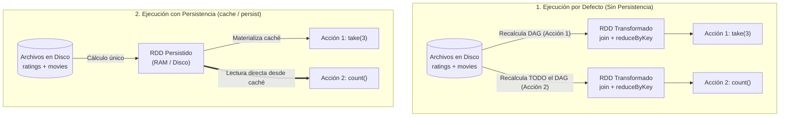
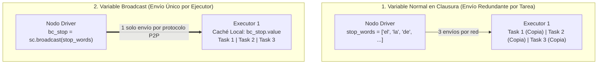
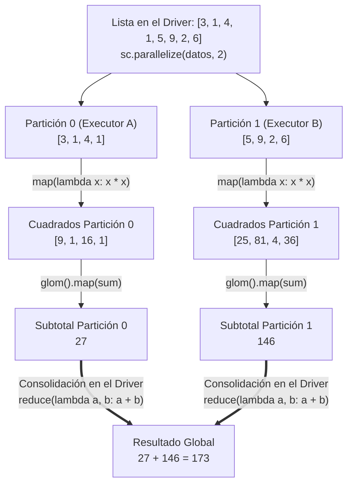
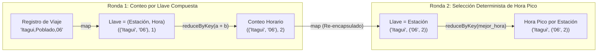

## 1. Persistencia y Almacenamiento en Caché de RDDs (`cache`, `persist` y `StorageLevel`)

En **Apache Spark**, la evaluación perezosa (*Lazy Evaluation*) posterga la ejecución de cualquier transformación hasta que se invoca una **acción** (`collect()`, `take(n)`, `count()`, `reduce()`). Sin embargo, el comportamiento por defecto de un **RDD (*Resilient Distributed Dataset*)** es efímero: cada vez que se ejecuta una acción sobre un RDD derivado, Spark **recalcula todo el linaje del grafo acíclico dirigido (DAG) desde el almacenamiento de origen**, a menos que el estado intermedio haya sido persistido explícitamente.

Cuando un pipeline incluye transformaciones computacionalmente costosas (como cruces `join`, reducciones `reduceByKey` sobre grandes volúmenes o limpiezas complejas de texto) y su resultado va a ser reutilizado en múltiples acciones posteriores o algoritmos iterativos, recomputar todo el DAG degrada drásticamente el tiempo de respuesta.



---

### 1.1 Anatomía de `StorageLevel` y Niveles de Persistencia

Spark controla la estrategia física de almacenamiento de un RDD mediante el objeto **`StorageLevel`**, cuya firma interna consta de cinco parámetros booleanos y numéricos:

$$\text{StorageLevel}(\text{useDisk}, \ \text{useMemory}, \ \text{useOffHeap}, \ \text{deserialized}, \ \text{replication})$$

| Parámetro | Tipo | Significado Técnico en el Motor de Ejecución |
| :--- | :---: | :--- |
| **`useDisk`** | `bool` | Permite almacenar o desbordar (*spill*) particiones en el disco local del nodo ejecutor cuando la memoria RAM es insuficiente. |
| **`useMemory`** | `bool` | Almacena las particiones directamente en la memoria RAM gestionada por el ejecutor. |
| **`useOffHeap`** | `bool` | Utiliza memoria fuera del *Heap* de la JVM (*Off-Heap Memory*) para evitar la sobrecarga del recolector de basura (*Garbage Collector*). |
| **`deserialized`** | `bool` | `True` conserva los objetos en su representación nativa en memoria (acceso más rápido); `False` los almacena como flujos de bytes serializados (menor consumo de RAM). |
| **`replication`** | `int` | Factor de replicación de cada partición persistida en distintos nodos del clúster ($1$ por defecto; $2$ para tolerancia inmediata a fallos sin recalcular). |

Los niveles preconfigurados más utilizados en ingeniería de datos son:

| Nivel de Persistencia | Configuración Interna `(Disk, Mem, OffHeap, Deser, Rep)` | Caso de Uso Recomendado |
| :--- | :---: | :--- |
| **Sin persistencia (Por defecto)** | `(False, False, False, False, 1)` | Pipelines lineales de una sola pasada donde ningún RDD intermedio vuelve a consultarse. |
| **`MEMORY_ONLY` / `.cache()`** | `(False, True, False, True, 1)` | Máxima velocidad en memoria RAM cuando el dataset intermedio cabe holgadamente en los ejecutores. *(En PySpark, los objetos siempre se almacenan serializados con Pickle, por lo que `deserialized` se reporta como `False`)*. |
| **`MEMORY_AND_DISK`** | `(True, True, False, True, 1)` | Escenarios de producción donde el dataset puede exceder la RAM disponible; las particiones que no caben en RAM se escriben en disco en lugar de ser recalculadas desde cero. |
| **`MEMORY_AND_DISK_2`** | `(True, True, False, True, 2)` | Pipelines críticos donde un fallo de nodo no puede permitirse el tiempo de recomputación del linaje; mantiene **dos réplicas** de cada partición en nodos distintos. |
| **`DISK_ONLY`** | `(True, False, False, False, 1)` | Puntos de control (*checkpoints*) sobre datasets masivos cuando la memoria RAM debe reservarse para otras etapas del flujo. |

> **Liberación de Recursos con `unpersist()`**: Toda partición almacenada en caché consume memoria RAM y espacio en disco en los nodos trabajadores. Una vez que el RDD persistido ya no se requiere en las etapas restantes del notebook o pipeline, es una buena práctica invocar `.unpersist()` para liberar inmediatamente los bloques de almacenamiento.

---

### 1.2 Caso Práctico: Agregación y Cruce de Calificaciones de Películas con Persistencia

En el siguiente flujo se procesan dos conjuntos de datos: un archivo de calificaciones de usuarios (`ratings.txt` con estructura `user_id, movie_id, rating, timestamp`) y un catálogo de películas (`movies.txt` con estructura `movie_id, title, genres`). Se compara la ejecución sin persistencia, con `.cache()` y con `.persist(StorageLevel.MEMORY_AND_DISK_2)`:

```python
from pyspark import StorageLevel

# 1. Lectura de datasets base
ratings_raw = sc.textFile("data/ratings.txt")
movies_raw = sc.textFile("data/movies.txt")

# Funciones de extracción (parsing)
def extract_movie_rating(line):
    fields = line.split(",")
    return (int(fields[1]), float(fields[2]))  # (movie_id, rating)

def extract_movie_title(line):
    fields = line.split(",")
    return (int(fields[0]), fields[1])         # (movie_id, title)

# --- ESCENARIO A: Sin Persistencia (Por Defecto) ---
movie_ratings = ratings_raw.map(extract_movie_rating).reduceByKey(lambda a, b: a + b)
movies_rdd = movies_raw.map(extract_movie_title)

print("Nivel por defecto:", movie_ratings.getStorageLevel())
# Salida: StorageLevel(False, False, False, False, 1) -> Disk: No, Memory: No, Rep: 1

# --- ESCENARIO B: Persistencia en Memoria con .cache() ---
movie_ratings_cached = (
    ratings_raw
    .map(extract_movie_rating)
    .reduceByKey(lambda a, b: a + b)
    .cache()  # Equivalente a persist(StorageLevel.MEMORY_ONLY)
)

print("Nivel con cache():", movie_ratings_cached.getStorageLevel())
# Salida en PySpark: StorageLevel(False, True, False, False, 1) -> Memory: True, Rep: 1
print("Muestra de suma de ratings:", movie_ratings_cached.take(4))

# --- ESCENARIO C: Persistencia Híbrida Replicada (MEMORY_AND_DISK_2) ---
# Cruce (JOIN) por movie_id y ordenamiento por calificación acumulada
joined_results = (
    movies_rdd
    .join(movie_ratings_cached)                # (movie_id, (title, total_rating))
    .map(lambda x: (x[1][0], x[1][1]))         # (title, total_rating)
    .persist(StorageLevel.MEMORY_AND_DISK_2)   # Se declara ANTES de la acción que consolida el DAG
)

# La acción take(3) dispara el DAG y materializa las 2 réplicas en memoria/disco
top_movies = joined_results.take(3)
print("Nivel con MEMORY_AND_DISK_2:", joined_results.getStorageLevel())
# Salida: StorageLevel(True, True, False, False, 2) -> Disk: True, Memory: True, Rep: 2

# Liberación explícita de memoria caché al finalizar el procesamiento
movie_ratings_cached.unpersist()
joined_results.unpersist()
```

---

## 2. Variables Compartidas de Solo Lectura: *Broadcast Variables*

Cuando una transformación (`map` o `filter`) referencia una variable local definida en el programa principal (*Driver*), como un diccionario de búsqueda o una lista de palabras vacías (*Stop Words*), Spark serializa y envía una copia de esa variable **junto con cada tarea (*Task*)** a través de la red. Si un trabajo tiene $1\,000$ tareas repartidas en $10$ ejecutores, la misma estructura se transmite $1\,000$ veces por la red.

Las **Variables *Broadcast* (`sc.broadcast(v)`)** optimizan este patrón manteniendo **una única copia inmutable de solo lectura en caché por cada nodo ejecutor (*Executor*)**, en lugar de enviarla con cada tarea:



### 2.1 Caso Práctico: Filtrado de *Stop Words* en Procesamiento de Lenguaje Natural (NLP)

En minería de texto y **Procesamiento de Lenguaje Natural (NLP)**, palabras funcionales de alta frecuencia como artículos, preposiciones y conjunciones (`"el"`, `"la"`, `"de"`, `"y"`, `"en"`) no aportan peso semántico al análisis y deben filtrarse antes de contabilizar frecuencias. Difundir la lista de *Stop Words* mediante `sc.broadcast()` evita lecturas repetitivas de archivos o transferencias redundantes en el clúster:

```python
# 1. Definición de la lista de Stop Words en el Driver y difusión a los ejecutores
lista_stop_words = ["el", "la", "los", "las", "un", "una", "de", "en", "y", "a", "que", "es"]
broadcast_stop_words = sc.broadcast(lista_stop_words)

# 2. Carga de corpus textual y limpieza utilizando el atributo .value de la variable Broadcast
lineas_rdd = sc.parallelize([
    "el procesamiento distribuido en spark es rapido",
    "la memoria en spark acelera el analisis de datos",
    "el analisis de datos distribuidos usa mapreduce"
])

conteo_semantico_rdd = (
    lineas_rdd
    .flatMap(lambda linea: linea.lower().split())
    # Cada ejecutor consulta su copia local mediante broadcast_stop_words.value
    .filter(lambda palabra: palabra not in broadcast_stop_words.value)
    .map(lambda palabra: (palabra, 1))
    .reduceByKey(lambda a, b: a + b)
)

print(conteo_semantico_rdd.take(10))
# Salida: [('procesamiento', 1), ('distribuido', 1), ('spark', 2), ('rapido', 1), ('memoria', 1), ...]
```

---

## 3. Paralelización en Memoria, Particionamiento Físico (`glom`) y Reducción Jerárquica

Durante el diseño y prueba de algoritmos distribuidos, no siempre es necesario leer archivos externos desde HDFS o almacenamiento en la nube. El método **`sc.parallelize(coleccion, numSlices)`** permite distribuir una lista nativa de Python en memoria indicando explícitamente en cuántas **particiones físicas** debe dividirse el conjunto de datos.

Para inspeccionar cómo Spark divide y procesa internamente los datos dentro de cada partición antes de enviarlos al *Driver*, se utiliza la transformación **`.glom()`**, la cual agrupa todos los elementos de cada partición en una lista independiente.



### 3.1 Demostración de Reducción por Pares y Particiones con `glom()`

La acción **`reduce(func)`** aplica una función binaria de dos en dos elementos ($a, b$), donde el resultado acumulado se convierte en el primer argumento $a$ de la siguiente invocación:

$$\text{Para } [9, 1, 16, 1, 25, 81, 4, 36]: \quad (((((((9 + 1) + 16) + 1) + 25) + 81) + 4) + 36) = 173$$

```python
# 1. Creación de un RDD distribuido en exactamente 2 particiones
numeros_rdd = sc.parallelize([3, 1, 4, 1, 5, 9, 2, 6], 2)

# Transformación map: eleva cada elemento al cuadrado (Lazy: solo construye el DAG)
cuadrados_rdd = numeros_rdd.map(lambda x: x * x)

# Acción collect(): devuelve una lista estándar de Python en el Driver
print("Cuadrados:", cuadrados_rdd.collect())
# Salida: [9, 1, 16, 1, 25, 81, 4, 36]

# 2. Reducción global: suma de cuadrados y búsqueda del elemento máximo
suma_cuadrados = cuadrados_rdd.reduce(lambda a, b: a + b)
maximo_valor = numeros_rdd.reduce(lambda a, b: a if a > b else b)

print("Suma total de cuadrados:", suma_cuadrados)  # 173
print("Valor máximo original:", maximo_valor)      # 9

# 3. Inspección física de particiones con glom()
particiones_fisicas = cuadrados_rdd.glom().collect()
print("Datos divididos en 2 particiones:", particiones_fisicas)
# Salida: [[9, 1, 16, 1], [25, 81, 4, 36]]

# Suma parcial ejecutada independientemente en cada partición
subtotales_por_particion = cuadrados_rdd.glom().map(sum).collect()
print("Subtotales por partición:", subtotales_por_particion)
# Salida: [27, 146] -> Total consolidado: sum([27, 146]) = 173
```

---

## 4. Propiedades Algebraicas en MapReduce y el Patrón del Promedio Distribuido

Para que una operación de reducción (`reduce` o `reduceByKey`) produzca un resultado determinista y correcto en un entorno distribuido donde las particiones se procesan en paralelo y en orden arbitrario, la función binaria $f(a, b)$ **debe satisfacer obligatoriamente dos propiedades algebraicas**:

1. **Asociatividad**: $f\big(f(a, b), c\big) = f\big(a, f(b, c)\big)$. Permite agrupar y pre-reducir subconjuntos en cualquier partición local antes de combinar los resultados globales.
2. **Conmutatividad**: $f(a, b) = f(b, a)$. Garantiza que el orden en que los ejecutores terminen y entreguen sus subtotales por la red no altere el resultado final.

Operaciones como la suma ($a + b$), el producto ($a \cdot b$), el máximo ($\max(a, b)$) y el mínimo ($\min(a, b)$) son asociativas y conmutativas. Sin embargo, **la media aritmética (promedio) NO es asociativa**.

### 4.1 Demostración de la No-Asociatividad del Promedio

Supóngase que se tienen tres mediciones $\{120, 60, 90\}$ cuyo promedio real es:

$$\bar{x}_{\text{real}} = \frac{120 + 60 + 90}{3} = \frac{270}{3} = 90$$

Si una función intentara reducir de par en par aplicando $f(a, b) = \frac{a + b}{2}$:
* **Agrupación 1**: $f\big(f(120, 60), 90\big) = f(90, 90) = \frac{90 + 90}{2} = \mathbf{90}$.
* **Agrupación 2**: $f\big(120, f(60, 90)\big) = f(120, 75) = \frac{120 + 75}{2} = \mathbf{97.5} \neq 90$.

En general, **el promedio de los promedios parciales no es igual al promedio global** cuando las particiones contienen distinto número de elementos:

$$\frac{1}{2}\left(\frac{\sum_{i=1}^{n_1} x_i}{n_1} + \frac{\sum_{j=1}^{n_2} y_j}{n_2}\right) \neq \frac{\sum_{i=1}^{n_1} x_i + \sum_{j=1}^{n_2} y_j}{n_1 + n_2}$$

### 4.2 El Patrón Canónico de Tupla Acumuladora `(suma, conteo)`

Para volver asociativa y conmutativa la operación de promedio en MapReduce, cada valor escalar $v$ se transforma primero en un vector de dos componentes **`(v, 1)`** que representa `(suma_parcial, conteo_parcial)`. La reducción suma componente a componente (lo cual sí es estrictamente asociativo y conmutativo), y la división se realiza únicamente al final:

$$\text{Fase 1 (mapValues): } v \longrightarrow (v, \ 1)$$

$$\text{Fase 2 (reduceByKey): } (s_a, c_a) \oplus (s_b, c_b) = (s_a + s_b, \ c_a + c_b)$$

$$\text{Fase 3 (mapValues final): } (S_{\text{total}}, C_{\text{total}}) \longrightarrow \frac{S_{\text{total}}}{C_{\text{total}}}$$

---

## 5. Casos de Estudio y Patrones de Ingeniería con MapReduce en PySpark

### 5.1 Analítica Comercial por Ciudad y Procesamiento de Calificaciones Académicas

#### A. Analítica de Ventas por Ciudad (Totales, Frecuencias, Listas y Promedio)
Dado un conjunto de transacciones `(ciudad, monto)`, se requiere obtener: el monto total vendido por ciudad, el número total de transacciones, el listado detallado de ventas por ciudad y el promedio por venta:

```python
ventas_rdd = sc.parallelize([
    ("Medellin", 120), ("Bogota", 200), ("Medellin", 60),
    ("Cali", 40),      ("Bogota", 150), ("Cali", 80),
    ("Medellin", 90),  ("Bogota", 50)
])

# 1. Total de ventas por ciudad: suma directa de los valores asociados a cada llave
total_por_ciudad = ventas_rdd.reduceByKey(lambda a, b: a + b)
print("Totales:", total_por_ciudad.collect())
# Salida: [('Medellin', 270), ('Bogota', 400), ('Cali', 120)]

# 2. Número de ventas por ciudad: se proyecta cada tupla a (ciudad, 1) y se suma
conteo_ventas = (
    ventas_rdd
    .map(lambda kv: (kv[0], 1))
    .reduceByKey(lambda a, b: a + b)
)
print("Número de ventas:", conteo_ventas.collect())
# Salida: [('Medellin', 3), ('Bogota', 3), ('Cali', 2)]

# 3. Lista de montos por ciudad usando groupByKey()
# Nota: groupByKey agrupa en un iterable sin reducir; usar con precaución en volúmenes masivos
listas_por_ciudad = ventas_rdd.groupByKey().mapValues(list)
print("Listas de ventas:", listas_por_ciudad.collect())
# Salida: [('Medellin', [120, 60, 90]), ('Bogota', [200, 150, 50]), ('Cali', [40, 80])]

# 4. Promedio de ventas por ciudad mediante tupla acumuladora (suma, conteo)
suma_y_conteo = (
    ventas_rdd
    .mapValues(lambda v: (v, 1))                               # ('Medellin', (120, 1))
    .reduceByKey(lambda a, b: (a[0] + b[0], a[1] + b[1]))      # ('Medellin', (270, 3))
)

promedio_por_ciudad = suma_y_conteo.mapValues(lambda s: round(s[0] / s[1], 2))
print("Promedios:", promedio_por_ciudad.collect())
# Salida: [('Medellin', 90.0), ('Bogota', 133.33), ('Cali', 60.0)]
```

#### B. Procesamiento de Registros CSV de Notas con Funciones Explícitas (`def`)
Cuando la lógica de transformación involucra desestructuración de múltiples columnas y conversión de tipos, es preferible definir una función estándar de Python con `def` en lugar de una expresión `lambda` compleja:

```python
registros_csv = sc.parallelize([
    "Ana,Bases de Datos,4.5",   "Luis,Bases de Datos,3.2",
    "Ana,Algoritmos,3.8",       "Sara,Bases de Datos,4.0",
    "Luis,Algoritmos,4.4",      "Ana,Estadistica,4.2",
    "Sara,Algoritmos,3.9",      "Sara,Estadistica,4.0"
])

# Función de parsing explícita: convierte el tercer campo de texto a flotante (float)
def parsear_estudiante_nota(linea):
    estudiante, materia, nota = linea.split(",")
    return (estudiante, float(nota))

notas_rdd = registros_csv.map(parsear_estudiante_nota)

# Nota máxima y mínima por estudiante usando las funciones nativas max y min
nota_maxima = notas_rdd.reduceByKey(max)
nota_minima = notas_rdd.reduceByKey(min)

# Promedio por estudiante con el patrón (nota, 1)
promedio_notas = (
    notas_rdd
    .mapValues(lambda n: (n, 1))
    .reduceByKey(lambda a, b: (a[0] + b[0], a[1] + b[1]))
    .mapValues(lambda s: round(s[0] / s[1], 2))
)

# Listado de materias cursadas por estudiante
materias_por_estudiante = (
    registros_csv
    .map(lambda l: (l.split(",")[0], l.split(",")[1]))
    .groupByKey()
    .mapValues(list)
)

print("Máximas:", nota_maxima.collect())         # [('Ana', 4.5), ('Luis', 4.4), ('Sara', 4.0)]
print("Mínimas:", nota_minima.collect())         # [('Ana', 3.8), ('Luis', 3.2), ('Sara', 3.9)]
print("Promedios:", promedio_notas.collect())    # [('Ana', 4.17), ('Luis', 3.8), ('Sara', 3.97)]
print("Materias:", materias_por_estudiante.collect())
```

---

### 5.2 Observabilidad y Análisis Distribuido de Logs de Servidores

Uno de los casos de uso fundacionales de MapReduce y Spark en ingeniería de infraestructura es el análisis de **archivos de registro (*Server Logs*)** de sistemas operativos Linux (kernel, demonios de autenticación, servidores web y bases de datos) para cuantificar eventos por nivel de severidad (`INFO`, `WARN`, `ERROR`) e identificar franjas horarias de incidentes:

```python
logs_servidor = sc.parallelize([
    "08:12:01 INFO Usuario autenticado correctamente",
    "08:15:44 ERROR Conexion rechazada a la base de datos",
    "08:40:10 WARN Uso de memoria al 80%",
    "09:02:11 ERROR Tiempo de espera agotado en replica",
    "09:18:55 INFO Backup incremental finalizado",
    "09:45:30 ERROR Conexion rechazada en nodo secundario",
    "10:05:00 WARN Latencia de disco elevada",
    "10:20:15 INFO Servicio reiniciado"
])

# 1. Conteo global de eventos por nivel de severidad (columna 1 tras aplicar split)
conteo_por_nivel = (
    logs_servidor
    .map(lambda l: (l.split()[1], 1))
    .reduceByKey(lambda a, b: a + b)
)
print("Eventos por nivel:", conteo_por_nivel.collect())
# Salida: [('INFO', 3), ('ERROR', 3), ('WARN', 2)]

# 2. Filtrado exclusivo de líneas de ERROR y agregación por franja horaria (HH:00)
errores_rdd = logs_servidor.filter(lambda l: l.split()[1] == "ERROR")

errores_por_hora = (
    errores_rdd
    .map(lambda l: (l.split()[0][:2] + ":00", 1))
    .reduceByKey(lambda a, b: a + b)
)
print("Errores por hora:", errores_por_hora.collect())
# Salida: [('08:00', 1), ('09:00', 2)]

# 3. Agrupación de los mensajes descriptivos de error por cada franja horaria
mensajes_error_por_hora = (
    errores_rdd
    .map(lambda l: (l.split()[0][:2] + ":00", " ".join(l.split()[2:])))
    .groupByKey()
    .mapValues(list)
)
print("Detalle de errores por hora:", mensajes_error_por_hora.collect())
# Salida: [
#   ('08:00', ['Conexion rechazada a la base de datos']),
#   ('09:00', ['Tiempo de espera agotado en replica', 'Conexion rechazada en nodo secundario'])
# ]
```

---

### 5.3 Patrones Avanzados de Laboratorio: Transporte Masivo y Telemetría con Limpieza de Datos

Durante la sesión práctica de diseño de pipelines MapReduce se abordaron patrones de ingeniería que extienden el modelo básico de una sola etapa hacia **desdoblamientos múltiples (`flatMap`)**, **pipelines de múltiples rondas con desempate determinista** y **agregaciones vectoriales en una sola pasada**:



#### 1. Flujo en Estaciones de Metro: Desdoblamiento con `flatMap` y Hora Pico en Dos Rondas
Cada registro de viaje en el sistema de transporte contiene `(estacion_origen, estacion_destino, hora)`:
* **Entradas y salidas simultáneas**: Dado que un único viaje involucra **dos estaciones** (una entrada en el origen y una salida en el destino), una transformación `map` ($1:1$) es insuficiente. Se utiliza **`flatMap` ($1:2$)** para emitir dos pares por cada viaje: `(origen, (1, 0))` y `(destino, (0, 1))`, reduciendo luego componente a componente.
* **Hora pico con reducción determinista**: Para encontrar la hora con mayor afluencia por estación se ejecutan dos rondas de `reduceByKey`. En la segunda ronda, si dos horas empatan en cantidad de viajes, una comparación simple `>` dependería del orden en que se procesen las particiones. Para garantizar **conmutatividad y asociatividad estricta**, se define una regla de desempate determinista (a igual número de viajes, se conserva la hora más temprana):

```python
viajes_metro = sc.parallelize([
    "Itagui,Poblado,06",   "Itagui,SanAntonio,06",
    "Itagui,Exposiciones,07", "Itagui,Poblado,07",
    "Poblado,Bello,17",    "Poblado,Envigado,18",
    "SanAntonio,Itagui,18", "Bello,SanAntonio,06",
    "Envigado,Poblado,07", "Berrio,Itagui,17"
], 2)

# A. Conteo simultáneo de (entradas, salidas) por estación usando flatMap (1 registro -> 2 tuplas)
def emitir_entrada_y_salida(linea):
    origen, destino, _ = linea.split(",")
    return [(origen, (1, 0)), (destino, (0, 1))]

flujo_estaciones = (
    viajes_metro
    .flatMap(emitir_entrada_y_salida)
    .reduceByKey(lambda a, b: (a[0] + b[0], a[1] + b[1]))
)
print("Flujo (Entradas, Salidas):", flujo_estaciones.collect())

# B. Cálculo de Hora Pico por estación de entrada en 2 rondas de MapReduce
# Ronda 1: Llave compuesta (estacion_origen, hora) -> conteo de viajes
conteo_estacion_hora = (
    viajes_metro
    .map(lambda l: ((l.split(",")[0], l.split(",")[2]), 1))
    .reduceByKey(lambda a, b: a + b)
)

# Función reductora conmutativa y asociativa:
# Prioriza mayor cantidad de viajes (x[1]); en caso de empate, elige la hora menor (x[0])
def seleccionar_mejor_hora(h1, h2):
    hora1, viajes1 = h1
    hora2, viajes2 = h2
    if viajes1 > viajes2:
        return h1
    elif viajes2 > viajes1:
        return h2
    else:
        return h1 if hora1 < hora2 else h2

# Ronda 2: Llave simple (estacion_origen) -> (hora_pico, max_viajes)
hora_pico_estacion = (
    conteo_estacion_hora
    .map(lambda kv: (kv[0][0], (kv[0][1], kv[1])))
    .reduceByKey(seleccionar_mejor_hora)
)
print("Hora pico por estación:", hora_pico_estacion.collect())
#En Itagüí ('06' con 2 viajes vs '07' con 2 viajes), siempre gana determinísticamente '06'
```

#### 2. Telemetría de Sensores IoT: Tolerancia a Datos Corruptos y Agregación en Una Sola Pasada
En escenarios reales de ingesta desde sensores o dispositivos de red, los flujos suelen incluir lecturas vacías o cadenas corruptas. En lugar de ejecutar cuatro trabajos separados para calcular el mínimo, el máximo, la suma y el conteo de lecturas válidas, se filtra primero la anomalía con manejo de excepciones y se empaqueta una **4-tupla `(min, max, suma, conteo)`** que se reduce en una única pasada por la red:

```python
lecturas_crudas = sc.parallelize([
    "S1,22.4", "S2,24.1", "S1,error_lectura", "S1,21.0",
    "S2,25.9", "",        "S1,23.2",          "S2,CORRUPTO"
], 2)

# 1. Función de limpieza tolerante a fallos: retorna None ante líneas malformadas
def parsear_lectura_segura(linea):
    try:
        partes = linea.strip().split(",")
        if len(partes) != 2:
            return None
        return (partes[0], float(partes[1]))
    except ValueError:
        return None

lecturas_validas = (
    lecturas_crudas
    .map(parsear_lectura_segura)
    .filter(lambda x: x is not None)
)

# 2. Agregación en una sola pasada con 4-tupla: (minimo, maximo, suma, conteo)
metricas_sensores = (
    lecturas_validas
    .mapValues(lambda temp: (temp, temp, temp, 1))
    .reduceByKey(lambda a, b: (
        min(a[0], b[0]),   # Mínimo acumulado
        max(a[1], b[1]),   # Máximo acumulado
        a[2] + b[2],       # Suma acumulada
        a[3] + b[3]        # Conteo acumulado
    ))
    .mapValues(lambda m: {
        "min": m[0],
        "max": m[1],
        "promedio": round(m[2] / m[3], 2),
        "lecturas_validas": m[3]
    })
)

print("Resumen por sensor:", metricas_sensores.collect())
# Salida: [('S1', {'min': 21.0, 'max': 23.2, 'promedio': 22.2, 'lecturas_validas': 3}), ...]
```

---

## 6. Reflexión: Eficiencia Distribuida, Telemetría y Seguridad en Infraestructura de Datos

La consolidación práctica del paradigma **MapReduce sobre Apache Spark** deja tres lecciones fundamentales para el diseño y operación de infraestructuras de datos en producción:

1. **La Persistencia y el *Broadcast* Basados en Telemetría, no en Intuición**: Aplicar `.cache()` indiscriminadamente en cada paso de un pipeline satura la memoria RAM de los ejecutores y provoca expulsiones prematuras de bloques, mientras que omitirla en nodos de ramificación del DAG multiplica el tiempo de cómputo de minutos a horas. En entornos reales, la decisión de persistir un RDD (`MEMORY_ONLY` vs. `MEMORY_AND_DISK`) o de difundir una estructura mediante `sc.broadcast()` debe guiarse por la **telemetría de ejecución**, identificando las etapas con mayor latencia o tráfico de *Shuffle*.
2. **Determinismo Algebraico en Sistemas Distribuidos**: A diferencia de la programación secuencial en una sola máquina, en un clúster distribuido el orden de llegada de las particiones no está garantizado. Diseñar funciones de reducción que sean estrictamente **asociativas y conmutativas** —utilizando tuplas acumuladoras `(suma, conteo)` para promedios o criterios explícitos de desempate en búsquedas de extremos— es indispensable para evitar condiciones de carrera lógicas y resultados no reproducibles.
3. **Analítica de Logs y Seguridad Operativa en Infraestructura**: El procesamiento masivo de registros de servidores (`INFO`, `WARN`, `ERROR`) se conecta directamente con los desafíos actuales de ciberseguridad en infraestructuras conectadas a Internet. Ante la proliferación de vulnerabilidades críticas de **ejecución remota de código (*Remote Code Execution - RCE*)** en lenguajes interpretados y frameworks web, el compromiso de autoridades de certificación (*PKI / Certificados Intermedios TLS*) y el escaneo automatizado mediante agentes de Inteligencia Artificial, mantener la infraestructura actualizada, desplegar cortafuegos de capa de aplicación (**WAF / Seguridad Perimetral**) y auditar continuamente los logs de acceso y error mediante pipelines distribuidos constituyen pilares inseparables para proteger la integridad de los servidores y de las bases de datos que alojan.

---

## 7. Referencias y Enlaces de Interés

1. **Apache Software Foundation (2026)**. *Spark Programming Guide: RDD Persistence (`StorageLevel`) and Shared Variables (`Broadcast Variables`)*. [https://spark.apache.org/docs/latest/rdd-programming-guide.html#rdd-persistence](https://spark.apache.org/docs/latest/rdd-programming-guide.html#rdd-persistence).
2. **Karau, H., Konwinski, A., Wendell, P., & Zaharia, M. (2015)**. *Learning Spark: Lightning-Fast Big Data Analysis*. O'Reilly Media. Chapter 4: *Working with Key/Value Pairs* & Chapter 6: *Advanced Spark Programming*. [https://www.oreilly.com/library/view/learning-spark/9781449359034/](https://www.oreilly.com/library/view/learning-spark/9781449359034/).
3. **Chambers, B., & Zaharia, M. (2018)**. *Spark: The Definitive Guide: Big Data Processing Made Simple*. O'Reilly Media. Part III: *Low-Level APIs (RDDs and Distributed Shared Variables)*. [https://www.oreilly.com/library/view/spark-the-definitive/9781491912201/](https://www.oreilly.com/library/view/spark-the-definitive/9781491912201/).
4. **OWASP Foundation (2026)**. *OWASP Top 10 & Web Application Firewall (WAF) / Remote Code Execution Defense Guidelines*. [https://owasp.org/www-project-top-ten/](https://owasp.org/www-project-top-ten/).

---

*Publicado por [Mateo Vargas Tirado](https://github.com/araigumadev) como parte del registro de aprendizaje en el curso Bases de Datos 2026/2 - Universidad de Antioquia.*
