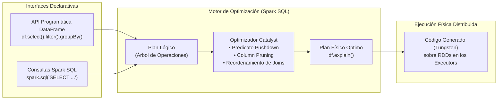
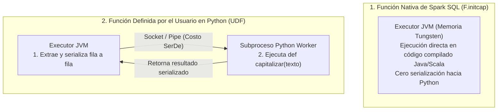
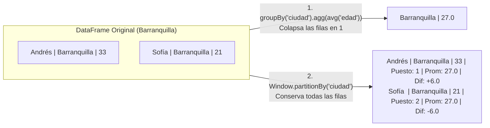

## 1. Arquitectura de los DataFrames en PySpark y el Optimizador Catalyst

Si bien los **RDDs (*Resilient Distributed Datasets*)** constituyen la primitiva de bajo nivel sobre la cual se ejecuta el paradigma MapReduce en **Apache Spark**, el trabajo diario en ingeniería de datos, construcción de bodegas analíticas (*Data Warehouses* / *Data Lakes*) y preparación de sábanas de datos (*Analytical Wide Tables*) para tableros de control o modelos de *Machine Learning* se realiza mayoritariamente a través de la API de alto nivel de **DataFrames** y **Spark SQL**.

Un **DataFrame** es una colección distribuida e inmutable de filas (*Rows*) organizadas en **columnas con nombre y tipo de dato estricto**, conceptualmente equivalente a una tabla en una base de datos relacional o a un DataFrame de la librería *Pandas* en Python, pero particionada y ejecutada en paralelo a lo largo de un clúster.



---

### 1.1 Propiedades Arquitectónicas de los DataFrames

1. **Esquema Explícito (*Schema*)**: A diferencia de un RDD genérico que almacena objetos opacos para el motor, un DataFrame conoce de antemano el nombre, el tipo de dato (`StringType`, `IntegerType`, `LongType`, `DoubleType`) y la nulabilidad (`nullable`) de cada columna. Esto permite al motor almacenar los datos en un formato binario columnar comprimido fuera del *Heap* de la JVM (*Project Tungsten*) y optimizar las consultas mediante **Catalyst**.
2. **Inmutabilidad**: Ninguna operación modifica un DataFrame existente. Métodos como `.select()`, `.filter()` o `.withColumn()` devuelven siempre una **nueva instancia de DataFrame** que representa el siguiente paso en el linaje del grafo.
3. **Evaluación Perezosa (*Lazy Evaluation*)**:
   * **Transformaciones (*Lazy*)**: `select()`, `filter()`, `where()`, `withColumn()`, `groupBy()`, `orderBy()`, `join()`, `limit()`. Únicamente construyen el plan lógico sin procesar filas.
   * **Acciones (*Eager*)**: `show(n)`, `count()`, `collect()`, `take(n)`, `write.parquet()` / `write.csv()`. Disparan la compilación del plan físico a través de Catalyst y ejecutan el trabajo en los nodos *Executors*.

---

## 2. Creación de DataFrames e Ingeniería de Esquemas (Inferencia vs. `StructType`)

En **PySpark**, el punto de entrada unificado para crear DataFrames, registrar vistas y ejecutar consultas SQL es el objeto **`SparkSession`** (convencionalmente instanciado en la variable `spark`). Existen múltiples mecanismos para construir un DataFrame según la naturaleza de la fuente de datos:

```python
from pyspark.sql import SparkSession

# Inicialización de SparkSession con ajuste de particiones de Shuffle para entornos ligeros
spark = (
    SparkSession.builder
    .appName("IngenieriaDataFrames")
    .master("local[*]")
    .config("spark.sql.shuffle.partitions", "4")  # Por defecto es 200 en clústeres de producción
    .getOrCreate()
)
```

---

### 2.1 Creación desde Colecciones Nativas de Python (Lista de Tuplas)

Cuando se dispone de datos en memoria (por ejemplo, una lista de tuplas en Python para pruebas unitarias o catálogos pequeños), `spark.createDataFrame(data, schema)` construye el DataFrame asignando los nombres de las columnas e infiriendo los tipos a partir de los valores nativos:

```python
datos_personas = [
    ("Jorge",    "M", "Medellin",     45),
    ("Catalina", "F", "Medellin",     31),
    ("Maria",    "F", "Medellin",     30),
    ("Juan",     "M", "Medellin",     27),
    ("Luisa",    "F", "Bogota",       29),
    ("Juana",    "F", "Bogota",       26),
    ("Mario",    "M", "Bogota",       23),
    ("Andres",   "M", "Barranquilla", 33),
    ("Sofia",    "F", "Barranquilla", 21),
    ("Carlos",   "M", "Cali",         24),
    ("Elena",    "F", "Cali",         23),
    ("Pedro",    "M", "Cali",         20)
]

columnas_personas = ["nombre", "genero", "ciudad", "edad"]
df_personas = spark.createDataFrame(datos_personas, schema=columnas_personas)

# Acción show(5): dispara la ejecución y muestra las primeras 5 filas formateadas
df_personas.show(5)

# Inspección de la estructura de metadatos del DataFrame
df_personas.printSchema()
# root
#  |-- nombre: string (nullable = true)
#  |-- genero: string (nullable = true)
#  |-- ciudad: string (nullable = true)
#  |-- edad: long (nullable = true)
```

---

### 2.2 Lectura de Archivos CSV con Inferencia Automática de Esquema (`inferSchema`)

Al ingerir archivos de texto delimitados por comas (**CSV**), el lector `spark.read.csv()` trata por defecto todas las columnas como cadenas de texto (`string`). Configurar las opciones `header="true"` e `inferSchema="true"` instruye a Spark para tomar la primera fila como encabezado y realizar una pasada adicional sobre los datos para detectar tipos numéricos de punto flotante (`double`), enteros (`integer`) o fechas:

```python
# Lectura de catálogo de dispositivos con coordenadas geográficas (5 decimales de precisión)
df_dispositivos = (
    spark.read
    .option("header", "true")
    .option("inferSchema", "true")
    .csv("data/dispositivos.csv")
)

df_dispositivos.show(5)
df_dispositivos.printSchema()
# root
#  |-- codigo: string (nullable = true)
#  |-- tipo: string (nullable = true)
#  |-- latitud: double (nullable = true)
#  |-- longitud: double (nullable = true)
```

---

### 2.3 Lectura de Archivos JSON Imponiendo un Esquema Estricto (`StructType` y `StructField`)

Aunque la inferencia automática resulta cómoda en exploración interactiva, en pipelines de producción presenta dos desventajas: requiere leer el archivo dos veces (costo de E/S) y puede inferir tipos subóptimos o fallar ante registros atípicos.

La práctica recomendada en ingeniería de datos consiste en definir programáticamente el esquema mediante las clases **`StructType`** (que representa la estructura completa de la fila) y **`StructField(nombre, tipo, nullable)`** (que define cada columna individual):

```python
from pyspark.sql.types import StructType, StructField, StringType, LongType

# Definición explícita del esquema para un archivo JSON Lines de rutas aéreas
esquema_vuelos = StructType([
    StructField("DEST_COUNTRY_NAME",   StringType(), True),
    StructField("ORIGIN_COUNTRY_NAME", StringType(), True),
    # Se utiliza LongType (entero de 64 bits) en lugar de IntegerType (32 bits)
    # para prevenir desbordamientos (overflow) en conteos masivos de vuelos
    StructField("count",               LongType(),   True)
])

df_vuelos = (
    spark.read
    .schema(esquema_vuelos)
    .json("data/vuelos.json")
)

df_vuelos.show(5)
df_vuelos.printSchema()
```

| Estrategia de Esquema | Ventajas Técnicas | Limitaciones |
| :--- | :--- | :--- |
| **Inferencia Automática (`inferSchema = True`)** | Rapidez de prototipado cuando se desconoce la estructura exacta del archivo origen. | Requiere un escaneo previo adicional del archivo y puede asignar tipos imprecisos (`int` donde se requiere `long`). |
| **Esquema Explícito (`StructType` / `StructField`)** | Lectura en una sola pasada, validación estricta de tipos desde la ingesta y prevención de desbordamientos numéricos. | Requiere declarar en código la especificación de columnas antes de la lectura. |

---

## 3. API Programática de Consultas vs. Vistas Temporales en Spark SQL

Una de las mayores fortalezas de Spark SQL es que permite expresar exactamente la misma lógica relacional a través de dos interfaces equivalentes que compilan hacia el mismo plan físico en Catalyst: la **API programática de métodos encadenados** (similar a un *ORM* como Django ORM o SQLAlchemy) y las **consultas SQL declarativas estándar**.

### 3.1 Selección (`select`), Filtrado (`filter`), Columnas Derivadas (`withColumn`) y Ordenamiento

Para referenciar columnas dentro de expresiones aritméticas o booleanas en Python (por ejemplo, comparar `edad > 25` o sumar `edad + 5`), no basta con escribir el nombre de la columna como un `str` plano, ya que Python intentaría comparar un texto con un entero. Se utiliza la función **`col("nombre_columna")`** del módulo `pyspark.sql.functions`:

```python
from pyspark.sql.functions import col

# Pipeline programático encadenado sobre el DataFrame de personas
df_transformado = (
    df_personas
    .select("nombre", "ciudad", "edad")                        # Proyección inicial (π)
    .filter(col("edad") > 25)                                  # Selección booleana (σ: WHERE edad > 25)
    .withColumn("edad_en_5_anios", col("edad") + 5)            # Columna calculada derivada
    .orderBy(col("edad_en_5_anios").desc())                    # Ordenamiento descendente
)

df_transformado.show()
```

> **Inmutabilidad y Reutilización de `select()`**: En cualquier punto del encadenamiento se puede invocar nuevamente `.select("nombre", "edad_en_5_anios")` para descartar columnas intermedias (como `edad` o `ciudad`) que ya cumplieron su propósito en el filtro o cálculo previo.

---

### 3.2 Agrupación (`groupBy`), Agregación Múltiple (`agg`) y la Importancia de `.alias()`

En SQL estándar, las funciones de agregación (`SUM`, `COUNT`, `AVG`) se escriben dentro de la cláusula `SELECT` y la columna de agrupación se declara al final en `GROUP BY`. En la API programática de DataFrames el orden sigue el flujo lógico de los datos: primero se invoca **`.groupBy("columna")`** y sobre el objeto agrupado resultante se invoca **`.agg(...)`** pasando las funciones del módulo `pyspark.sql.functions as F`:

```python
from pyspark.sql import functions as F

# Equivalente programático de:
# SELECT DEST_COUNTRY_NAME, SUM(count) AS total_vuelos, COUNT(*) AS rutas
# FROM vuelos GROUP BY DEST_COUNTRY_NAME ORDER BY total_vuelos DESC LIMIT 5
top_destinos_df = (
    df_vuelos
    .groupBy("DEST_COUNTRY_NAME")
    .agg(
        F.sum("count").alias("total_vuelos"),
        F.count("*").alias("rutas")
    )
    .orderBy(col("total_vuelos").desc())
    .limit(5)
)

# Hasta este punto NO se ha ejecutado ningún cálculo en el clúster (Lazy Evaluation)
print(top_destinos_df)
# Salida: DataFrame[DEST_COUNTRY_NAME: string, total_vuelos: bigint, rutas: bigint]

# Disparo físico de la ejecución mediante show()
top_destinos_df.show()
```

> **Por qué usar siempre `.alias()` en `.agg()`**: Si se omite `.alias("total_vuelos")`, Spark bautiza automáticamente la columna resultante con la cadena literal de la expresión aplicada: `"sum(count)"`. Esto obliga a referenciarla posteriormente como `col("sum(count)")` en ordenamientos o cruces, haciendo el código frágil y difícil de mantener.

---

### 3.3 Consultas SQL Directas mediante Vistas Temporales y Plan de Ejecución (`explain`)

Cualquier DataFrame cargado desde un CSV, JSON o base de datos puede registrarse como una **vista temporal en memoria** dentro de la sesión de Spark mediante `.createOrReplaceTempView("nombre_vista")` y consultarse directamente con sintaxis SQL ANSI:

```python
# 1. Registro del DataFrame JSON como una vista temporal llamada 'vuelos'
df_vuelos.createOrReplaceTempView("vuelos")

# 2. Consulta SQL estándar ejecutada directamente sobre el archivo JSON subyacente
consulta_sql_df = spark.sql("""
    SELECT 
        DEST_COUNTRY_NAME,
        SUM(count) AS total_vuelos,
        COUNT(*)   AS rutas
    FROM vuelos
    GROUP BY DEST_COUNTRY_NAME
    ORDER BY total_vuelos DESC
    LIMIT 5
""")

consulta_sql_df.show()

# 3. Inspección del Plan Físico compilado por el optimizador Catalyst
top_destinos_df.explain()
```

Al invocar `top_destinos_df.explain()`, Spark revela las operaciones físicas exactas que ejecutará en el clúster (leídas de abajo hacia arriba):
1. **`FileScan json`**: Lee únicamente las columnas necesarias del archivo JSON.
2. **`HashAggregate(keys=[DEST_COUNTRY_NAME], functions=[partial_sum(count), partial_count(1)])`**: Ejecuta una **pre-agregación local basada en Hash** dentro de cada partición antes de mover datos por la red (el mismo principio de *Map-side Combine* de `reduceByKey`).
3. **`Exchange hashpartitioning(DEST_COUNTRY_NAME, 4)`**: Realiza el *Shuffle* redistribuyendo los subtotales en las $4$ particiones configuradas en `spark.sql.shuffle.partitions`.
4. **`HashAggregate` final + `TakeOrderedAndProject(limit=5, orderBy=[total_vuelos DESC])`**: Consolida la suma final y extrae el Top $5$ ordenado en un solo paso.

---

## 4. Álgebra Relacional en DataFrames: Joins Estructurales y Auditoría con `left_anti`

El método **`df_izq.join(df_der, condicion, how="tipo")`** implementa los operadores de combinación relacional ($\bowtie$) de manera distribuida. Considérese el cruce entre un DataFrame de transacciones financieras (`df_transacciones`, con $300$ registros) y el catálogo maestro de terminales/dispositivos (`df_dispositivos`), vinculados mediante el atributo `cod_dispositivo == codigo`. En los datos de transacciones existen $7$ registros cuyo código de dispositivo es `"D999"`, el cual **no existe** en el catálogo maestro de dispositivos.

| Tipo de Join (`how`) | Notación en Álgebra Relacional | Comportamiento sobre las 300 Transacciones (293 válidas + 7 con `D999`) | Caso de Uso en Ingeniería de Datos |
| :--- | :---: | :--- | :--- |
| **`"inner"`** *(Por defecto)* | $T \bowtie_{c} D$ | Retorna únicamente las **$293$ filas** donde el código de dispositivo existe en ambos DataFrames. Descarta silenciosamente las $7$ transacciones de `D999`. | Cruces analíticos estándar sobre datos con integridad referencial garantizada. |
| **`"left_outer"`** (`"left"`) | $T \bowtie_{\text{left}} D$ | Retorna las **$300$ filas** completas de `df_transacciones`. Para las $7$ filas de `D999`, rellena con **`null`** las columnas provenientes de `df_dispositivos`. | Reportes financieros donde ninguna transacción puede omitirse aunque falte información del catálogo. |
| **`"left_anti"`** | $T \triangleright_{c} D$ | Retorna **exclusivamente las $7$ filas** de la tabla izquierda (`df_transacciones`) que **NO tienen coincidencia** en la tabla derecha (`df_dispositivos`), conservando solo el esquema izquierdo. | **Auditoría de calidad de datos**: detección de claves foráneas huérfanas o registros no catalogados. |
| **`"left_semi"`** | $T \ltimes_{c} D$ | Retorna las **$293$ filas** de la tabla izquierda que sí tienen coincidencia en la derecha, pero sin anexar las columnas de la tabla derecha (equivalente a `WHERE EXISTS`). | Filtrado eficiente de una tabla de hechos a partir de una tabla de dimensiones. |

```python
# 1. INNER JOIN: conserva las 293 transacciones con dispositivo válido y selecciona columnas limpias
df_inner = (
    df_transacciones
    .join(
        df_dispositivos,
        df_transacciones["cod_dispositivo"] == df_dispositivos["codigo"],
        how="inner"
    )
    # Se descarta la columna duplicada 'codigo' y las coordenadas que no se requieren en el reporte
    .select("id_transaccion", "cliente", "monto", "cod_dispositivo", "tipo")
)
print("Total transacciones:", df_transacciones.count())  # 300
print("Transacciones tras Inner Join:", df_inner.count()) # 293

# 2. LEFT ANTI JOIN: aísla exactamente las 7 transacciones huérfanas (cod_dispositivo = 'D999')
df_huerfanas = df_transacciones.join(
    df_dispositivos,
    df_transacciones["cod_dispositivo"] == df_dispositivos["codigo"],
    how="left_anti"
)
print("Transacciones sin dispositivo registrado:", df_huerfanas.count()) # 7
df_huerfanas.show(5)

# 3. LEFT OUTER JOIN: preserva las 300 transacciones mostrando NULL en los atributos de 'D999'
df_left_outer = (
    df_transacciones
    .join(
        df_dispositivos,
        df_transacciones["cod_dispositivo"] == df_dispositivos["codigo"],
        how="left_outer"
    )
    .filter(col("cod_dispositivo") == "D999")
)
df_left_outer.show(5)
```

---

## 5. Funciones Definidas por el Usuario (*UDFs*) vs. Funciones Nativas Vectorizadas

Cuando se requiere aplicar una regla de negocio o transformación de texto personalizada a una columna de un DataFrame, PySpark permite registrar una función escrita en Python como una **UDF (*User-Defined Function*)** especificando su tipo de retorno (`StringType()`, `DoubleType()`, etc.).

Sin embargo, existe una diferencia arquitectónica crítica en cómo se ejecuta una UDF de Python frente a una función nativa de `pyspark.sql.functions`:



* **Funciones Nativas (`pyspark.sql.functions`)**: Se ejecutan íntegramente dentro de la máquina virtual de Java (**JVM**) sobre los bloques de memoria de *Tungsten*, permitiendo al optimizador **Catalyst** inspeccionarlas y vectorizarlas.
* **UDFs Estándar en Python (`udf(...)`)**: Para Catalyst, una UDF de Python es una "caja negra". El *Executor* de la JVM debe deserializar cada fila, enviarla por un socket local a un proceso intérprete de Python externo, evaluar la función elemento por elemento ($1:1$) y volver a serializar el resultado hacia la JVM.

```python
from pyspark.sql.functions import udf
from pyspark.sql.types import StringType

# 1. Definición de una función en Python usando List Comprehension para capitalizar palabras
def capitalizar_texto(texto):
    if texto is None:
        return None
    return " ".join([w[0].upper() + w[1:].lower() for w in texto.split() if len(w) > 0])

# Registro de la función como UDF de Spark indicando el tipo de retorno StringType()
capitalizar_udf = udf(capitalizar_texto, StringType())

df_nombres = spark.createDataFrame(
    [("juan perez",), ("MARIA GOMEZ",), ("carlos andres ruiz",)],
    ["nombre_crudo"]
)

# Comparación entre nuestra UDF personalizada y la función nativa F.initcap() de Spark
df_comparativo = (
    df_nombres
    .withColumn("con_udf_python", capitalizar_udf(col("nombre_crudo")))
    .withColumn("con_nativa_spark", F.initcap(col("nombre_crudo")))
)

df_comparativo.show(truncate=False)
```

> **Regla de Oro de Rendimiento con UDFs**: Siempre debe verificarse primero si la operación requerida ya existe en el catálogo nativo de `pyspark.sql.functions` (manipulación de cadenas, expresiones regulares, fechas, matemáticas). Las UDFs deben reservarse exclusivamente para lógica de dominio específica que no pueda componerse mediante expresiones nativas de Spark SQL.

---

## 6. Analítica Avanzada con Funciones de Ventana (*Window Functions*)

En consultas analíticas es frecuente necesitar calcular un ranking, un acumulado o un promedio por grupo (por ejemplo, por ciudad o por departamento) **sin perder el detalle de las filas individuales**.

* **`groupBy("ciudad")`**: **Colapsa** las $N$ filas de una misma ciudad en una única fila de resumen. Ya no es posible ver simultáneamente el nombre de cada persona junto al promedio de su ciudad sin hacer un `join` posterior consigo misma.
* **Funciones de Ventana (`Window.partitionBy(...)`)**: Definen un marco o subconjunto lógico de filas (**ventana**) para cada registro, calculan la función analítica sobre ese grupo y **adjuntan el resultado como una nueva columna conservando intactas todas las filas originales**.



---

### 6.1 Ranking Intra-Grupo con `row_number()` y Extracción de Líderes (`Top-N per Group`)

Para numerar a las personas de mayor a menor edad dentro de cada ciudad y extraer posteriormente a la persona de mayor edad de cada ciudad:

1. Se importa `Window` desde `pyspark.sql.window`.
2. Se especifica la ventana particionando por `ciudad` y ordenando descendentemente por `edad`: `Window.partitionBy("ciudad").orderBy(col("edad").desc())`.
3. Se aplica `F.row_number().over(ventana)` dentro de `.withColumn("puesto", ...)`.

```python
from pyspark.sql.window import Window

# 1. Definición de la especificación de ventana: particionada por ciudad y ordenada por edad DESC
ventana_ranking_ciudad = Window.partitionBy("ciudad").orderBy(col("edad").desc())

# 2. Asignación del número de fila (puesto 1, 2, 3...) reiniciado por cada ciudad
df_con_puesto = df_personas.withColumn(
    "puesto",
    F.row_number().over(ventana_ranking_ciudad)
)

df_con_puesto.show()
# +--------+------+------------+----+------+
# |  nombre|genero|      ciudad|edad|puesto|
# +--------+------+------------+----+------+
# |  Andres|     M|Barranquilla|  33|     1|
# |   Sofia|     F|Barranquilla|  21|     2|
# |   Luisa|     F|      Bogota|  29|     1|
# |   Juana|     F|      Bogota|  26|     2|
# |   Mario|     M|      Bogota|  23|     3|
# |  Carlos|     M|        Cali|  24|     1|
# ...

# 3. Filtrado de líderes por grupo: obtiene la persona de mayor edad en cada ciudad (puesto == 1)
df_mayores_por_ciudad = df_con_puesto.filter(col("puesto") == 1)
df_mayores_por_ciudad.show()
```

---

### 6.2 Agregaciones de Ventana y Desviación Individual Respecto al Promedio del Grupo

Si se define una ventana particionada únicamente por `ciudad` (`Window.partitionBy("ciudad")`, sin cláusula `orderBy`), funciones de agregación como `F.avg("edad").over(ventana_ciudad)` calculan la media aritmética de la ciudad $\bar{x}_c$ y la colocan en cada fila perteneciente a esa ciudad. Esto permite calcular en la siguiente línea la **desviación individual** de cada persona frente a la media de su propia ciudad:

$$\Delta_i = \text{edad}_i - \bar{x}_c, \qquad \text{donde } \bar{x}_c = \frac{1}{|C|} \sum_{j \in C} \text{edad}_j$$

```python
# Ventana particionada por ciudad (abarca todos los habitantes de la misma ciudad)
ventana_ciudad = Window.partitionBy("ciudad")

df_comparativa_edades = (
    df_personas
    # Calcula el promedio de la ciudad y lo añade como columna en cada fila individual
    .withColumn("promedio_ciudad", F.round(F.avg("edad").over(ventana_ciudad), 1))
    # Calcula cuántos años está cada persona por encima (+) o por debajo (-) de la media de su ciudad
    .withColumn("diferencia_vs_promedio", F.round(col("edad") - col("promedio_ciudad"), 1))
    .orderBy("ciudad", col("edad").desc())
)

df_comparativa_edades.show()
# En Barranquilla (promedio 27.0): Andrés (33) -> +6.0; Sofía (21) -> -6.0
# En Medellín (promedio 33.3): Jorge (45) -> +11.7; Juan (27) -> -6.3
```

---

## 7. Reflexión: Convergencia entre SQL Declarativo y Procesamiento Distribuido

La evolución desde los RDDs de bajo nivel hasta los **DataFrames y Spark SQL** sintetiza décadas de ingeniería de bases de datos relacionales aplicadas a la computación distribuida:

1. **Separación entre el *Qué* y el *Cómo* (El Triunfo de Codd en Big Data)**: Al programar con RDDs mediante `map` y `reduceByKey`, el desarrollador especifica imperativamente *cómo* transformar las tuplas, y un error humano (como usar `groupByKey` en lugar de `reduceByKey`) penaliza severamente el rendimiento. En contraste, los DataFrames retoman el paradigma declarativo del modelo relacional de Edgar F. Codd: el ingeniero declara *qué* proyección, filtro, unión o ventana necesita, y el optimizador **Catalyst** decide automáticamente el plan físico óptimo (`HashAggregate`, reordenamiento de `Joins`, poda de columnas y ejecución nativa en la JVM).
2. **Expresividad Analítica sin Sacrificar Escalabilidad**: Primitivas relacionales avanzadas como el **`left_anti` join** (para auditar integridad referencial entre millones de transacciones) y las **Funciones de Ventana (`OVER (PARTITION BY ... ORDER BY ...)`)** demuestran que las abstracciones clásicas de SQL no quedaron obsoletas con la llegada del *Big Data*, sino que se convirtieron en el lenguaje universal sobre el cual operan los motores modernos de analítica distribuida.

---

## 8. Referencias y Enlaces de Interés

1. **Armbrust, M., Xin, R. S., Lian, C., Huai, Y., Liu, D., Bradley, J. K., Meng, X., Kaftan, T., Franklin, M. J., Ghodsi, A., & Zaharia, M. (2015)**. *Spark SQL: Relational Data Processing in Spark*. Proceedings of the 2015 ACM SIGMOD International Conference on Management of Data, 1383–1394. [https://dl.acm.org/doi/10.1145/2723372.2742797](https://dl.acm.org/doi/10.1145/2723372.2742797).
2. **Apache Software Foundation (2026)**. *Spark SQL, DataFrames and Datasets Guide*. [https://spark.apache.org/docs/latest/sql-programming-guide.html](https://spark.apache.org/docs/latest/sql-programming-guide.html).
3. **Apache Software Foundation (2026)**. *PySpark SQL Functions & Window API Reference (`pyspark.sql.functions`, `pyspark.sql.Window`)*. [https://spark.apache.org/docs/latest/api/python/reference/pyspark.sql/functions.html](https://spark.apache.org/docs/latest/api/python/reference/pyspark.sql/functions.html).
4. **Chambers, B., & Zaharia, M. (2018)**. *Spark: The Definitive Guide: Big Data Processing Made Simple*. O'Reilly Media. Part II: *Structured APIs — DataFrames, SQL, and Datasets*. [https://www.oreilly.com/library/view/spark-the-definitive/9781491912201/](https://www.oreilly.com/library/view/spark-the-definitive/9781491912201/).

---

*Publicado por [Mateo Vargas Tirado](https://github.com/araigumadev) como parte del registro de aprendizaje en el curso Bases de Datos 2026/2 - Universidad de Antioquia.*
